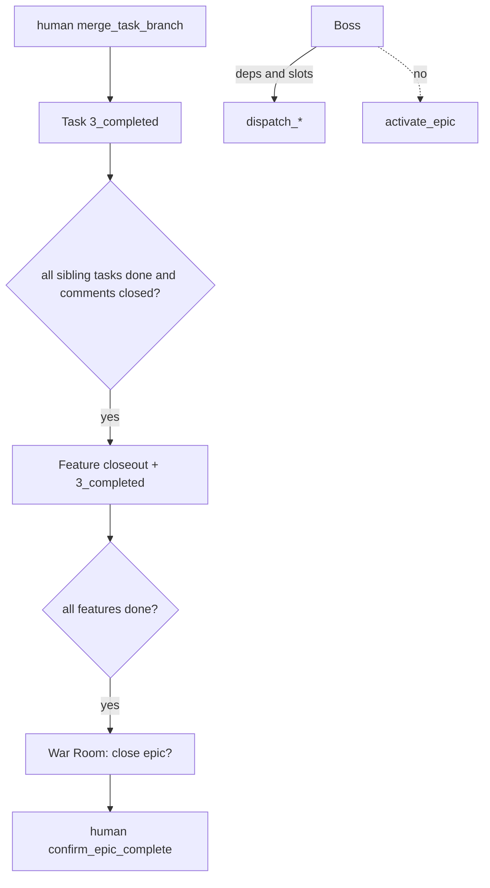

# Boss agent and completion rollup

> **Current workflow update (2026-10-20):** This completed feature records the original human-order and human-merge design. The current supervisor automatically dispatches eligible child work after Epic plan approval and automatically merges a green Task branch into its Feature branch. `TaskFailed` starts an owning Feature Team recovery turn; that team may revise and retry only its own blocked child. Feature rollup now pushes `epic/{parent}` and `feat/{id}` and opens a draft MR from Feature to Epic, whose merge closes the Feature. The decision log below is retained as historical context; [DESIGN.md](../../../DESIGN.md) is authoritative for current behavior.

## Parent Epic

[epic_001](../../epics/2_active/epic_001_functional_mvp.md) — Functional MVP.

Constraints this feature must honor:

- Boss is not a planner and not a coder. Lifecycle: as long as the local app runs.
- Boss may `dispatch_feature` / `dispatch_task` (feat_002). Cannot `activate_epic`. Cannot merge. Cannot `write_doc` plan bodies. Cannot mint.
- Boss honors `depends_on` and `task_parallelism`; does not invent edges.
- Task completes when local branch is merged to mainline and file is in `3_completed`.
- Feature completes when every child Task is completed, **no open human comment threads**, and Feature Architect writes a one-paragraph closeout.
- Epic completes when every child Feature is completed, **no open human comments**, and the **human confirms**.
- Orphans are flagged, not auto-repaired.
- On `TaskFailed`: propose a retry in War Room / BossView. Do **not** auto-call `dispatch_task` on that id. A later `dispatch_task` is legal only after a fresh Human order (or the human dispatching themselves). Feature/Epic cannot restart.

## Scope

**In**

- Boss graph: `list_board`, `dispatch_feature`, `dispatch_task`
- `merge_task_branch` for the **human** (UI): merge `task/{id}` to mainline, `move_doc` task → completed, `TaskMerged {task_id, branch, merge_sha}`
- Rollup: when all child tasks complete → notify Feature graph to write closeout, then `move_doc` feature → completed (`FeatureCompleted`)
- When all child features complete → War Room prompt; `activate`-style **human** `confirm_epic_complete`
- Orphan detector (toast + list): Feature without parent, Task whose Feature is completed, completed Epic with an active child

**Out**

- Boss writing architecture
- Auto-merge
- Auto-firing `dispatch_task` after `TaskFailed`
- Setting comment `blocking` (human-only; feat_005)

## Data structures

```text
BossView
  dispatchable_features: [WorkId]   # deps met, still backlog
  dispatchable_tasks: [WorkId]
  slots_free: int                   # cap minus status=active Tasks (blocked excluded)
  failed_tasks: [WorkId]            # blocked in 2_active; propose only, do not auto-restart

Closeout
  feature_id: WorkId
  paragraph: str
  open_human_comments: 0
```

## API contracts

```text
# Boss
list_board() -> BossView
dispatch_feature(id) -> DispatchResult    # by=boss
dispatch_task(id) -> DispatchResult       # by=boss
# no activate_epic, no merge, no write_doc

# Human / watchdog
merge_task_branch(task_id) -> merge_sha
    merge task/{id} -> mainline; move_doc completed; TaskMerged

try_complete_feature(feature_id) -> bool
    require all children completed
    require zero open comments with author=human
    require closeout paragraph present
    move_doc feature completed; FeatureCompleted

confirm_epic_complete(epic_id, by: Principal) -> bool
    refuse unless by==human
    same comment + children gates
    move_doc epic completed; EpicCompleted
```

## Logic flow



## Task breakdown

| ID | Title |
|---|---|
| [task_038](../../tasks/3_completed/task_038_boss_view.md) | BossView read model (`list_board` for Boss) |
| [task_039](../../tasks/3_completed/task_039_boss_order_consumer.md) | Boss queue consumer + order parsing |
| [task_040](../../tasks/3_completed/task_040_merge_task_branch.md) | Human `merge_task_branch` |
| [task_041](../../tasks/3_completed/task_041_feature_rollup.md) | Feature rollup + closeout helper |
| [task_042](../../tasks/3_completed/task_042_epic_complete.md) | Epic completion + human confirm |
| [task_043](../../tasks/3_completed/task_043_orphan_detector.md) | Orphan detector (flag only) |
| [task_044](../../tasks/3_completed/task_044_boss_war_room_integration.md) | War Room / watchdog wiring |

Depends on: feat_003, feat_006, feat_007 completed.

## Risks & upward questions

- Boss that is "too helpful" will violate dispatch spirit by starting every ready Task. Instruct: wait for a human high-level order ("drain feat_001 tasks") or sit idle. Do not busy-loop dispatch on sight.
- `slots_free` ignores `blocked` Tasks. A failed card does not starve the cap.

## Decision log

- `dec_011` · 2026-10-10 · Feature Architect · **Task split**
  Seven implementation tasks: read-only BossView (038), order-driven Boss consumer (039), human merge (040), feature rollup (041), epic confirm (042), orphan detector (043), single integration wave for server/loop/UI (044). Boss never auto-dispatches ready cards; failed tasks restart only on explicit human orders.
  Rationale: parallel SWE ownership with one wiring task for shared War Room surfaces.
  Honors: DESIGN.md §5.0.1, §9.3, §12; epic_001 dec_007.

## Closeout

Boss ships a read-only `BossView` and order-driven queue consumer so the lieutenant dispatches only on explicit human orders; the War Room wires ask-boss and drain without auto-firing ready tasks. Human `merge_task_branch` merges `task/{id}` to mainline, moves the Task to `3_completed`, and emits `TaskMerged`. Feature rollup runs when all sibling tasks are done, with open human comment threads and a written closeout paragraph as gates before `FeatureCompleted`. When every child Feature is completed, the UI prompts for epic close; only `confirm_epic_complete` by a human may move the Epic to `3_completed`. Orphan detection flags inconsistent board states (toast/list only, no auto-repair). This epic remains active until the human confirms completion.
