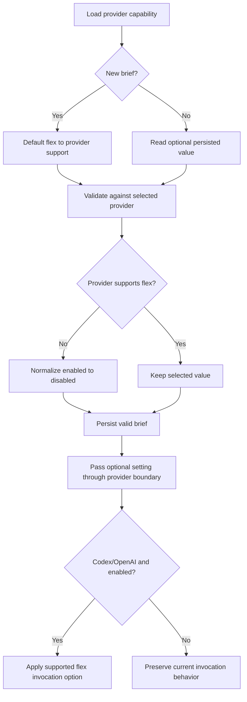

# Model provider flex capability and execution plumbing

## Parent Epic

epic_009

## Scope

### Intent

Add a provider-neutral flex-mode capability and carry a validated selection from brief persistence into Codex/OpenAI execution.

### Acceptance criteria

- Provider metadata exposes whether flex mode is supported; Codex/OpenAI advertises support only where the installed integration can honor it.
- New briefs default flex mode on for a supporting provider and cannot persist it as enabled for an unsupported provider.
- Codex/OpenAI invocations receive the flex setting through the existing provider boundary.
- Existing briefs and non-supporting providers retain current behavior.
- Focused integration tests cover supported, disabled, unsupported, and legacy-brief cases.

## Data structures

- Provider capability metadata gains a provider-neutral boolean indicating whether flex mode is supported.
- Brief persistence gains an optional flex-mode boolean. Absence remains valid for legacy briefs.
- On brief creation, the value defaults to enabled only when the selected provider advertises support.
- Before persistence, an enabled value for a non-supporting provider is normalized to disabled; unsupported providers must never retain an enabled value.
- When reading a legacy brief with no value, preserve existing execution behavior rather than retroactively opting it into flex mode.

## API contracts

- Provider discovery/capability APIs expose the flex-support flag without requiring consumers to identify Codex/OpenAI by name.
- Brief create/update paths accept the optional flex selection and persist only a value valid for the selected provider.
- The existing provider execution boundary carries the validated flex selection as an optional provider-neutral invocation setting.
- The Codex/OpenAI adapter translates an enabled selection into the integration's supported flex option. Disabled or absent values do not change current invocation behavior.
- Other provider adapters may ignore the optional setting and must retain current behavior.

## Logic flow

## Task breakdown

1. `task_009_001_001` — Add provider flex capability and brief persistence rules.
2. `task_009_001_002` — Propagate flex mode through the provider execution boundary. Depends on task 001.
3. `task_009_001_003` — Add focused flex-mode integration coverage. Depends on tasks 001 and 002.

## Risks & upward questions

- Capability advertisement must reflect the installed Codex/OpenAI integration rather than assuming every version can honor flex.
- Normalization must cover provider changes as well as initial brief creation so unsupported providers cannot retain an enabled value.
- An absent legacy value must remain distinguishable from the enabled default used for newly created briefs.
- No upward decision is currently required.

## Decision log

- `dec_001` · 2026-10-26 · Feature Lead · **Task scope**
  Chose task_009_001_001 owns provider-neutral flex capability metadata plus brief creation, normalization, and backward-compatible persistence only. task_009_001_002 owns execution-boundary propagation, and task_009_001_003 owns focused end-to-end integration coverage.
  Rationale: The activated task still contains placeholders, so an explicit feature-level boundary prevents scope overlap and keeps the three dependency-ordered tasks as the smallest shippable slices.
  Honors: Feature acceptance criteria and the existing dependency-ordered task plan.

- `dec_002` · 2026-10-26 · Feature Architect · **Flex contract**
  Chose Model flex support as provider-neutral capability metadata and the brief selection as an optional persisted boolean; default new briefs from capability support, normalize enabled values off for unsupported providers, and treat an absent legacy value as current behavior..
  Rationale: This keeps provider identity out of shared brief and execution code, prevents invalid persisted state, and preserves backward compatibility while allowing the existing provider boundary to carry the setting.
  Honors: Feature acceptance criteria, dec_001 task boundaries, and the frugal-engineering preference for the smallest compatible data and execution contract..

## Closeout

Completed child work: `task_009_001_001` (Add provider flex capability and brief persistence rules), `task_009_001_002` (Propagate flex mode through the provider execution boundary), `task_009_001_003` (Add focused flex-mode integration coverage).
