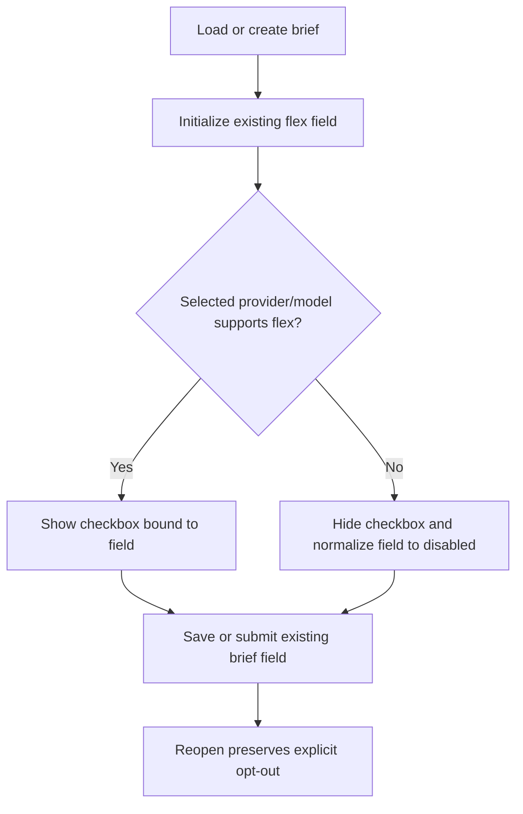

# Brief editor flex-mode control

## Parent Epic

epic_009

## Scope

Expose the existing brief-level flex-mode field in the brief editor only when the selected provider/model advertises flex capability. Keep persistence and submission on the field already consumed by provider execution.

## Intent

Let users opt out of flex mode for capable Codex/OpenAI selections without showing an inapplicable control for other providers.

## Acceptance criteria

- A checkbox appears for a flex-capable Codex/OpenAI selection and is checked by default for a new brief.
- Changing to a provider without the capability hides the control and clears/normalizes the enabled value.
- Returning to a capable provider uses the form's current normalized value; saving and reopening preserves explicit opt-out.
- Submission uses the same brief field consumed by provider execution.
- One focused UI/system test covers visibility, default-on, opt-out persistence, and provider switching.

## Data structures

- Reuse the existing persisted brief flex-mode field; do not add a parallel editor-only field.
- Derive control visibility from the selected provider/model's existing capability metadata.
- Treat a new brief as flex-enabled by default, while distinguishing and preserving an explicitly saved false value.

## API contracts

- Brief load maps the persisted flex-mode value into form state without converting an explicit false to the default.
- Provider/model changes normalize the form value to disabled when flex capability is absent.
- Brief submission writes the normalized form value to the existing execution-consumed field.
- No new endpoint or provider execution contract is introduced.

## Logic flow

## Task breakdown

1. task_009_002_001 — Wire flex-mode brief state through load and submission.
2. task_009_002_002 — Add the capability-gated flex-mode control to the brief editor. Depends on task_009_002_001.
3. task_009_002_003 — Cover the behavior with one focused UI/system test. Depends on task_009_002_002.

## Risks & upward questions

- Capability metadata must be the single source for visibility; provider-name-only checks would drift as models change.
- Defaulting must not overwrite an explicit persisted opt-out.
- No epic amendment is required; the work stays within the approved feature contract.

## Decision log

- Use the existing execution-consumed brief field end to end; do not introduce duplicate editor state.
- Cover the acceptance path with one high-signal UI/system test rather than redundant lower-level tests.

- `dec_001` · 2026-10-26 · Feature Lead · **Data flow**
  Chose Use the existing execution-consumed brief flex-mode field end to end; do not introduce duplicate editor-only state..
  Rationale: A single persisted field prevents divergence between editor behavior and provider execution while preserving explicit opt-out.
  Honors: Feature acceptance criteria requiring submission to use the same brief field consumed by provider execution..

- `dec_002` · 2026-10-26 · Feature Lead · **Testing**
  Chose Cover the acceptance path with one focused UI/system test rather than redundant lower-level tests..
  Rationale: The end-to-end scenario provides the highest signal across visibility, defaulting, persistence, switching, and submission with lower maintenance cost.
  Honors: Feature acceptance criteria and the assigned frugal-engineering guidance..

## Closeout

Completed child work: `task_009_002_001` (Wire flex-mode brief state through load and submission), `task_009_002_002` (Add capability-gated flex-mode control to brief editor), `task_009_002_003` (Cover flex-mode editor behavior with a focused UI/system test).
