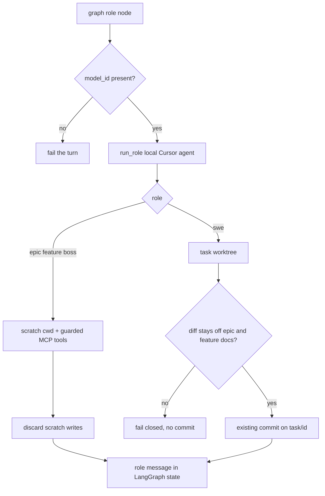

# Cursor agent backend

## Parent Epic

[epic_001](../../epics/2_active/epic_001_functional_mvp.md) — Functional MVP.

Constraints this feature must honor:

- Local only. The Cursor agent runs on this machine against a local `cwd`. Cloud Cursor agent VMs are forbidden.
- Each roster role is called with an explicit model id. This feature does not choose, default, or substitute a model. Resolving project defaults and document overrides is feat_010.
- Filesystem is truth. LangGraph checkpointers stay local. A Cursor conversation is not a second board and not a second transcript store.
- Context isolation and the path sandbox still hold. Prompting the model not to wander is not enforcement.
- Dispatch law is unchanged. The backend has no `dispatch_*`, `activate_epic`, or column move.
- Task commits stay on `task/{id}`. Nothing from a model run lands on `main` inside this feature.
- `CURSOR_API_KEY` comes from the environment. It is never written into the repo, `cascade.toml`, or a plan file.
- Python supervisor. Use the Python Cursor SDK (`cursor-sdk`), not a TypeScript sidecar.

## Scope

**In**

- A single adapter the epic, feature, task, and boss graphs call for a role turn.
- Required `model_id` on every call. Empty, missing, or whitespace fails the call before any SDK request.
- Local runtime only: `local=LocalAgentOptions(cwd=...)`. Passing cloud options is a programming error, not a fallback.
- One-shot run per role turn (`Agent.prompt`, or create + one send + close). Dispose the agent at the end of the turn. Do not keep a Cursor agent alive beside the LangGraph checkpointer.
- Role set: `epic_manager`, `epic_architect`, `feature_lead`, `feature_architect`, `swe`, `boss`.
- Replace the deterministic quote replies in those graphs with this adapter. Tool registries, guards, and queue handling stay Cascade's.
- War Room and watchdog processes use the async SDK client. Do not mix the sync default client and the async client in one process.
- Startup failures (`CursorAgentError`) vs run failures (`result.status == "error"`) stay distinct. On a live Task, a retryable startup failure counts as an infra flake under the existing two-retry policy. A run that executed and failed, and any non-retryable startup failure, fail closed. Planning and Boss turns surface the error in the room and do not retry by themselves.

**Out**

- Project default models and per-document overrides (feat_010). Callers pass the id.
- Board filtering (feat_011).
- Cloud agents, remote checkpointers, GitHub/GitLab remotes.
- Loading ambient Cursor settings (`setting_sources` stays empty). Task `SKILL.md` paths stay on the Cascade boot path.
- A model catalog checked into the repo. Optional validation may call `Cursor.models.list()` at the edge of a turn; an id the account cannot use fails that turn.

## Data structures

```text
RoleId = epic_manager | epic_architect | feature_lead | feature_architect | swe | boss

RoleTurn
  role: RoleId
  model_id: str                 # required, non-empty; caller-supplied
  prompt: str                   # role briefing + Cascade messages for this turn
  cwd: Path                     # local directory the SDK agent may see
  tools: [CascadeTool]          # already-guarded tools for this role only

RoleResult
  text: str
  status: finished | error
  tool_effects: [ToolEffect]    # only effects Cascade applied through its own tools
```

`cwd` is not the repo root for planning roles or the Boss:

- Epic, feature, and boss turns get a fresh scratch directory containing only the documents that role may read. MCP tools wrap the existing guarded Cascade tools (`mint_feature`, `write_doc`, `dispatch_*` for the Boss, and so on). Writes inside the scratch directory are discarded. The repo changes only when a Cascade tool runs.
- SWE turns get the existing task worktree as `cwd`. After the run, Cascade commits on `task/{id}` with the existing git tools. A diff that touches `docs/epics` or `docs/features` fails the turn closed and is not committed.

## API contracts

```text
run_role(turn: RoleTurn) -> RoleResult
    reject missing/blank model_id
    reject cloud runtime
    local cwd = turn.cwd
    model = turn.model_id
    api key = CURSOR_API_KEY
    setting_sources = empty
    MCP = turn.tools only
    dispose the agent before return

graph role nodes
    build RoleTurn from graph state + the model id the caller already resolved
    pass the result text back as that role's message
    do not store the Cursor agent id as the graph's memory
```

The adapter does not read `cascade.toml` and does not read `model` / `models` frontmatter. If the caller has no id yet, it does not call `run_role`.

Auth and network errors that never start a run raise a typed startup error with `retryable` preserved from `CursorAgentError`. They are not reported as a finished `RoleResult`.

## Logic flow



## Task breakdown

All four implementation tasks are **completed** (in [`docs/tasks/3_completed/`](../../tasks/3_completed/)):

| ID | Title |
|---|---|
| [task_045](../../tasks/3_completed/task_045_sdk_adapter.md) | SDK adapter (`run_role`, local async client, dispose-on-return) |
| [task_046](../../tasks/3_completed/task_046_planning_sandbox.md) | Planning sandbox (scratch cwd, MCP over epic/feature/boss tools) |
| [task_047](../../tasks/3_completed/task_047_swe_worktree_turn.md) | SWE worktree turn (path gate, `swe_commit`, failure classification) |
| [task_048](../../tasks/3_completed/task_048_graph_wiring.md) | Graph wiring (replace `_quote` nodes; boss model reply path) |

Depends on: feat_004, feat_005, feat_007, feat_008 completed.

## Risks & upward questions

- The SDK agent has built-in file tools. Isolation has to be the scratch directory plus Cascade-owned commits, not a sentence in the prompt. If a future SDK can disable built-in tools, the scratch directory still stays.
- One-shot turns cost a cold start per role. A durable Cursor agent would fork memory away from the LangGraph checkpointer. That split is rejected here.
- Model ids the operator cannot access fail the turn. Listing models is diagnostic. It does not invent a replacement id.

## Decision log

- `dec_001` · 2026-10-10 · Feature Architect · **Task split**
  Four implementation tasks: SDK adapter (045), planning sandbox (046), SWE worktree turn (047), graph wiring (048). Adapter stays free of dispatch law; boss queue consumer unchanged; task infra retries only on live SWE startup flakes.
  Rationale: parallel SWE ownership with a thin adapter boundary before graph replacement.
  Honors: feat_009 constraints; epic_001 dec_012.
