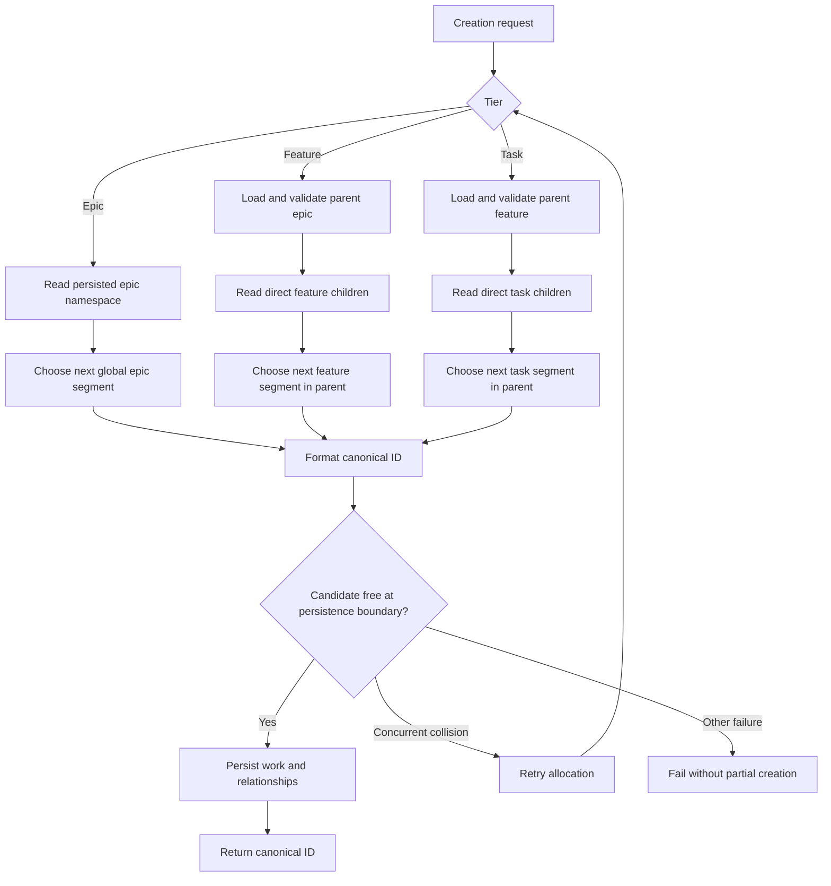

# Hierarchical ID allocation for new work

## Parent Epic

epic_004

## Scope

Deliver the canonical ID module and wire it into every supported creation path:

- New epics use `epic_NNN`.
- New features use `feat_NNN_MMM`, with the epic segment copied from the stored parent ID.
- New tasks use `task_NNN_MMM_KKK`, with the epic and feature segments copied from the stored parent ID.
- Each numeric segment is zero-padded to three digits.
- Epic numbers are allocated globally; feature and task suffixes are allocated monotonically within their direct parent.
- Writers emit only hierarchical IDs after rollout. Readers continue to accept retained active/completed identifiers.
- Allocation rejects malformed parentage and collisions and retries concurrent creation through the existing persistence boundary.

Backlog graph migration belongs to feat_010 and is not part of this feature.

## Data structures

Use one canonical work-ID module with typed parse results for epic, feature, and task identifiers. The parsed representation carries the work tier and ordered numeric segments, allowing callers to:

- format a canonical ID;
- parse and validate canonical IDs;
- recognize retained compatible IDs without rewriting them;
- verify that encoded parent segments match the stored parent link; and
- derive the next child segment from persisted direct children.

No new datastore, counter service, or configurable ID scheme is introduced. Persisted work documents and existing authoritative indexes remain the source of allocation state.

## API contracts

The canonical module must expose behavior equivalent to:

- format a tier plus numeric segments into its canonical ID;
- parse a canonical ID into tier and segments, rejecting malformed prefixes, separators, segment counts, or widths;
- validate an ID against its tier and, for features/tasks, its stored direct parent;
- allocate the next candidate ID from the appropriate persisted namespace; and
- distinguish canonical IDs from retained compatible IDs so readers accept both while writers emit only canonical IDs.

Creation interfaces must supply the direct parent where required and must not reconstruct identifier strings independently. Persistence must reject an occupied candidate. When a concurrent writer wins the same candidate, creation retries allocation through the existing persistence boundary and otherwise returns a clear failure without a partial work item.

## Logic flow

## Acceptance criteria

- Supported epic, feature, and task creation interfaces persist the canonical hierarchical forms.
- Child IDs encode the stored direct parent and fail validation when encoded and stored parentage disagree.
- Separate epics may each allocate `feat_*_001`; separate features may each allocate `task_*_*_001`.
- Allocation advances from persisted identities, does not depend on title or list order, and does not reuse an occupied identifier.
- A collision at commit time is retried through the existing persistence boundary; unrecoverable failure leaves no partial work item.
- Retained active/completed identifiers remain readable and operable, but no new creation emits a legacy identifier.
- High-signal integration coverage proves creation at all three tiers, sibling allocation in distinct parent namespaces, persistence round-trip, collision handling, and retained-ID compatibility.

## Task breakdown

- task_018 — Implement canonical hierarchical ID allocation and validation.
- task_019 — Persist hierarchical IDs and wire all creation interfaces; depends on task_018.
- task_020 — Verify hierarchical work creation end to end; depends on task_019.

## Risks & upward questions

- The allocator must use authoritative persisted children rather than cached ordering; stale reads are handled by collision detection and retry at persistence.
- Existing identifiers may not expose canonical parent segments. They remain readable, while new descendants derive hierarchy only where the parent ID has the required numeric segment, as required by the epic contract.
- No upward question remains; feat_010 owns backlog migration and graph-wide reference rewriting.

## Out of scope

- Migrating or renaming backlog, active, or completed work.
- Rewriting arbitrary prose or structured references in existing graphs.
- Renaming runtime artifacts, branches, worktrees, checkpoints, or queues.
- Configurable widths, separators, prefixes, or a general-purpose identifier framework.
- A new external datastore or coordination service.
- Exhaustive unit coverage of trivial formatting helpers when integration coverage exercises them.

## Decision log

- `dec_001` · 2026-10-22 · Feature Lead · **Feature delivery boundary**
  Chose Centralize hierarchical ID parsing, formatting, validation, and parent-scoped allocation in one module; route every supported creation interface through it; keep backlog migration in feat_010..
  Rationale: This is the smallest reusable implementation that prevents creation paths from drifting while preserving the approved sequencing and avoiding migration scope in steady-state allocation work.
  Honors: Epic decisions dec_001 through dec_003 and the frugal-engineering requirement to deliver the smallest reliable slice..

## Closeout

Completed child work: `task_018` (Implement canonical hierarchical ID allocation and validation), `task_019` (Persist hierarchical IDs and wire all creation interfaces), `task_020` (Verify hierarchical work creation end to end).
