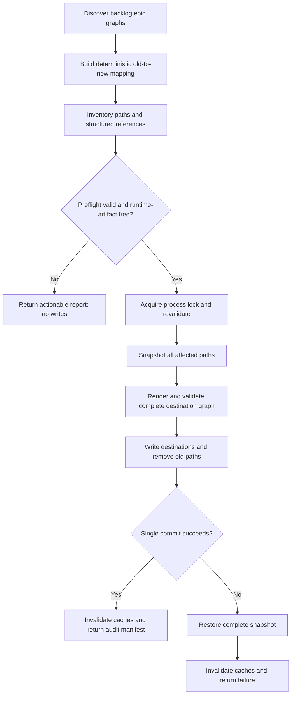

# Backlog epic ID migration

## Parent Epic

epic_004

## Scope

Migrate every backlog epic and all of its descendant features and tasks to the canonical hierarchical ID scheme:

- Epic: `epic_NNN`
- Feature: `feat_NNN_MMM`
- Task: `task_NNN_MMM_KKK`

The migration rewrites only board-owned identity data and structured references. Active and completed work, lifecycle states, titles, ordering, human-authored prose, and runtime identity artifacts remain unchanged. The workflow must support a deterministic dry run and either commit the complete graph rewrite or leave the board byte-for-byte at its pre-migration state.

## Data structures

- **Migration plan:** deterministic old-to-new ID mapping plus the complete source/destination path set and rendered document/sidecar outputs.
- **Audit manifest:** mapping, affected paths, checked runtime-artifact classes, and any validation blockers.
- **Graph snapshot:** original bytes and existence state for every affected board-owned path, retained until the single commit succeeds.
- **Structured-reference inventory:** parent/child links, dependencies, citations, metadata, indexes, and eligible board-owned comment/chat sidecars resolved by identity rather than unrestricted text replacement.

No new external service or datastore is introduced. Canonical parsing, formatting, validation, and allocation come from `feat_009`.

## API contracts

### Plan / dry run

Input: the current board graph.

Output: a deterministic migration plan and audit manifest, without writes.

The planner:

- selects backlog epics and all descendants;
- derives collision-free hierarchical targets through the canonical ID module;
- enumerates all board-owned paths and structured references requiring changes;
- verifies source hierarchy, target availability, and complete reference resolution;
- rejects any selected graph containing active/completed work or local runtime identity artifacts, including integration-worktree registrations, matching local branches, checkpoints, queues, or runtime sidecars.

### Apply

Input: a previously validated migration plan for the current board state.

Output: one committed graph rewrite, or an error with the original graph restored.

Under the board process lock, apply revalidates the plan, snapshots every affected path, writes all destinations and removes old paths, validates the rendered graph, and commits the complete path set once through the existing isolated-index `commit_paths` boundary. Any write, validation, or commit failure restores the full snapshot and invalidates relevant caches.

Re-running after a successful migration is a no-op. A stale, colliding, malformed, incomplete, or unsafe plan fails before mutation.

## Logic flow

## Acceptance criteria

- All eligible backlog epics and descendants receive canonical hierarchical IDs with stored parentage matching encoded parentage.
- Every board-owned structured reference and applicable backlog sidecar is rewritten consistently; arbitrary prose is not.
- Active and completed work remains unchanged and readable under the compatibility contract.
- Planning is deterministic and read-only, reports the full mapping and affected paths, and gives actionable blockers.
- Duplicate sources, occupied targets, malformed hierarchy, unresolved references, stale plans, and local runtime artifacts are rejected before mutation.
- Apply performs one locked graph-wide commit and restores all original bytes/path existence on any write, validation, or commit failure.
- Re-running after success, or running with no eligible work, is a safe no-op.
- Representative integration coverage proves nested multi-epic migration, cross-document references, deterministic mappings, retained-work compatibility, collision and malformed-reference rejection, runtime-artifact refusal, and injected apply/commit failure rollback.

## Task breakdown

1. **task_021 — Build and validate the backlog migration plan**
   - Discover eligible graphs, create the deterministic mapping and full reference/path inventory, and fail preflight without writes.
2. **task_022 — Apply the ID and reference migration atomically** (depends on `task_021`)
   - Implement the locked, prevalidated graph rewrite, single commit, snapshot restoration, and cache invalidation.
3. **task_023 — Verify migration integrity and failure safety** (depends on `task_022`)
   - Add focused fixture-level integration coverage for success, compatibility, refusal, idempotence, and rollback behavior.

## Risks & upward questions

- Migration safety depends on complete enumeration of board-owned structured references and local runtime identity artifacts. Unknown reference stores must fail closed rather than be silently skipped.
- The epic explicitly assumes no external integration currently persists Cascade work IDs. If that assumption changes, external discovery and coordination require an epic-level contract amendment before migration ships.
- No open upward questions.

## Out of scope

- Renumbering active or completed work.
- Renaming integration branches, worktrees, checkpoints, queues, or other runtime artifacts.
- Rewriting arbitrary user-authored prose that mentions an old ID.
- Changing lifecycle state, titles, ordering, slugs, ID syntax, or allocation policy.
- Adding an external transaction or coordination service.
- Discovering or rewriting external-system identifiers under the approved no-external-persistence assumption.

## Decision log

- `dec_001` · 2026-10-22 · Feature Lead · **Migration execution boundary**
  Chose Use a deterministic read-only plan followed by one prevalidated graph-wide apply under the existing process lock, with byte/path snapshots, one commit_paths commit, and full restoration on failure..
  Rationale: The migration spans documents, metadata, paths, indexes, and sidecars; document-scoped writes cannot prevent partial identity changes. Reusing the existing lock and isolated-index commit boundary is the smallest reliable transaction mechanism.
  Honors: The epic's atomicity, idempotence, collision-safety, and no-partial-migration requirements..

- `dec_002` · 2026-10-22 · Feature Lead · **Verification scope**
  Chose Concentrate task_023 on fixture-level integration coverage for representative graph migration, retained-work compatibility, preflight refusals, idempotent no-op behavior, and injected apply/commit rollback..
  Rationale: These tests exercise the risky public workflow and transaction boundary directly; redundant mock-heavy helper tests would add maintenance cost without comparable confidence.
  Honors: The epic's high-signal integration criterion and the frugal-engineering guidance..

## Closeout

Completed child work: `task_021` (Build and validate the backlog migration plan), `task_022` (Apply the ID and reference migration atomically), `task_023` (Verify migration integrity and failure safety).
