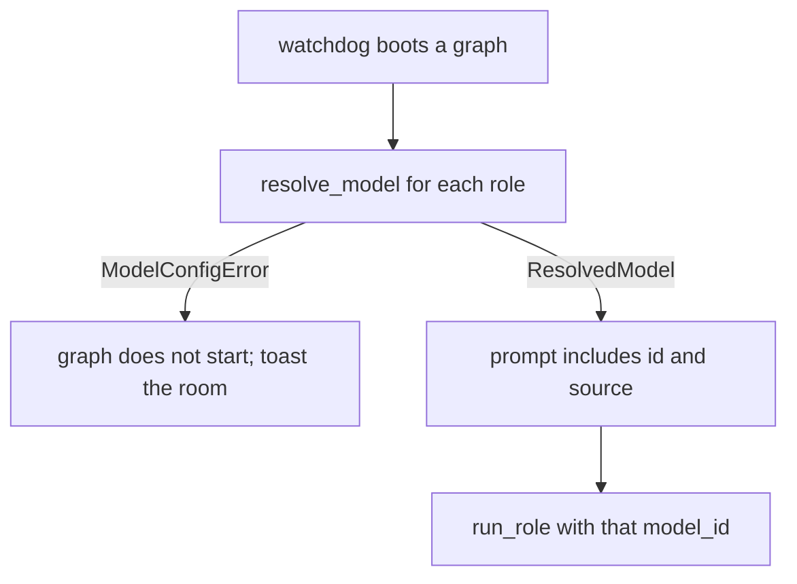

# Model defaults and overrides

## Parent Epic

[epic_001](../../epics/2_active/epic_001_functional_mvp.md) — Functional MVP.

Constraints this feature must honor:

- Feat_009 is the only inference path. This feature resolves a model id and passes it. It does not call the SDK itself.
- Defaults are project guidance: they apply when the work document does not specify a model. They are not a second catalog.
- Overrides live on the epic, feature, or task `.md`. Folder membership stays the lifecycle. No parallel model database.
- The Boss is a workspace agent, not a work document. It has a project default and no document override.
- Missing configuration fails closed at boot or at the turn. No hardcoded product model, and no silent `auto` unless the project file sets `auto` on purpose.
- Planning agents do not read `cascade.toml` to start work. The watchdog and graph boot resolve the id and pass it in.
- `depends_on` and dispatch law are unchanged. A model override does not make a document dispatchable.

## Scope

**In**

- `cascade.toml` defaults for epic agents, feature agents, and task agents, plus an optional Boss default.
- Optional per-role keys in that file when one role inside a tier should differ.
- Optional frontmatter on an epic, feature, or task: one `model` for every agent on that document, and/or a `models` map for individual roles.
- A pure resolver used at epic, feature, task, and boss boot.
- Validation of the new frontmatter. Parse and render round-trip it. Unknown role names for that tier fail validation.
- The resolved id and its source (`document-role`, `document`, `project-role`, `project-tier`, `boss-falls-back-to-epic`) are included in the role prompt so the assignment is visible. The same id is the `model_id` passed to feat_009.

**Out**

- Implementing the Cursor call (feat_009).
- Changing a model mid-turn, or letting the agent pick a different one.
- A War Room editor for `cascade.toml`. Operators edit the file.
- Per-comment or per-message model selection.

## Data structures

Project file at the repo root:

```toml
[models]
epic = "example-model"       # epic_manager, epic_architect
feature = "example-model"    # feature_lead, feature_architect
task = "example-model"       # swe
# boss = "example-model"     # optional; if omitted, Boss uses the epic default

[models.roles]               # optional; wins over the tier key for that role
# epic_architect = "example-model"
```

The strings above are shape examples, not mandated ids. An absent `[models]` table is legal on disk and illegal at boot of a graph that needs a model.

Document frontmatter (optional; existing keys unchanged):

```yaml
model: example-model
models:
  epic_architect: example-model
```

Legal `models` keys:

| Tier | Roles |
|---|---|
| epic | `epic_manager`, `epic_architect` |
| feature | `feature_lead`, `feature_architect` |
| task | `swe` |

A key from another tier, a non-string, or a blank string fails validation of that document.

```text
ModelSource = document-role | document | project-role | project-tier | boss-falls-back-to-epic

ResolvedModel
  role: RoleId
  model_id: str
  source: ModelSource
```

## API contracts

```text
resolve_model(role, doc | None, *, root) -> ResolvedModel
    1. doc.models[role]                         -> document-role
    2. doc.model                                -> document
    3. cascade.toml [models.roles].<role>       -> project-role
    4. cascade.toml [models].<tier>             -> project-tier
    5. boss only, when boss is unset: [models].epic
                                                -> boss-falls-back-to-epic
    else ModelConfigError

task_parallelism reader stays as it is.
A non-string, blank, or non-table models value is ConfigError, same family as a bad task_parallelism.
```

Boot of an epic graph resolves `epic_manager` and `epic_architect` against that epic document. Feature boot resolves `feature_lead` and `feature_architect` against that feature. Task boot resolves `swe` against that task. Boss boot resolves `boss` with no document.

The document override covers every agent on that work object unless `models` names a role. It does not leak to children: a feature does not inherit the epic's `model`. Children have their own defaults (the project tier) until their own file says otherwise.

## Logic flow



## Task breakdown

All four implementation tasks are **completed** (in [`docs/tasks/3_completed/`](../../tasks/3_completed/)):

| ID | Title |
|---|---|
| [task_049](../../tasks/3_completed/task_049_models_config_table.md) | Models config table (`cascade.toml` `[models]`) |
| [task_050](../../tasks/3_completed/task_050_model_frontmatter.md) | Model frontmatter on `WorkMeta` |
| [task_051](../../tasks/3_completed/task_051_resolve_model.md) | `resolve_model` pure resolver |
| [task_052](../../tasks/3_completed/task_052_model_boot_wiring.md) | Model resolution boot and turn wiring |

Depends on: feat_009 completed.

## Risks & upward questions

- Operators may expect a feature to inherit its epic's model. Inheritance is rejected: the project tier default is the guidance, and only that document's frontmatter overrides it. Otherwise an epic override would silently retarget every child SWE run.
- `auto` is a legal id only when someone writes it in config or frontmatter. The resolver must not insert it.
- Round-tripping old documents that omit `model` must keep omitting it. A missing field means "use the project default," not "write an empty string back."

## Decision log

_(empty — lock entries when this feature is active)_
