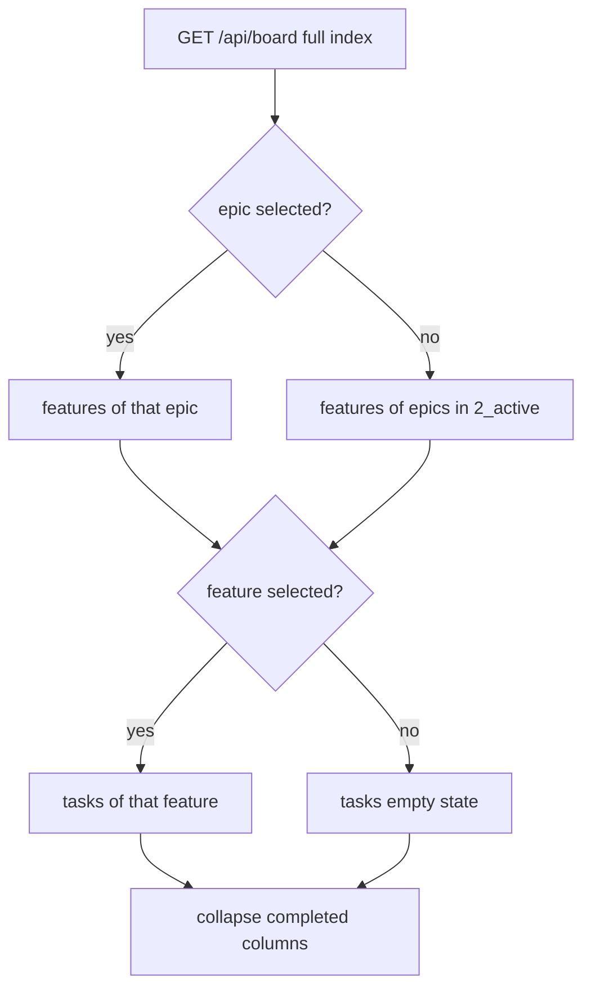

# Board focus and collapse

## Parent Epic

[epic_001](../../epics/2_active/epic_001_functional_mvp.md) — Functional MVP.

Constraints this feature must honor:

- Filesystem is the board. Focus and collapse are a War Room lens. They do not move files, change frontmatter, or add a status store.
- `GET /api/board` still returns every epic, feature, and task. Filtering happens in the UI.
- Localhost only. Preference state stays in the browser session, not on disk.
- Dispatch, attach, merge, and Boss actions on a visible card behave as they do now.
- Parent links already on the documents are the filter key. A feature is in an epic's lens when `parent` is that epic. A task is in a feature's lens when `parent` is that feature.

## Scope

**In**

- Collapse control on the completed column for features and for tasks. The completed epic column gets the same control.
- Completed features and completed tasks start collapsed. Completed epics start expanded.
- A collapsed column shows the count of cards in that column after the focus filter, and hides the cards. Backlog and active columns do not collapse.
- Feature rows are limited to the selected epic, or to every epic currently in `2_active` when none is selected.
- Task rows are limited to the feature selected on the board. With no feature selected, the tasks tier shows an empty state and no task cards.
- Selecting a feature also selects its parent epic, so that feature stays inside the epic lens.
- Attaching a feature room selects that feature on the board. Selecting a card does not attach.

**Out**

- Hiding backlog or active cards except through the epic and feature lens above.
- A "show every feature and every task" mode.
- Editing plans from the board.
- Persisting collapse or selection in git.

## Data structures

```text
BoardFocus
  selected_epic_id: str | null
  selected_feature_id: str | null
  completed_collapsed:
    epics: bool      # default false
    features: bool   # default true
    tasks: bool      # default true
```

Session only. Refresh may reset it. The full `BoardView` from `GET /api/board` is the input; the lens is derived:

```text
feature_parents =
  {selected_epic_id}            if an epic card is selected
  else {id of every epic in 2_active}

visible features = features whose parent is in feature_parents
visible tasks    = tasks whose parent == selected_feature_id
                   or none, when selected_feature_id is null
```

Counts on a collapsed completed column use the visible set, not the unfiltered board.

## API contracts

No new board route. Existing card actions stay on the buttons they already use.

```text
click epic card
    toggle selected_epic_id
    if the selected feature's parent is not that epic, clear selected_feature_id

click feature card
    set selected_feature_id
    set selected_epic_id to that feature's parent

click the same selected card again
    clear that selection
    clearing the epic also clears the feature when the feature is no longer in the lens

attach feature
    set selected_feature_id and selected_epic_id as a feature click would
    do not detach on a later selection change

collapse button on a completed column
    toggle that tier's completed_collapsed flag
```

Empty copy when the lens has nothing to show:

- No epic in `2_active` and none selected: features say that no epic is active or selected.
- No feature selected: tasks say to select a feature.

Action buttons do not toggle selection. Dispatching a visible feature leaves it selected.

## Logic flow



## Task breakdown

All three implementation tasks are **completed** (in [`docs/tasks/3_completed/`](../../tasks/3_completed/)):

| ID | Title |
|---|---|
| [task_053](../../tasks/3_completed/task_053_completed_column_collapse.md) | Completed column collapse |
| [task_054](../../tasks/3_completed/task_054_epic_lens.md) | Epic lens |
| [task_055](../../tasks/3_completed/task_055_feature_lens.md) | Feature lens |

Depends on: feat_003 completed.

## Risks & upward questions

- Several epics can be in `2_active`. Showing all of their features until the operator picks one matches "active epic" as the live set. Selecting one replaces that set. It does not union with the other active epics.
- A selected backlog or completed epic is a legal lens. Active status is only the default when nothing is selected.
- Card density in backlog and active is unchanged on purpose. Collapse is for the completed pile that makes the board hard to scan.

## Decision log

- `dec_feat011_001` · 2026-10-10 · Feature Architect · **BoardFocus shape and interaction contract**
  Locked session-only `BoardFocus` (`selected_epic_id`, `selected_feature_id`, `completed_collapsed` with defaults epics=false, features=true, tasks=true). Epic card click toggles `selected_epic_id` and clears `selected_feature_id` when the selected feature's parent is not that epic. Feature card click sets both ids to the feature and its parent; clicking the same selected card again clears that tier's selection, and clearing the epic clears the feature when it falls out of the lens. Feature attach sets selection like a feature click and does not auto-detach on later selection changes. Completed-column collapse buttons toggle per-tier flags only; action buttons never toggle selection or collapse. Counts on collapsed completed columns use the post-lens visible set; `GET /api/board` remains unfiltered.
  Rationale: spec § Data structures and § API contracts; no server or git persistence.
  Honors: DESIGN.md filesystem board; feat_003 War Room actions unchanged on visible cards.
