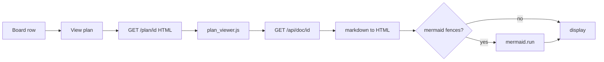

# Plan viewer (View plan)

## Parent Epic

[epic_001](../../epics/2_active/epic_001_functional_mvp.md) — Functional MVP.

Constraints this feature must honor:

- Filesystem is the board. The viewer reads the same `read_doc` truth as agents; it does not cache a second plan store.
- Localhost only (`127.0.0.1`). No remote markdown CDN for core rendering (vendor libraries under `cascade/war_room/static/` if needed).
- Read-only in v1. The operator edits plans in the repo or via graph tools, not in this pane.
- Board lens (feat_011) still applies on the War Room home; **View plan** is available on every visible epic, feature, and task row regardless of column.
- YAML frontmatter is metadata for the board API, not part of the rendered article. The page shows title, id, tier, status, path, and git SHA from `WorkMeta`, then the markdown **body** only.

## Scope

**In**

- A **View plan** control on each epic, feature, and task card on the War Room board (alongside existing dispatch / attach / merge actions). It must not toggle board selection (feat_011).
- Navigation opens a dedicated plan view for that work id in the same origin (new tab or same tab — pick one in implementation; default **same tab** with a **Back to War Room** link).
- Server route `GET /plan/{id}` (or equivalent) serves an HTML shell bound to `127.0.0.1`, validates `id` as a single work id (no path segments), 404 when the id is not on the board.
- Client loads `GET /api/doc/{id}` (existing JSON: `meta`, `body`, `sha`) and renders the body as HTML.
- Markdown rendering covers normal plan content: headings, lists, tables, fenced code blocks, blockquotes, and links. Relative links between docs under `/docs/` may resolve as same-origin navigation to `/plan/{other_id}` when the target id can be inferred from the href; otherwise leave as plain links.
- **Mermaid:** fenced blocks with language `mermaid` render as diagrams when a Mermaid build is bundled in-repo (e.g. `static/vendor/mermaid.min.js`). If Mermaid fails to load or parse, show the block as a preformatted fallback — do not break the whole page.
- Optional: show `parent_rev` and a one-line note when pinned, without fetching historical parent bodies in v1.

**Out**

- In-browser editing or `write_doc` from the UI.
- Rendering amendment diff sidecars (`_amendments/`) as work plans.
- Comment threads inline in the plan view (comments stay in War Room / feat_005 chrome).
- Server-side Python markdown dependency unless implementation discovers an existing project dependency; prefer vendored client markdown + Mermaid to keep the War Room stack thin.

## Data structures

```text
PlanViewPayload   # same as GET /api/doc/{id}
  meta: WorkMeta (JSON)
  body: str        # markdown after frontmatter
  sha: str | null

PlanPageState     # browser only
  work_id: str
  render_error: str | null   # fetch or parse failure
```

No new persistence. No changes to frontmatter schema.

## API contracts

Server (localhost):

```text
GET /plan/{id}     -> text/html plan viewer shell (work id in path)
GET /api/doc/{id}  -> unchanged; plan page is the primary consumer
```

Path rules match existing `/api/doc/{id}`: reject empty ids, slashes, and unknown ids with 404.

Board UI:

```text
click "View plan" on row {id}
  -> navigate to /plan/{id}
  (does not change BoardFocus selection)
```

Static assets (if used):

```text
/static/vendor/markdown*.js   # or minimal in-house subset — implementation choice
/static/vendor/mermaid.min.js
/static/plan_viewer.js
/static/plan_viewer.css
```

## Logic flow



## Task breakdown

All three implementation tasks are **completed** (in [`docs/tasks/3_completed/`](../../tasks/3_completed/)):

| ID | Title | Depends on (tasks) |
|---|---|---|
| [task_056](../../tasks/3_completed/task_056_plan_viewer_route.md) | Plan viewer route and HTML shell | — |
| [task_057](../../tasks/3_completed/task_057_plan_markdown_mermaid.md) | Plan markdown and Mermaid render | task_056 |
| [task_058](../../tasks/3_completed/task_058_view_plan_board_control.md) | View plan board control | task_057 |

Feature depends on: feat_003 completed.

## Risks & upward questions

- Plan bodies can be large. v1 may render synchronously in the browser; if perf hurts, defer incremental render — not a blocker for MVP.
- Vendoring Mermaid increases static asset size; acceptable for local-only operator UX.
- Toast links already use `/api/doc/{id}` JSON; plan view is the human-readable counterpart. Toasts need not change in v1.

## Decision log

- `dec_feat012_001` · 2026-10-10 · Feature Architect · **feat_012 shipped**
  Plan viewer shipped: `GET /plan/{id}`, client markdown + Mermaid (vendored under War Room static), **View plan** on all board rows. Read-only; uses existing `GET /api/doc/{id}`.
  Rationale: operators read specs in the War Room without raw JSON; honors dec_014 scope.
  Honors: filesystem is truth; local-only UI; dec_014.
