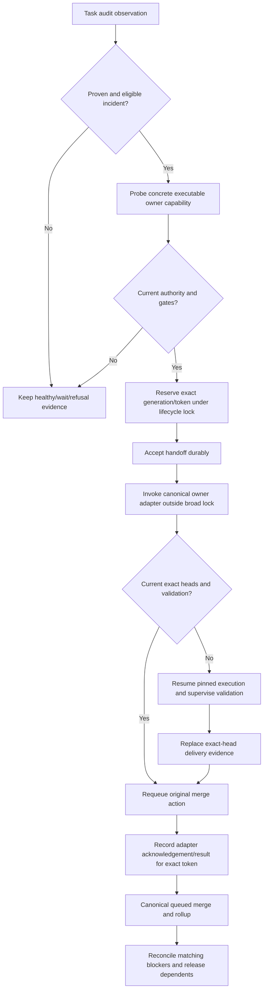

# Recover Task delivery incidents through canonical guarded adapters

## Parent Epic

epic_013

## Scope

## Outcome
Connect the audit to existing owner-scoped Task recovery and prove that lost queues and stale deliveries reach exactly one normal merge and rollup.

## Acceptance criteria
1. Use capabilities from completed Epics 041 and 042: supervisor_recover_task_delivery, concrete parent recovery, durable action retry/rearm, supervised checkpoint resume/revalidation, canonical queue/merge and rollup. Do not duplicate those algorithms.
2. Reproduce task_038_002_002: validated active Task, retryable merge action, absent pending-task-merges.json entry. The audit rechecks lease, ownership, current heads/evidence, gates and generation under the lifecycle lock, requeues through the canonical path, merges once, completes rollup and releases dependent work.
3. Handle stale leases and ownerless turns using pinned inputs; pass the authoritative Feature ID, never parent_rev or a SHA. Missing checkpoint, stale validation, dirty worktree, busy target and live/stale-but-live owner each receive the correct safe repair or precise durable refusal.
4. Material Feature-base movement requires fresh supervised validation and replacement exact-head delivery evidence before retrying the original action. Existing team-owned conflict recovery is routed to the actual work ID, wakes an idle/completed owner and persists acknowledgement/result; ambiguous semantic conflicts require the owning team/human.
5. Preserve user changes and history. No reset/clean/force-push, new replacement Task, approval/comment bypass, provider/credential change, or dependency install. Clear only matching derived parent blockers before resuming; preserve unrelated sibling/manual blockers.
6. Crash/restart, manual parent recovery and simultaneous audits converge without duplicate workers, validations, queues or merges. Negative outcomes and interrupted claims retry only under the shared bounded generation/cooldown rules.
7. Start a scoped auditor agent only for an incident requiring bounded diagnosis or an authorized recovery plan; deterministic repairs run without a model turn. Missing executable adapters remain visible and automatically re-evaluate when capability changes.

## Validation
Extend existing isolated-repository real recovery scenarios, especially tests/test_task_recovery_generations_regressions.py and tests/watchdog/test_health.py. Cross the actual owner route, wakeup, acknowledgement, owned-branch mutation, work-defined supervised checks, replacement evidence, blocker reconciliation and merge/rollup boundaries. Deterministic model/forge responses may be substituted, but event-only or mocked recovery callbacks do not establish acceptance. Assert original action identity and exactly one terminal completion. Correct the two provider-preflight-blocked health fixtures with deterministic provider inventory; keep production preflight unchanged. Feature 005 owns the all-tier integrated default-on release gate.

## Scope
Epic criteria 4, 8–13, 16–17, 19–20, 22–24. Foundations and independent scheduling are prerequisites.

## Data structures

- Audit identity is the typed pair `(tier="task", TaskId)`; `FeatureId` comes from the live Task parent. `DocumentRevision`, Task/Feature `GitHead`, branch, action ID, review ID, incident generation and claim token occupy separate fields. Neither `parent_rev` nor a SHA is a Feature ID.
- `AuditObservation` carries classification, failure class, accountable owner, current document/execution/review/queue/action evidence and an authoritative generation that includes capability authority. The incident envelope records that generation, selected executable capability, bounded retry policy, request, acknowledgement, result and attempts in its existing durable store. Keep the original merge action ID and exact delivery head pair in evidence.
- `CapabilityDescriptor` names an actual callable, allowed Task failure classes and owner kinds, required evidence, attempt bound and durable store. `IncidentReservation` has reservation ID, exact claim token, Task ID, tier, generation, capability and lease deadline. Pending and accepted claims are distinguishable; only the matching current token may finish a result.
- `PinnedExecutionInputs` retain provider, model, reasoning and Flex selection from the checkpoint. `DeliveryEvidence` retains deliverable SHA, Feature-base SHA, current-head match and queue membership. Existing execution, action-recovery, orphan-delivery, pending-merge and review stores remain authoritative in their respective tracking or owning repository; do not infer all state from one checkout.

## API contracts

1. `project_audit_observation(task_id, root=...)` and `project_incident(observation, ledger)` classify current evidence and bounded eligibility. `probe_capability(incident, "feature_team:<actual FeatureId>" or "task_team:<actual TaskId>", root=...)` must prove a registered callable and reachable evidence. Missing capability stays a visible incident and is retried when its registry fingerprint changes.
2. `reserve_after_recheck(incident, descriptor, root=..., handoff_pending=True)` rechecks local owner, gates, lease, action, generation and claim under the canonical lifecycle lock. Prepare Git/worktree facts outside the broad lock, compare local fingerprints inside it, and recheck exact heads at the adapter's publication boundary. An admission claim is not permission to mutate stale evidence. Accept the exact token durably before execution; reconcile interrupted pending versus accepted handoffs through the existing ledger. Execute adapters and supervised validation outside broad locks, then `record_result(reservation, acknowledgement, result, root=...)` with the same token.
3. `supervisor_recover_task_delivery(task_id, root=..., observed_incident=...)` is the Task delivery adapter. It re-reads canonical Task state; the observed incident is only an idempotency hint. For a valid lost queue, use existing `recover_orphan_delivery` and canonical queue/merge/rollup. For stale execution, use checkpoint resume and work-defined supervised validation before replacing exact-head delivery evidence. `recover_task(task_id, feature_id=<live Task parent>, root=...)` is the parent-owned route; action retry/rearm uses the original action ID. Do not create another merge path or Task.
4. For a team-owned conflict, route by the actual owning work ID and durable review identity, wake the idle/completed owner, and persist request, acknowledgement and result. Leave ambiguous semantic conflicts to the owner/human. At the canonical safe merge boundary, reconcile only blockers derived from this matching child/action; preserve sibling/manual blockers and imported 25794f1f/6e32c7f4 guards.
5. Only an incident requiring bounded diagnosis or an authorized recovery plan gets a scoped auditor model turn. Deterministic queue replay, claim handling and guarded adapter invocation use zero model turns. Apply shared finite attempts, cooldown and changed-generation reassessment; terminal success suppresses only its exact generation.

## Logic flow

## Task breakdown
1. task_013_003_001 — Admit Task delivery incidents through guarded audit capabilities. Acceptance: classify the three Task delivery failure classes plus missing validated delivery; bind typed Task/live Feature owner and concrete callable; reserve and durably accept the exact generation/token under canonical gates; invoke the adapter outside broad locks; preserve missing capability visibility and safe refusal; use zero model turns for deterministic repair. Focused audit admission tests must cover stale evidence, live owner and gate refusal.
2. task_013_003_002 — Requeue lost validated Task deliveries through canonical merge and rollup (depends on 001).
3. task_013_003_003 — Resume stale Task execution with fresh supervised validation (depends on 001).
4. task_013_003_004 — Route owned conflicts and reconcile parent recovery blockers (depends on 002 and 003).
5. task_013_003_005 — Converge restart, parent recovery and simultaneous audits (depends on 004).

## Risks & upward questions

None.

## Decision log

None yet.

- `dec_001` · 2026-11-08 · Feature Lead · **Task recovery contract**
  Chose Use the existing Task supervisor and Feature owner adapters with typed live-parent identity, exact generation/token claims, original merge action, and canonical merge/rollup; require real audit-entry acceptance and deterministic provider-inventory fixtures..
  Rationale: The completed foundations already own admission, recovery and durability; a second path would risk duplicate delivery and weak event-only evidence. The explicit contracts bind the five tasks to one executable recovery route and the imported safety guards.
  Honors: Epic dec_022, dec_025, Feature 003 activation handoff, Feature 002 bounded coordinator and split-tracking authority..

## Closeout

Completed child work: `task_013_003_001` (Admit Task delivery incidents through guarded audit capabilities), `task_013_003_002` (Requeue lost validated Task deliveries through canonical merge and rollup), `task_013_003_003` (Resume stale Task execution with fresh supervised validation), `task_013_003_004` (Route owned conflicts and reconcile parent recovery blockers), `task_013_003_005` (Converge restart, parent recovery and simultaneous audits).
