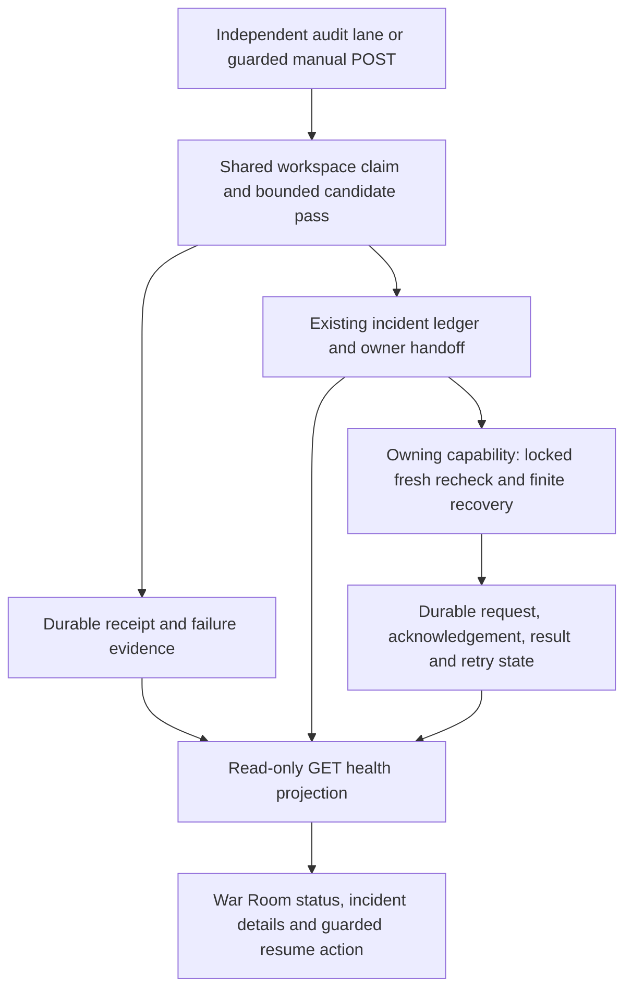

# Expose audit controls and prove default-on recovery acceptance

## Parent Epic

epic_013

## Scope

## Outcome
Ship the complete audit loop enabled by default every 30 minutes, with truthful War Room status and guarded manual execution.

## Acceptance criteria
1. War Room displays last audit time, next due time, duration, counts by tier/outcome, and active incidents with concrete owner, evidence, request/acknowledgement/result, retry/cooldown and exact resume action. No "investigating" state without a delivered pending/acknowledged request.
2. Add guarded "Run health audit now" using existing human request protections and the shared coordinator. Duplicate clicks/concurrent scheduled runs coalesce; the action does not alter the periodic deadline. Explicit manual execution is available when scheduled audits are disabled.
3. Document the config grammar/bounds/defaults, independent supervisor lane, work/pass limits, seven-day completed window plus unresolved references, generation retry semantics, capabilities/privilege boundaries, escalation and troubleshooting.
4. Document the only healthy-run writes: a compact untracked supervisor audit receipt/cursor that cannot trigger work. A healthy workspace has no lifecycle mutation, model turn, event/toast/chat, Git change, success-only external API call, or document timestamp rewrite.
5. Release default enablement only after Task lost-queue/stale-delivery, Feature owner/publication and Epic owner/closeout adapters pass real recovery acceptance through terminal outcomes. Missing capability paths must fail closed with precise actionable evidence and later automatic re-evaluation; they do not excuse missing required adapters.
6. End-to-end acceptance covers all 24 epic success criteria. Repeat named regressions through the audit entry point, including task_038_002_002 and Feature ID versus parent_rev, and verify recovery while ordinary watchdog I/O is blocked.
7. Concurrent manual/periodic/parent recovery, crash/restart, healthy silence, invalid/disabled intervals, bounded scans, blocked approval/comment gates, dirty worktrees and split repositories pass the selected integrated suite. No external package/service installation is required.

## Validation
Use the existing War Room route/JavaScript harness and real isolated-repository lifecycle fixtures. Assert visible status reflects durable state and the actual manual request path. Reuse adapter acceptance rather than creating redundant mock-heavy unit suites; document commands and observed outcomes for each epic criterion.

## Scope
Epic criteria 1–24 at release, with primary ownership of 7, 14 and rollout/acceptance. No analytics product, new notification channel, arbitrary repair console, or UI redesign.

## Data structures

- Use the existing compact, untracked `.cascade/health_audit/receipt.json` in the canonical product workspace. Its completed-pass fields are `last_completed_at`, `next_scheduled_at`, `interval_seconds`, `duration_seconds`, `counts` (tier/outcome keys), and `next_cursor`. Read `failure.json` separately for active pass failure or unavailable candidate evidence. An absent or malformed receipt means “no completed audit recorded,” never a healthy result.
- Project active incidents from the existing durable recovery ledgers and authoritative lifecycle state. Each incident has a typed work ID/tier, failure class, accountable owner, authoritative generation, evidence, selected capability, request, acknowledgement, result, attempts, retry policy, claim expiry, next reassessment time, outcome, and recorded time. Do not create a second mutable War Room incident store or treat a completed-pass count as a current incident.
- Keep tracking-repository documents, queues, actions and ledgers separate from product-worktree Git evidence in split-repository setups. Retain unresolved references beyond the seven-day completed-work window.

## API contracts

- `GET /api/health` remains the read-only supervisor readiness route. `GET /api/health/audit` provides the read-only audit projection from the receipt/failure files and bounded active incident reads. Missing, stale or unavailable source evidence is explicit. The UI shows last completion, next scheduled time, duration, counts by tier/outcome, and each current incident’s owner, evidence, request, acknowledgement, result, retry/cooldown and exact guarded resume action. “Investigating” is shown only for a delivered pending/acknowledged request, never for admission or an unowned event.
- `POST /api/health/audit` accepts an empty body from an authenticated local human under the existing human-request protections. It calls the shared supervisor lane: HTTP 202 `{ok:true,status:"admitted"}` means a manual pass was queued; HTTP 202 `{ok:true,status:"coalesced"}` means a pass/request is already pending or running. Neither response claims recovery completed. HTTP 401 rejects unauthenticated requests; HTTP 400 rejects a nonempty body; HTTP 503 with `health audit unavailable` covers a missing/stopped coordinator. The UI disables repeated submission while the request is in flight and reads subsequent durable status to show actual completion or failure.
- Manual admission remains possible with scheduled auditing disabled; a manual pass does not move the periodic deadline. Scheduled and manual work use the same canonical workspace claim, generation checks and owner recovery capabilities. The route grants no direct repair authority.

## Logic flow

## Task breakdown
- `task_013_005_001` — Expose durable status and actionable incidents in the War Room.
- `task_013_005_002` — Wire the guarded run-now control to the shared coordinator (after 001).
- `task_013_005_003` — Document operation, limits, privilege boundaries, and healthy-run silence.
- `task_013_005_004` — Prove real Task, Feature, and Epic recovery through the audit entry point (after 001–002).
- `task_013_005_005` — Complete the 24-criterion integrated acceptance and default-on release evidence (after 003–004).

## Risks & upward questions

None.

## Decision log

- Keep supervisor readiness at `GET /api/health` and expose durable audit detail at `GET /api/health/audit`. The War Room reads the audit route directly; this matches the merged status route without adding audit reads to the readiness banner.

- `dec_001` · 2026-11-08 · Feature Lead · **API contracts**
  Chose Keep supervisor readiness at GET /api/health and expose durable audit status at GET /api/health/audit..
  Rationale: The merged War Room status route and UI use the dedicated audit endpoint. It preserves a bounded, explicit read for audit detail without adding incident ledger reads to the existing readiness banner.
  Honors: Feature 005 acceptance criterion 1 and epic_013 dec_027; audit status remains truthful and read-only..

## Closeout

Completed child work: `task_013_005_001` (Expose durable audit status and incidents in the War Room), `task_013_005_002` (Wire the guarded Run health audit now control), `task_013_005_003` (Document audit operation, boundaries, and healthy-run silence), `task_013_005_004` (Verify real Task, Feature, and Epic recovery through the audit entry point), `task_013_005_005` (Complete integrated audit acceptance and default-on release evidence).
