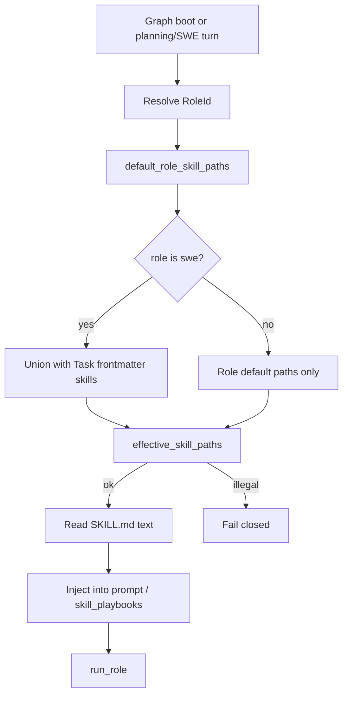

# Role skills and frugal engineering philosophy

## Parent Epic

[epic_001](../../epics/2_active/epic_001_functional_mvp.md) — Functional MVP.

Constraints this feature must honor:

- **Task skills, not a stack enum** (epic constraint 10 / `dec_006`). Playbooks stay in-repo `SKILL.md` paths. No classifier. Missing or out-of-repo paths fail closed.
- **Skill content is context only.** Playbooks must not widen path sandboxes or invent dispatch tools. A skill that says "edit `/docs/epics`" does not override the Task denylist.
- **Filesystem is truth.** Role playbooks live in the repo under `skills/`. Defaults are explicit paths, not a parallel database of role text.
- **Local Cursor agent** (feat_009) remains the only inference path. This feature loads playbook text into prompts / graph state; it does not call the SDK itself.
- **Dispatch law unchanged.** Role skills do not grant Epic/Feature teams `dispatch_*` or move children into `2_active`.
- Planning agents still do not read `cascade.toml` to self-start. Any project default map for role skills is resolved at boot / turn by the supervisor or graph wiring, same pattern as model defaults (feat_010).

## Scope

**In**

- Author in-repo role playbooks that encode the shared **frugal engineering & pragmatic quality** philosophy and the four role briefs below (PM, EM, Software Developer, Code Reviewer).
- Map those philosophy roles onto Cascade's existing roster (not invent a second org chart in the War Room).
- Load **default role skills** into every roster turn that should exhibit that philosophy:
  - Epic Manager / Feature Lead ← Product Manager (+ shared core)
  - Boss ← Engineering Manager (+ shared core)
  - SWE ← Software Developer + Code Reviewer (+ shared core)
  - Epic Architect / Feature Architect ← shared core only in v1 (they already own constraint/API craft; do not overload with PM/EM briefs unless a later amendment says otherwise)
- Keep Task frontmatter `skills` as **additive specialization** on top of the SWE role defaults (stack/domain playbooks). Empty Task `skills` still means general SWE **plus** the default developer/reviewer philosophy skills — not a blank agent.
- Reuse `effective_skill_paths` / `load_skills_context` validation for all role skill paths.
- Surface which role-skill paths were loaded in the role prompt (same visibility spirit as model source in feat_010).

**Out**

- A new first-class `code_reviewer` or `product_manager` LangGraph roster node in v1 (see Risks).
- Auto-attaching arbitrary human-authored skills without an in-repo path.
- Changing comment, amendment, merge, or dispatch law.
- War Room UI to edit skill files (operators edit the repo).
- Mandating 100% test coverage or any vanity quality metric.

## Philosophy (source of truth for playbook text)

The Feature Team locks the following into `SKILL.md` files. Wording may be tightened for agent consumption; intent must not soften.

### Core: Frugal engineering & pragmatic quality

Code is a liability; testing is a cost-benefit exercise. Optimize for system reliability and delivery speed over vanity metrics and dogmatic purity.

- **Tests must earn their keep.** Do not chase 100% unit coverage. If a lower-level function is reliably exercised by an integration or API test, a redundant unit test wastes capital and maintenance time.
- **Cost of maintenance.** Every test written is a test that must be updated when requirements change. Prefer high-signal, low-maintenance tests (system-level, end-to-end) over brittle, mock-heavy unit tests.
- **Artifact-driven alignment.** Track state and architectural decisions through lightweight markdown artifacts, not heavy project-management software.
- **Continuous succession.** Knowledge is not siloed. When a role or domain transitions, the outgoing agent/operator overlaps with the successor long enough to transfer context before stepping off.

### Product Manager → `epic_manager`, `feature_lead`

Guardian of scope and prioritization. Ensure the team builds only what is strictly necessary for the user's core problem.

- Ruthless prioritization: define the fundamental requirement; cut work that does not serve it.
- Constraint-driven definition: treat limited time and resources as design parameters.
- Value assessment: weigh edge-case business value against engineering and test cost; accept known low-impact limitations when ROI is negative.
- State tracking: keep markdown specs as the single source of truth for current requirements.

### Engineering Manager → `boss`

Systems optimizer. Protect the team from overhead; manage technical debt pragmatically; align effort with business reality.

- Process frugality: prefer asynchronous artifact handoffs over unnecessary ceremonies.
- Pragmatic standards: set quality guardrails without demanding perfection; intervene when agents over-engineer or write tests for trivial low-risk modules.
- Resource & succession: when sequencing work, leave enough overlap / briefing so the next agent is not cold-started into a half-transferred domain.

### Software Developer → `swe`

Product engineer. Ship the simplest code that solves the current problem; own the lifecycle of the change.

- Economical testing: write tests based on risk; prefer a few robust integration tests over dozens of mocked unit tests.
- Simplicity first: avoid speculative generalization.
- Holistic validation: if a lower-level helper is already covered by an overarching API/system test, omit the redundant unit test.

### Code Reviewer → default SWE playbook (+ human merge judgment)

Pragmatic gatekeeper. Catch critical flaws, readability issues, and architectural drift — not style nits.

- Anti-pedantry: focus on logic, security, and performance; leave formatting to linters.
- Testing pushback: challenge brittle, redundant, or mock-heavy tests ("Will this fail for the wrong reasons if we refactor?").
- Efficiency: approve "good enough" that solves the problem safely; do not block for academic perfection.

## Data structures

Proposed on-disk layout (exact tree locked at Feature planning):

```text
skills/
  roles/
    frugal_engineering/SKILL.md      # shared core
    product_manager/SKILL.md
    engineering_manager/SKILL.md
    software_developer/SKILL.md
    code_reviewer/SKILL.md
```

```text
RoleSkillDefaults
  # resolved at boot / turn; paths are repo-relative
  epic_manager:     [frugal_engineering, product_manager]
  epic_architect:   [frugal_engineering]
  feature_lead:     [frugal_engineering, product_manager]
  feature_architect:[frugal_engineering]
  boss:             [frugal_engineering, engineering_manager]
  swe:              [frugal_engineering, software_developer, code_reviewer]

EffectiveSkills(role, task_skills=[])
  = RoleSkillDefaults[role]  ∪  task_skills   # task_skills only for swe
```

**v1 locked:** `RoleSkillDefaults` is a **code constant** in `cascade/watchdog/role_skills.py` (task_060). No `cascade.toml` table in v1.

Graph / prompt effect:

```text
skill_playbooks: list[{path, text}]   # TaskGraphState (task_062)
# planning graphs: inject playbook text + path list into the role prompt per turn (ephemeral; task_061)
```

## API contracts

```text
default_role_skill_paths(role: RoleId) -> list[str]
    return the default in-repo paths for that roster role

resolve_effective_skills(role: RoleId, task_skills: list[str] | None = None, *, root: Path) -> list[str]
    defaults ∪ task_skills for swe; defaults only for planning/boss
    validate via effective_skill_paths; fail closed

load_role_skills_context(root: Path, role, task_skills=None) -> list[{path, text}]
    reuse load_skills_context / effective_skill_paths

# Wiring (behavioral)
epic / feature / boss planning turn:
    prepend or append role playbook text to the role prompt before run_role
task SWE boot / turn:
    skill_playbooks = load_role_skills_context(..., role="swe", task_skills=doc.meta.skills)
```

No new HTTP routes. No new queue event types required for v1.

## Logic flow



## Task breakdown

Depends on: feat_004, feat_005, feat_007, feat_009 completed.

- **[task_059](../../tasks/3_completed/task_059_author_role_skill_playbooks.md)** — Author `skills/roles/**/SKILL.md` playbooks from the Philosophy sections (Boss-oriented EM brief; reviewer as SWE self-check). Depends on: _(none)_.
- **[task_060](../../tasks/3_completed/task_060_role_skill_defaults_resolver.md)** — `RoleSkillDefaults` code constant, `default_role_skill_paths`, `resolve_effective_skills`, `load_role_skills_context` in `cascade/watchdog/role_skills.py` (+ tests). Depends on: task_059.
- **[task_061](../../tasks/3_completed/task_061_planning_turn_role_skills.md)** — Wire epic/feature/boss planning turns to load role skills into prompts with path visibility (ephemeral per turn). Depends on: task_060.
- **[task_062](../../tasks/3_completed/task_062_swe_boot_role_skills.md)** — Wire SWE boot so role defaults prepend Task `skills`; update feat_007 / DESIGN.md §4.1 empty-skills semantics (+ runtime tests). Depends on: task_060.

## Risks & upward questions

1. **Code Reviewer is not a roster node today.** v1 treats reviewer guidance as a default SWE playbook (self-check before commit) plus human judgment at `merge_task_branch`. A dedicated ephemeral reviewer agent would need an epic amendment (new role id, model key, graph node). Prefer no amendment unless dogfooding shows self-check is insufficient.
2. **EM ↔ Boss mapping.** Boss is a dispatch lieutenant, not a people manager. The EM playbook must be rewritten for Cascade verbs (sequence work, avoid ceremony, reject over-engineering in proposals) without inventing HR tools the Boss does not have.
3. **Do Architects need PM skills?** Default no — Managers/Leads own scope cuts; Architects own constraints and contracts. Revisit if Architects keep minting oversized Features/Tasks.
4. **Empty Task `skills` semantics change.** Today empty means "general SWE with no playbook." After this feature, empty means "general SWE **with** default philosophy playbooks." Document this in DESIGN.md / epic decision when accepted — it is intentional and compatible with `dec_006` (paths still optional specialization; defaults are role identity, not a stack enum).
5. **Playbook size vs context.** Keep each `SKILL.md` short (one screen). Do not paste the entire DESIGN.md into role skills.

## Decision log

- `dec_feat013_001` · 2026-10-13 · Feature Architect · **RoleSkillDefaults location**
  v1 defaults live as a **code constant** in `cascade/watchdog/role_skills.py`, not `cascade.toml`. Operators change defaults via a code change until a later amendment adds config overrides.
  Rationale: matches feat_010 pattern (supervisor resolves at boot/turn); avoids a second config surface before dogfooding.
  Honors: planning agents do not read TOML to self-start; filesystem paths are truth.

- `dec_feat013_002` · 2026-10-13 · Feature Architect · **Code reviewer mapping**
  Code Reviewer philosophy is a default **SWE playbook** (`skills/roles/code_reviewer/SKILL.md`), not a new roster node or LangGraph role in v1.
  Rationale: reviewer is self-check before commit; human merge judgment remains at `merge_task_branch`.
  Honors: dispatch law; no amendment for new role id unless dogfooding requires it.

- `dec_feat013_003` · 2026-10-13 · Feature Architect · **Architect skills**
  `epic_architect` and `feature_architect` load **shared frugal core only** — no Product Manager brief in v1.
  Rationale: Managers/Leads own scope cuts; Architects own constraints and contracts.
  Honors: do not overload planning roles with PM ceremony.

- `dec_feat013_004` · 2026-10-13 · Feature Architect · **Empty Task skills semantics**
  After task_062, empty Task frontmatter `skills: []` means general SWE **plus** default role philosophy playbooks (frugal + developer + reviewer), not a blank agent with no playbook. Task-listed paths remain additive specialization. `DESIGN.md` §4.1 update is owned by task_062.
  Rationale: intentional shift compatible with `dec_006` — paths are optional stack/domain specialization; role identity defaults are not a stack enum.
  Honors: task skills not a classifier; skill content is context only.

- `dec_feat013_005` · 2026-10-13 · Feature Architect · **Planning prompt injection**
  Epic/feature/boss turns inject playbook text and a visible path list **ephemerally per turn** (task_061); Task SWE continues to use `skill_playbooks` on graph state (task_062).
  Rationale: avoid new checkpoint fields for v1; same visibility spirit as model source in feat_010.
  Honors: local Cursor agent path unchanged.

- `dec_feat013_006` · 2026-10-13 · Feature Architect · **feat_013 shipped**
  Role skill playbooks under `skills/roles/**/SKILL.md`, `RoleSkillDefaults` resolver, planning-turn injection, and SWE boot wiring (tasks task_059–task_062) shipped.
  Rationale: roster agents load shared frugal-engineering philosophy by default; Task frontmatter `skills` remain additive specialization.
  Honors: filesystem is truth; skill content is context only; empty Task `skills` semantics per dec_feat013_004.
