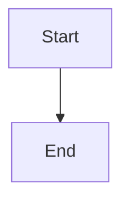

# Cancellation lifecycle and command contract

## Parent Epic

epic_014

## Scope

Define and implement the canonical cancelled lifecycle state and a single cancellation entry point for epics, features, and tasks. Require a non-empty reason, reject completed work, make repeated cancellation idempotent, and persist cancellation metadata before downstream effects. Acceptance must cover backlog and active items plus explicit invalid transitions.

## Data structures

TBD.

## API contracts

TBD.

## Logic flow

## Task breakdown
- task_014_001_003
- task_014_001_002
- task_014_001_001

_(empty — Feature Team mints tasks after dispatch)_

## Risks & upward questions

None.

## Decision log

None yet.

## Closeout

Completed child work: `task_014_001_001` (Add canonical cancelled state and cancellation metadata), `task_014_001_002` (Implement the unified cancellation command contract), `task_014_001_003` (Cover cancellation lifecycle and ordering with acceptance tests).
