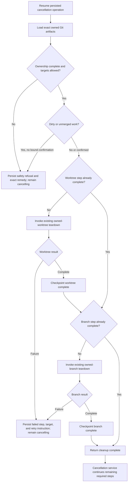

# Safe cancellation cleanup

## Parent Epic

epic_014

## Scope

Connect the shared cancellation service from `feat_014_001` to the existing local worktree/branch teardown path for active work.

The cleanup boundary is the exact artifacts recorded as owned by the cancelled work item. A successful operation removes that owned worktree and local branch, while preserving repository roots, canonical/base/integration branches, remotes, unrelated worktrees/branches/files, and uncommitted work that has not been explicitly approved for discard.

Cleanup participates in the persisted cancellation state machine: completed teardown steps are checkpointed, safety refusals and operational failures leave the item in `cancelling` with actionable details, and retry resumes only incomplete work. This feature does not implement cancellation lifecycle/schema, parent feedback, dispatch gating, recursive cancellation, remote deletion, archive, or restoration.

## Acceptance criteria

- Active cancellation resolves the worktree path and local branch from authoritative ownership metadata and delegates deletion to the established teardown primitive; it does not infer targets with broad globs or naming scans.
- On success, no local worktree or local branch owned by the cancelled item remains.
- Repository roots, canonical/base/integration branches, remote refs, and artifacts owned by other work items are never deletion targets.
- Dirty or unmerged owned work is refused unless explicit discard confirmation is present and bound to the same cancellation operation.
- A safety refusal or teardown failure keeps the item in `cancelling` and returns/persists the failed step, exact target, reason, and a usable retry or confirmation instruction.
- Cleanup checkpoints distinguish already-completed worktree and branch steps so retry is idempotent and does not replay successful deletion.
- An already-absent owned artifact is treated as completed only when ownership/checkpoint evidence makes that result safe; missing or conflicting ownership is surfaced rather than guessed.
- Focused service/integration or API coverage proves owned cleanup, protected/unrelated preservation, dirty-work refusal and confirmed discard, partial failure, and successful retry.

## Data structures

Use the cancellation operation record defined by `feat_014_001`; do not introduce a second cleanup state store.

The operation must retain or expose enough durable state for:

- stable operation ID and target work-item ID;
- exact owned worktree path and local branch resolved from authoritative metadata;
- discard confirmation associated with this operation;
- per-step status for worktree removal and branch removal;
- structured outcome classification: completed, safety refusal, or retryable operational failure;
- failure detail containing the step, exact artifact, reason, and required next action.

Existing teardown result types should be extended or wrapped only as needed to provide structured per-artifact outcomes.

## API contracts

The shared cancellation service invokes cleanup only for active work that owns local Git artifacts. Backlog cancellation and lifecycle validation remain owned by `feat_014_001`.

Cleanup input:

- cancellation operation ID;
- target work-item identity;
- authoritative owned-artifact metadata;
- explicit discard confirmation, when supplied.

Cleanup output/checkpoint:

- per-artifact result for the owned worktree and local branch;
- overall completion state;
- structured safety refusal or retryable failure with exact remedy;
- enough completed-step state for resume without duplicate destructive effects.

The service may transition to `cancelled` only after cleanup reports all required owned artifacts complete and every other epic-required step is complete. This feature must not finalize cancellation independently.

## Logic flow

## Task breakdown

1. `task_014_002_001` — Integrate cancellation with owned-artifact teardown.
   - Wire the shared service to exact ownership lookup and the existing teardown path.
   - Add safety checks, durable per-step outcomes, actionable failure reporting, and retry/resume behavior.
2. `task_014_002_002` — Verify cancellation cleanup safety and retry behavior.
   - Depends on `task_014_002_001`.
   - Add a focused high-signal integration/API matrix, reusing existing teardown coverage where it already proves lower-level behavior.

## Test strategy

Prefer service-level integration or API tests that exercise persistence plus the real teardown boundary. Reuse existing teardown tests and add unit tests only for safety/transition branches that are not economically covered.

Minimum matrix:

- owned clean worktree and branch are removed;
- canonical/base and unrelated artifacts are preserved;
- dirty/unmerged work is refused without confirmation and removed with operation-bound confirmation;
- injected failure between worktree and branch checkpoints leaves actionable `cancelling` state;
- retry skips the completed step, finishes the incomplete step, and leaves no owned artifacts;
- repeated retry after completion has no additional destructive effect.

## Dependencies and sequencing

Implementation depends on the stable cancellation operation/service contract from `feat_014_001` and the existing ownership/teardown primitives. Parent feedback and dispatch gating from `feat_014_003` are not prerequisites for implementing cleanup, but the combined cancellation service must wait for all epic-required steps before finalizing `cancelled`.

## Risks & upward questions

- Ownership metadata may be absent or stale. Fail closed with exact diagnostics; do not reconstruct destructive targets heuristically.
- Existing teardown may return only a single boolean/error. Wrap or minimally extend it to preserve per-artifact progress required for safe retry.
- Platform-specific Git behavior can make low-level tests brittle. Keep the new suite focused on observable service outcomes and safety invariants.

No upward contract change is required.

## Decision log

- `dec_001` · 2026-10-25 · Feature Lead · **Cleanup ownership and retry boundary**
  Chose Resolve only exact locally owned worktree and branch targets from authoritative metadata, use the existing teardown primitive, and checkpoint each artifact step on the shared cancellation operation..
  Rationale: This fails closed when ownership is uncertain, protects canonical and unrelated work, and makes interruption between worktree and branch removal safely resumable without creating a second state machine.
  Honors: Epic Git-safety, durable-checkpoint, idempotent-retry, and no-dangling-owned-artifact requirements..

- `dec_002` · 2026-10-25 · Feature Lead · **Verification scope**
  Chose Use a focused service/integration or API matrix and reuse existing teardown coverage; add lower-level unit tests only where a safety branch is not economically covered..
  Rationale: The highest-value evidence is observable cleanup, preservation, refusal, partial-failure, and retry behavior across the persistence/teardown boundary; duplicating teardown internals would add maintenance cost without proportional confidence.
  Honors: Epic end-to-end coverage requirements and the frugal-engineering testing policy..

## Closeout

Completed child work: `task_014_002_001` (Integrate cancellation with owned-artifact teardown), `task_014_002_002` (Verify cancellation cleanup safety and retry behavior).
