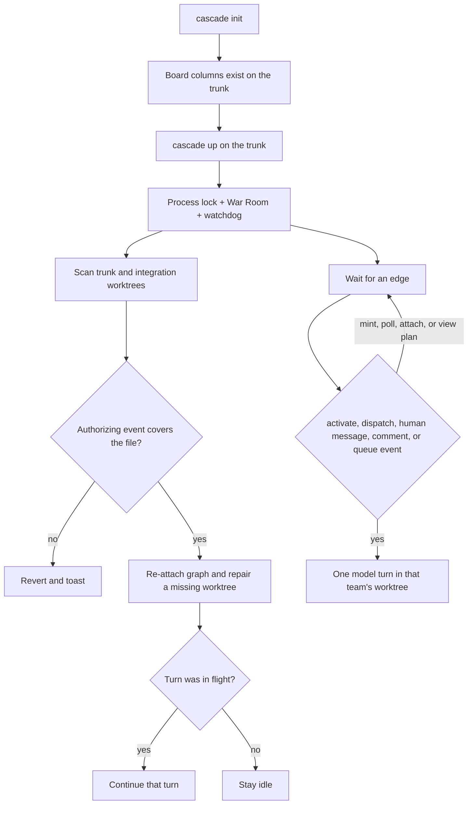
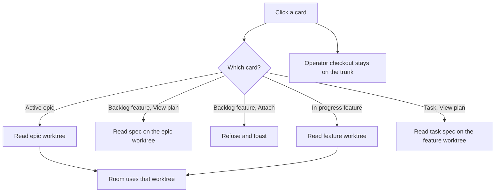

# Workspace contract and agent kickoff

## Parent Epic

[epic_001](../../epics/2_active/epic_001_functional_mvp.md) — Functional MVP.

Constraints this feature must honor:

- **Dispatch law** (epic constraint 3). Human activates an epic. Human or Boss dispatches a feature or a task. Epic Team and Feature Team still cannot move a child into `2_active`.
- **Local only.** UI stays on `127.0.0.1`. No remote runtime, no cloud checkpointer.
- **Filesystem is truth.** Each team's board is the `docs/` tree in that team's integration worktree. The supervisor's combined board is a view over those trees. This feature does not add a second status store.
- **One workspace, one repo.** A Cascade process supervises a single git root. Cross-repo orchestration (one supervisor, many repos) stays out.
- **Models fail closed** (feat_010). Boot resolves a model id or does not start the role. Missing `cascade.toml` models do not become `auto`.
- **`CURSOR_API_KEY` is environment only** (epic constraint 12 / feat_009). The key is never written into the workspace, `cascade.toml`, or a plan.
- **Boss is order-driven** (feat_008). Seeing ready work is not an order. The Boss does not auto-dispatch.
- Planning agents still do not read `cascade.toml` to self-start.

## Scope

**In**

- An operator contract for Cascade as a tool pointed at a git workspace, including this repo (dogfood) and any other local git repo.
- Two commands, one root:
  - `init` scaffolds a board in the target repo and does not start agents.
  - `up` starts the War Room and the watchdog together against that root.
- A kickoff rule: a model turn starts only on an authorized edge (table below). Minting a file, leaving it in backlog, opening the board, and a watchdog poll with no new edge do not start a model.
- Resume: `up` re-attaches graphs whose docs are already legally in `2_active`, and recreates a missing integration worktree from its branch. It does not write a new dispatch event and does not start backlog files.
- Stacked integration lines: product trunk, then `epic/{id}`, then `feat/{id}`, then `task/{id}`.
- War Room wiring: a click attaches to the worktree created at dispatch. It does not check out a branch in the operator's directory.
- A supervisor flight report: which features and tasks are in flight, which paths they are changing, and which of those paths overlap.
- The same rules recorded in DESIGN.md so the contract is not only this feature file.

**Out**

- One supervisor driving several repos, or a task whose worktree is a different repo from the board.
- Hosted UI, remote git, or publishing a release.
- Changing who may activate or dispatch.
- Boss auto-drain of ready features or tasks.
- Copying the `cascade` package source into the target repo.
- An LLM pass that guesses conflicts. Overlap is a git path intersection.
- Auto-merge, auto-rebase, or stopping a team because two branches touch the same path.
- Checking out `epic/*`, `feat/*`, or `task/*` in the operator's directory.

## Workspace

Cascade is a Python tool. The **workspace** is the git repo it supervises.

| Lives in the tool | Lives in the workspace |
|---|---|
| `cascade` package, War Room static assets | `docs/` board, plans, comments, queues |
| | `cascade.toml` (optional; models fail closed when a role boots without one) |
| | `.cascade/` checkpointers, worktrees, locks (gitignored) |
| | in-repo `SKILL.md` paths, task branches |

Dogfood is the case where the tool checkout and the workspace are the same directory. A foreign repo is the case where they differ: install or run Cascade from its checkout, and pass the other repo as the root.

```text
cascade init [--root PATH]     # default PATH = cwd
cascade up   [--root PATH] [--host 127.0.0.1] [--port 8765]
```

`init` requires a git repo. It creates missing `docs/{epics,features,tasks}/{1_backlog,2_active,3_completed}` directories, writes `cascade.toml` only when that file is absent (parallelism default 4; model keys present and blank so boot fails closed until the operator fills them), and ensures `.cascade/` is gitignored. It does not overwrite existing plans, activate an epic, or start a process.

`up` requires a git repo that already has the board layout (`init` first). The checkout at `--root` must be the product trunk. `up` refuses any other branch. It binds the War Room and the watchdog to that root, takes the existing process lock, and refuses a second `up` on that root. Starting `up` is not a dispatch. It does not check out `epic/*`, `feat/*`, or `task/*` in `--root`.

## Credentials

The backend token is **`CURSOR_API_KEY` in the environment of the `up` process**. It is not per-project. It is not read from `.netrc`, `cascade.toml`, a plan file, a dotenv file in the workspace, or Cursor user settings (`setting_sources` stays empty). The adapter passes that value into the SDK and does not fall back to another source.

One supervisor process has one key, shared by every role in that workspace. Two workspaces use different keys only when their `up` processes were started with different environments. `init` must not write a key into the repo. A missing or blank key fails the model turn before launch and does not retry.

## Branches

Work stacks on four lines. Each line is the merge parent of the one below it. A team's live board is that team's worktree, not the operator's checkout.

```text
main                         product trunk (or the repo's other trunk branch)
  └── epic/{id}              epic trunk: expanded plan, minted feature specs
        └── feat/{id}        one feature, merged back as one unit
              └── task/{id}  parallel task branches, merged into the feature
```

The **product trunk** is `main` when that branch exists. Otherwise it is the single local branch that is not `epic/*`, `feat/*`, or `task/*` and is an ancestor of every other such branch. If no unique trunk can be named, `up` and `activate_epic` refuse.

The human brief is a commit on the trunk before `activate_epic`. Activation cuts `epic/{id}` from that commit and adds `.cascade/worktrees/epic_{id}`. The trunk copy of the epic becomes a pointer to `epic/{id}` and is not edited again. Plan edits, decision-log entries, and minted feature specs commit on the epic worktree.

`dispatch_feature` cuts `feat/{id}` from the epic branch's current spec commit and adds `.cascade/worktrees/feat_{id}`. The feature team plans there. The feature merges back into `epic/{id}` once, when its tasks are done. That merge is the self-contained feature. It does not target the trunk.

`dispatch_task` cuts `task/{id}` from the feature branch and adds `.cascade/worktrees/task_{id}`. The SWE commits code only on that branch. A human merge lands the task into `feat/{id}`. Task branches stay parallel: the cap and `depends_on` apply to merges into the feature branch. A task is complete when it is merged there. A feature is complete when `feat/{id}` is merged into `epic/{id}`. The epic reaches the trunk when the human promotes `epic/{id}`.

Specs stay on the branch of the team that owns them. The epic doc lives on `epic/{id}`. The feature spec and task specs live on `feat/{id}`. A task branch does not edit `docs/epics` or `docs/features`. An amendment is applied on the epic worktree. The feature stays blocked until that commit is on `epic/{id}`, then merges the epic branch and updates `parent_rev`. A feature pins `parent_rev` to a SHA on `epic/{id}`. A task pins `parent_rev` to a SHA on `feat/{id}`.

Comments and queues live in the worktree of the team that owns them. The supervisor is the only writer that appends a queue event into another team's worktree. `cascade.toml` is read from the trunk checkout. A child worktree's copy does not change process settings.

Two epics in parallel are two epic worktrees. They meet when each is promoted to the trunk.

## War Room

A click does not create a worktree and does not change the branch of `--root`. Worktrees are created at activate or dispatch. The room reads the worktree that already belongs to that team.

| Click | Worktree | What the room does |
|---|---|---|
| Attach on an active epic | `.cascade/worktrees/epic_{id}`, created at `activate_epic` | Epic room. Doc, comments, and chat come from that worktree |
| View plan on a backlog feature | The parent epic worktree | Read-only spec as minted. No feature worktree exists yet |
| Attach on a backlog feature | none | Refused. Toast: dispatch the feature to open its room |
| Attach on an in-progress feature | `.cascade/worktrees/feat_{id}`, created at `dispatch_feature` | Feature room. Doc, comments, chat, and task cards come from that worktree |
| View plan on an in-progress feature or its tasks | The feature worktree | Live spec, not the branch-point copy still on the epic branch |
| A task row | The feature worktree for the spec. The task worktree is the SWE checkout | No room. View plan opens the task spec |

The home board is a view assembled by the supervisor: backlog epics from the trunk, an active epic's feature cards from the epic worktree, and an in-flight feature's status and tasks from the feature worktree. Selecting an epic or a feature still lenses the board. The lens reads those worktrees. It does not check one of them out in `--root`.

If a branch exists and its worktree directory is missing, the next attach or `up` recreates the worktree at the same path from that branch. That repair is not a dispatch and does not move the operator's checkout.

## Flight

The supervisor keeps a deterministic picture of in-flight work and refreshes it on each watchdog poll. It does not ask a model whether two teams will collide.

For each in-flight feature and task it records the branch, the worktree path, the SHA it was cut from, and the paths `git diff` reports against that parent. Overlap is the intersection of those paths between two in-flight features, or between a feature and commits that landed on `epic/{id}` after the feature was cut. The War Room epic home shows which features are in flight, the paths each one is changing, and any overlap. A new overlap toasts the epic room.

The report does not merge, rebase, or block dispatch. The human or the Boss decides whether to sequence the work. The Boss may read the report. Seeing an overlap is not an order.

## Kickoff

## Kickoff

**Boot** attaches a graph: resolve models, open the local checkpointer, load role context. Boot is not by itself a model call.

**A model turn** is the only thing that "kicks an agent off." It runs only for a reason in this table.

| Edge | Who | What runs |
|---|---|---|
| `activate_epic` | human | Cut `epic/{id}` from the trunk if needed, add the epic worktree, then boot the epic graph and one opening turn. Refuses unless the brief is on the trunk |
| `dispatch_feature` | human or Boss | Cut `feat/{id}` from the epic branch, add the feature worktree, then boot the feature graph and one opening turn |
| `dispatch_task` | human or Boss, deps merged into the parent feature branch, under cap | Cut `task/{id}` from the feature branch, add the task worktree, then the implementation turn |
| Human chat or comment on a live epic or feature | human | One turn of that team only |
| Queue event that team must answer (amendment, failure notice, and the existing typed events) | watchdog delivers | One turn of the owning graph |
| `up` while a doc is legally in `2_active` | supervisor resume | Re-attach from the checkpointer. Recreate a missing worktree from its branch. Continue an in-flight turn if one was interrupted. If the graph is idle, leave it idle |
| `dispatch_task` on a `blocked` task | human or Boss | New implementation turn (this is a new order, not a silent retry) |

These do **not** start a model turn:

- `mint_feature` or `mint_task` (the file stays in `1_backlog`)
- A backlog file, including `status: ready_to_plan`, with no activate or dispatch
- Opening or refreshing the War Room, including Attach and View plan
- A watchdog poll that finds nothing new, including a flight-report refresh
- The Boss noticing ready work without an order
- Comments or chat aimed at a task (tasks have no room)

The opening turn after `activate_epic` or `dispatch_feature` may do that team's job (read the doc, mint children into backlog, lock decisions). It may not dispatch. The SWE opening turn implements the task. No tier wakes on a timer.

## Data structures

No new work-object frontmatter.

```text
WorkspaceRoot
  path: git repo root passed to init/up, else cwd   # must be the product trunk
  trunk: branch name
  board: path / "docs"                              # trunk board: backlog epics and pointers
  config: path / "cascade.toml"                     # read here, not from child worktrees
  runtime: path / ".cascade"                        # checkpointers, worktrees; gitignored

IntegrationWorktree
  kind: epic | feature | task
  work_id: str
  branch: epic/{id} | feat/{id} | task/{id}
  path: .cascade/worktrees/{kind}_{id}
  base_sha: str          # commit the branch was cut from

FlightReport
  epics: [IntegrationWorktree]
  features: [IntegrationWorktree]
  tasks: [IntegrationWorktree]
  changed_paths: { work_id: [repo-relative path] }
  overlaps: [{ paths, work_ids }]

KickoffReason
  kind: activate | dispatch | human_message | comment | queue_event | resume_inflight
  work_id: str
  by: human | boss | watchdog
```

No new work-object frontmatter except the trunk pointer on an activated epic (branch name and worktree path). Child status stays folder membership inside that team's worktree.

Supervisor start walks trunk `docs/epics` and each integration worktree's `docs/*/2_active/*.md`. A doc is **legally active** when the existing dispatch authorization still holds. Unauthorized `2_active` files keep today's behavior: revert toward backlog and toast. Legal ones re-attach. A missing worktree for a live branch is recreated. None of them get a fresh `FeatureReadyToPlan` or `TaskDispatched`.

## API contracts

```text
init_workspace(root) -> WorkspaceRoot
    git repo required
    create missing board columns
    write cascade.toml only if absent
    gitignore .cascade/ if that line is absent
    do not start agents

up(root, host="127.0.0.1", port=8765) -> None
    git repo with board layout required
    --root must be checked out on the product trunk
    one process lock per root
    serve War Room on loopback and run the watchdog on the same root
    resume legally active graphs; recreate missing worktrees
    do not dispatch
    do not checkout epic/*, feat/*, or task/* in --root

resolve_doc_worktree(work_id) -> Path
    task spec -> its parent feature worktree
    feature with a worktree -> that worktree
    feature without a worktree -> parent epic worktree
    active epic -> epic worktree
    backlog epic -> trunk
    View plan and Attach use this path

flight_report(root) -> FlightReport
    git diff --name-only of each in-flight branch against its base
    overlaps are path intersections
    no model call

GET /api/flight
    the current FlightReport for the War Room epic home

kickoff_turn(reason: KickoffReason) -> None
    the only path to a roster model call
    model resolution failure toasts and does not call the model
```

Existing `activate_epic`, `dispatch_feature`, and `dispatch_task` stay the authority gates. Each successful call creates the integration worktree when it is missing, then boots. `up` and Attach must not call them. Attach on a backlog feature returns an error and does not create a worktree. Merge targets are task → `feat/{id}`, feature → `epic/{id}`, epic → trunk.

## Logic flow





## Task breakdown

*(minted when this Feature is dispatched)*

| ID | Purpose | Depends on |
|---|---|---|
| task_063 | `init_workspace` / `cascade init` for a foreign git root | — |
| task_064 | `cascade up` on the product trunk: War Room and watchdog, one lock, no branch switch | task_063 |
| task_065 | Integration worktrees at activate and dispatch; resume recreates a missing worktree without a new dispatch | task_064 |
| task_066 | Kickoff turns only on the authorized edges; tests that mint, backlog, idle polls, Attach, and View plan do not call the model | task_064 |
| task_067 | War Room attach and View plan read `resolve_doc_worktree`; Attach on a backlog feature is refused | task_065 |
| task_068 | Flight report and epic-home overlap toast; no merge and no model call | task_065 |
| task_069 | Merge targets: task into `feat/{id}`, feature into `epic/{id}`, epic into the trunk on human promote | task_065 |
| task_070 | Record this contract in DESIGN.md | task_066, task_067, task_068, task_069 |

## Risks & upward questions

1. **Opening turn vs silence.** A fresh epic or feature dispatch runs one opening turn so the team does not sit mute until the human types. That turn must still refuse `dispatch_*`. If dogfooding shows the opening turn mints unwanted children, narrow it to "read the doc and wait" with an amendment; do not add a timer.
2. **War Room today does not start the watchdog.** `python -m cascade.war_room` is HTTP only. `up` is the contract entry. Leaving the old module as a read-only server is fine; documenting two processes the operator must remember is not.
3. **Blank model template.** `init` writes model keys empty so the first boot fails closed with a clear toast. It must not invent `auto` or copy this repo's model ids into a foreign workspace.
4. **Resume vs re-dispatch.** An idle active epic stays idle across `up`. A blocked task stays blocked until a new human or Boss `dispatch_task`. Resume continues an interrupted turn; it does not spend a new order.
5. **Skills in the workspace.** Role and task `SKILL.md` paths resolve inside the worktree the role is running in, which was cut from the parent branch. They do not resolve against the tool checkout when that checkout is a different directory.
6. **No project token file.** Operators will look for a per-repo key or a `.netrc` entry. The contract refuses both. `up` fails the first model turn with a missing-`CURSOR_API_KEY` error rather than searching the workspace.
7. **Click feels like a checkout.** Attach and View plan on an in-progress feature open the feature worktree that dispatch already created. They leave `--root` on the trunk. A missing directory is repaired from the existing branch. Attach on a backlog feature does not create `feat/{id}`.
8. **Stale spec on the parent branch.** The epic worktree keeps the feature file from mint time. After dispatch, View plan and the feature room read the feature worktree. The epic room learns feature status from the queue and the flight report.
9. **Overlap is not a verdict.** The flight report lists intersecting paths. It does not decide which team should rebase, and it does not stop dispatch.

## Decision log

- 2026-10-14 — DESIGN.md §9.4 synced to implemented workspace contract (task_070).
