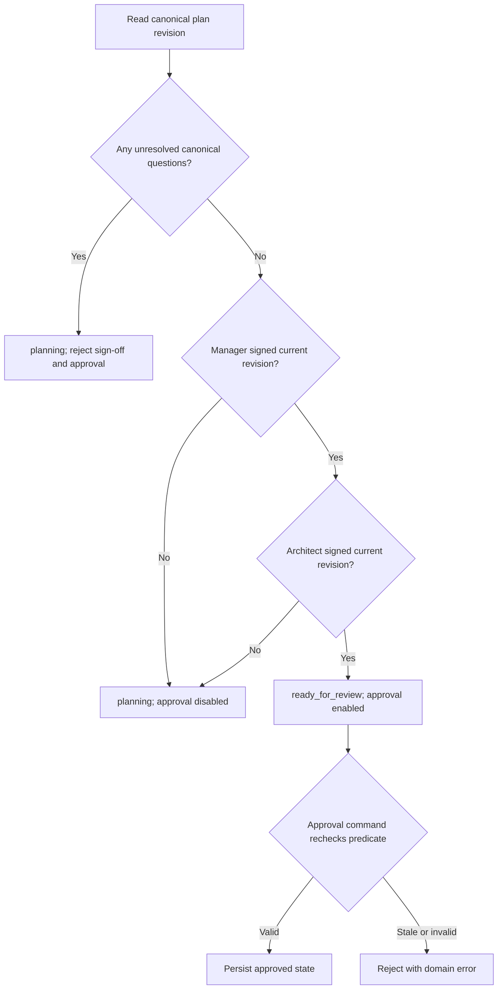

# Authoritative epic-plan readiness and approval gate

## Parent Epic

epic_015

## Objective

Make epic-plan approval impossible until both required planning roles have signed the current canonical plan revision and no canonical open question remains unresolved.

## Scope

- Persist independent Epic Manager and Epic Architect sign-offs against the canonical plan revision.
- Provide a role-authorized sign-off command for the current revision.
- Compute `planning` versus `ready_for_review` from current-revision sign-offs and canonical unresolved-question state.
- Enforce that same readiness predicate in the plan-approval command.
- Surface readiness, current valid sign-offs, approval capability, and a stable disabled reason through the existing read model.
- Preserve already-approved epics; active unapproved epics begin without valid sign-offs.

## Acceptance criteria

- A newly activated epic cannot be approved.
- One role's sign-off is insufficient.
- Either sign-off is rejected while unresolved canonical questions exist.
- Each required role can sign only for itself and only against the current canonical revision.
- Repeating the same role/revision sign-off is idempotent.
- Both roles signing the current revision with no unresolved questions permits approval.
- A material plan revision makes older sign-offs insufficient without requiring destructive cleanup.
- Direct and stale-client sign-off or approval attempts are rejected using existing domain error conventions.
- Read-model readiness and approval capability always agree with command behavior.
- Existing approved records remain approved.

## Data structures

Introduce the smallest persistent representation that records:

- epic identity;
- planning role (`epic_manager` or `epic_architect`);
- canonical plan revision identifier;
- sign-off timestamp and any existing audit identity required by repository conventions.

Enforce one effective sign-off per epic, role, and revision. Historical records may remain stored, but only records matching the current canonical revision count toward readiness. Migration or hydration defaults active, unapproved epics to no valid sign-offs and must not demote already-approved epics.

## API contracts

### Sign off the current plan

The existing command/API layer receives the target epic, caller identity/role, and the client's expected canonical plan revision.

It must:

1. authorize only `epic_manager` and `epic_architect`, each signing for its own role;
2. reject an expected revision that no longer matches the canonical revision;
3. reject while any canonical open question is unresolved;
4. idempotently persist the caller role's sign-off for the current revision;
5. return state consistent with the existing command response conventions.

Failures use established domain error mapping for unauthorized role, unresolved questions, stale revision, and invalid lifecycle state.

### Approve the plan

The existing approval command must evaluate the authoritative readiness predicate inside the mutation boundary. A client-provided readiness value is never trusted. Approval is allowed only when the epic is unapproved, has both required current-revision sign-offs, and has no unresolved canonical questions.

### Existing read model

Extend the current epic planning projection with:

- planning status: `planning` or `ready_for_review`;
- valid sign-offs for the current revision, by required role;
- `can_approve_plan`;
- a stable disabled reason when approval is unavailable.

The read model and both commands must derive from the same domain predicate rather than duplicate business rules.

## Logic flow

A material canonical plan revision changes the revision identifier; prior sign-offs cease to satisfy the predicate automatically.

## Task breakdown

1. `task_015_001_001` — Persist revision-bound epic planning sign-offs.
2. `task_015_001_002` — Implement role-authorized epic-plan sign-off command. Depends on task 001.
3. `task_015_001_003` — Gate plan approval and expose authoritative readiness. Depends on task 002.
4. `task_015_001_004` — Verify activation-to-approval planning flow. Depends on task 003.

## Verification

Use a compact transition table spanning activation, zero/one/two sign-offs, unresolved questions, revision changes, direct or stale-client attempts, and existing approved records. Cover the end-to-end activation-to-approval path with one integration/API flow that asserts command outcomes and the public read model. Add focused persistence/domain tests only for migration compatibility, uniqueness/idempotency, and revision binding where the integration flow cannot cover them economically.

## Out of scope

- New planning roles or configurable quorum rules.
- Redesigning canonical question storage or plan revision generation.
- Deleting historical sign-offs when a plan changes.
- A new approval UI or notification workflow.
- Retrofitting sign-offs onto already-approved epics.

## Risks & upward questions

None. The implementation should reuse the repository's canonical revision source, unresolved-question source, authorization mechanism, transaction boundary, and domain error conventions.

## Decision log

Decisions are recorded through Cascade's decision log.

- `dec_001` · 2026-10-23 · Feature Lead · **Readiness predicate**
  Chose Use one authoritative predicate requiring both required roles' sign-offs for the current canonical revision and zero unresolved canonical questions..
  Rationale: Keeping status, read-model capability, sign-off behavior, and approval enforcement on one rule prevents stale-client and projection drift.
  Honors: Feature acceptance criteria for two-role current-revision readiness and approval gating..

- `dec_002` · 2026-10-23 · Feature Lead · **Revision handling**
  Chose Retain historical sign-off records but count only sign-offs matching the current canonical revision..
  Rationale: Revision binding invalidates stale approval evidence without destructive cleanup or extra lifecycle machinery.
  Honors: The requirement that material revisions make prior sign-offs insufficient while keeping persistence changes small..

- `dec_003` · 2026-10-23 · Feature Lead · **Verification strategy**
  Chose Use one transition-driven integration/API flow plus only focused persistence tests for compatibility, idempotency, and revision binding..
  Rationale: This covers the user-visible invariant with high signal while avoiding redundant selector-level tests.
  Honors: The feature verification contract and frugal-engineering guidance..

## Closeout

Completed child work: `task_015_001_001` (Persist revision-bound epic planning sign-offs), `task_015_001_002` (Implement role-authorized epic-plan sign-off command), `task_015_001_003` (Gate plan approval and expose authoritative readiness), `task_015_001_004` (Verify activation-to-approval planning flow).
