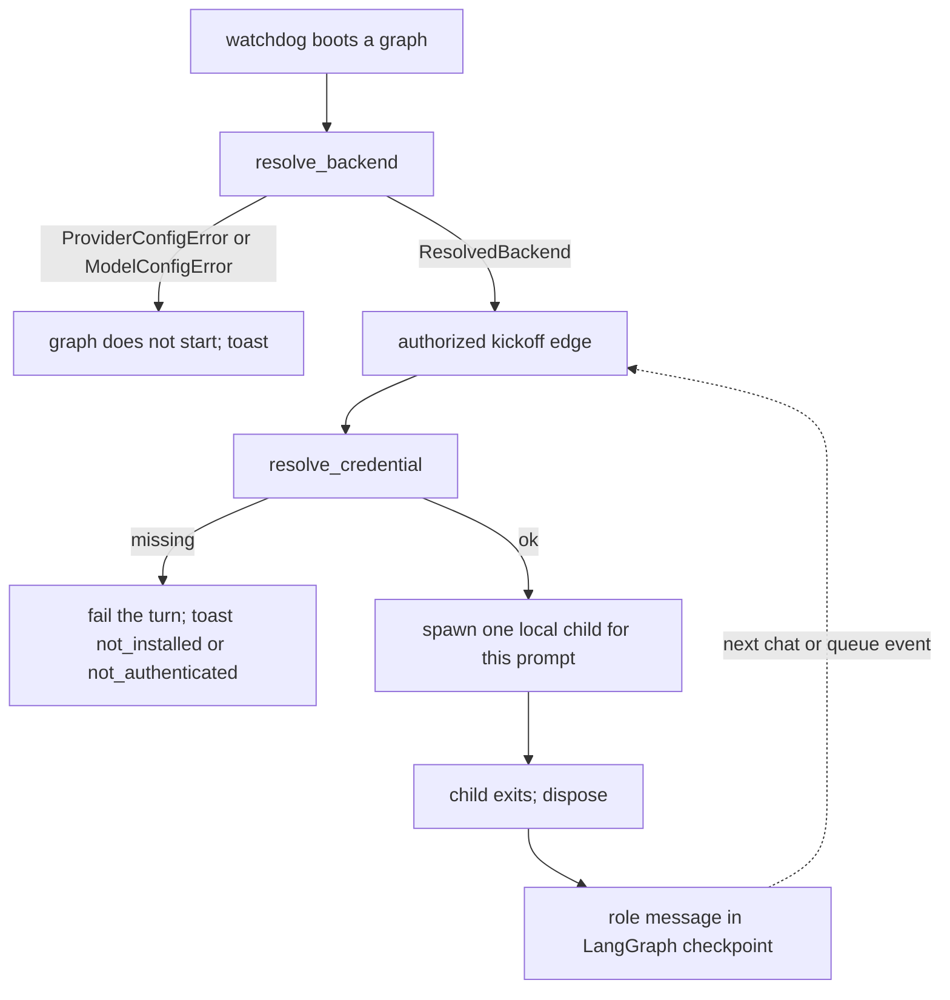

# Provider backends and credentials

## Parent Epic

[epic_001](../../epics/2_active/epic_001_functional_mvp.md) — Functional MVP.

Constraints this feature must honor:

- **Local only** (epic constraint 1 / DESIGN.md §2). The War Room stays on `127.0.0.1`. LangGraph checkpointers stay local. A provider backend is a local process on this machine. Cloud agent VMs, remote checkpointers, and remote brokers stay forbidden.
- **Dispatch law** is unchanged. A provider setting does not make a document dispatchable.
- **Filesystem is truth.** Provider choice lives in trunk `cascade.toml` and optional document frontmatter. Credentials do not live on the board.
- **Models fail closed** (feat_010). Boot still resolves a concrete model id. Blank config does not become `auto`. A feature does not inherit its epic's provider or model.
- **One-shot turns** (feat_009). Dispose the backend at the end of the turn. The LangGraph checkpointer is the durable memory. A provider conversation is not a second board.
- **Kickoff gates** (feat_014) still decide when a model turn runs. This feature changes *which local backend* runs, not *when*.
- **No new roster node.** Reviewer philosophy stays a SWE skill (feat_013). This feature does not add `code_reviewer` to the graph.
- Planning agents still do not read `cascade.toml` to self-start.

## Operating model

Cascade already has a supervisor. This feature does not add a second one.

The only long-lived process is `cascade up` (War Room + watchdog + LangGraph). The operator does **not** open tmux, does **not** leave `claude` / `codex` / Cursor running, and does **not** hand an epic to a cloud agent. A provider binary is a **child process of one turn**. It starts when that turn is authorized, does the work, and exits before `run_role` returns.

```text
operator:  cascade up
                 │
                 │  authorized kickoff (chat, dispatch, queue, …)
                 ▼
           LangGraph role node
                 │  builds ONE prompt from local state
                 │  (plan, comments, queue, skills — not a vendor thread)
                 ▼
           run_role
                 │
                 ├── cursor:  SDK Agent.prompt(...) in-process, then dispose
                 ├── claude:  subprocess `claude -p` / print mode, then wait + exit
                 └── codex:   subprocess `codex exec` / non-interactive, then wait + exit
                 │
                 ▼
           RoleResult.text → LangGraph checkpoint
           child is gone
```

**What the model sees.** One Cascade turn is one assembled prompt plus whatever tool-call roundtrips happen *inside that child*. The next human message or queue event is a **new** child and a **new** prompt, rebuilt from the local checkpoint. Cascade does not create a vendor conversation id, does not resume one, and does not upload the War Room transcript or the LangGraph checkpoint as a hosted thread.

**What may go to the network.** Inference weights. The child may call Cursor / Anthropic / OpenAI so the model can think. Tool execution, git, the board, and memory stay on this machine. That is the same split feat_009 already uses (`LocalAgentOptions`, `cloud=None`).

**What "CLI session" means.** Auth only. If the operator once ran `claude login` (or pasted a token in the War Room), later child processes can use those credentials. It is not a running agent and not a tmux window Cascade attaches to.

**Not this feature**

| Idea | Why not |
|---|---|
| Send the whole epic/feature chat to a cloud agent and let it persist | Hosted session dies; memory would fork from the checkpointer |
| `tmux new -s epic_001` + interactive `claude` / `codex` | Operator-driven TTY; Cascade cannot guard tools or dispose the turn |
| A daemon per epic/feature that stays warm | Second lifetime beside LangGraph; feat_009 rejected this |
| Cursor / Codex / Claude cloud VMs | Remote agent runtime; epic constraint 1 |

The operator's job is: run `cascade up`, optionally sign in once (War Room token or a one-time CLI login). Cascade launches and reaps every agent process.

## Scope

**In**

- A provider registry with three backends: `cursor`, `claude`, `codex`.
- **Use if installed.** Cascade does not install Cursor, Claude Code, or Codex. The Cursor backend is the existing `cursor-sdk` (already a Cascade dependency). The Claude and Codex backends are their CLIs, used only when that binary is on `PATH`.
- Per-provider project defaults for epic, feature, and task agents (optional boss; optional per-role map). Same resolution order as feat_010, scoped to the resolved provider.
- Optional document frontmatter `provider:` (and the existing `model` / `models` keys). One provider per work document. Role-level provider mixing is out.
- A credential resolver the adapter uses on every turn: process environment, then the user-level store, then an already-logged-in CLI session. Never `.netrc`, never the workspace, never `cascade.toml`.
- War Room **Providers** pane: status (installed / signed in / source) and login by pasting a token. Forget removes the user-store entry only.
- Refactor `run_role` so graphs keep calling one function. Graphs pass the resolved provider and model; they do not import a CLI.

**Out**

- Installing, downloading, or vendoring `claude`, `codex`, or the Cursor CLI.
- Remote / cloud agent runtimes (Cursor cloud VMs, hosted Codex/Claude sessions, any broker that owns the agent for longer than one Cascade turn).
- Writing tokens to `.netrc`, dotenv, `cascade.toml`, plans, or anything under the workspace root.
- Interactive TTY login spawned from the browser (`claude login` in a terminal is the operator's job; Cascade detects the resulting CLI session).
- A model catalog checked into the repo.
- A new `code_reviewer` (or other) LangGraph roster node.
- Per-comment or mid-turn provider switching.
- Changing dispatch law, kickoff edges, or stacked branches.

## Locked calls

These are epic-level choices (`epic_001` `dec_019`). The Feature Team implements them; it does not reopen them without an amendment.

1. **Local child, remote weights.** A token or CLI login authenticates inference. Cascade starts a local child for one `run_role` against `turn.cwd`, then reaps it. That is what Cascade already does with `cursor-sdk` + `LocalAgentOptions`. It is not a hosted VM, not a vendor thread, and not a tmux session.
2. **No remote agent runtime.** An epic or feature lives for days. Provider cloud agents do not. Durable memory is the LangGraph checkpointer and the markdown board. feat_009 already rejected a durable Cursor agent beside that checkpointer. A Codex or Claude cloud session would fork the same way, then vanish. Rejected.
3. **Do not install CLIs.** Missing `claude` or `codex` is a status of `not_installed`, not an installer prompt. The Cursor SDK remaining a Python dependency is unchanged.
4. **Login is in-app and user-scoped.** The operator should not have to edit `.netrc` or export a key before every `up`. Environment variables still win (CI / headless). The War Room can store a token under `~/.cascade/credentials` (mode `0600`). An existing CLI login is enough; Cascade must not require a second paste in that case.
5. **Defaults are per provider, not provider-agnostic ids.** `composer-2.5` is a Cursor id. `gpt-5-codex` is a Codex id. One flat `[models]` table cannot name both honestly. Each provider table has its own epic / feature / task / optional boss / optional roles map.
6. **Reviewer is not a new role.** feat_013 loads the code-reviewer playbook on SWE. Operators who want a different SWE model set that provider's `task` key or `roles.swe`. A later dedicated reviewer turn needs an epic amendment.

## Data structures

```text
ProviderId = cursor | claude | codex

AuthSource = env | user-store | cli-session | missing

ProviderStatus
  id: ProviderId
  installed: bool
  authenticated: bool
  auth_source: AuthSource
  # installed:
  #   cursor  → cursor-sdk importable (true if Cascade itself is installed)
  #   claude  → `claude` on PATH
  #   codex   → `codex` on PATH

ResolvedBackend
  provider: ProviderId
  provider_source: document | project-default
  model: ResolvedModel          # existing feat_010 type; resolution uses that provider's table
```

Project file, new shape (trunk `cascade.toml` only):

```toml
[providers]
default = "cursor"

[providers.cursor]
epic = "claude-opus-5-5"
feature = "claude-sonnet-5-5"
task = "composer-2.5"
# boss = "..."
# [providers.cursor.roles]
# epic_architect = "..."

[providers.claude]
epic = "claude-opus-4-6"
feature = "claude-sonnet-4-6"
task = "claude-sonnet-4-6"

[providers.codex]
epic = "gpt-5"
feature = "gpt-5"
task = "gpt-5-codex"
```

The strings above are shape examples, not mandated ids. An absent provider table is legal on disk. Boot of a graph that needs that provider fails closed.

**Legacy:** if `[providers]` is absent, today's `[models]` table is the `cursor` table and the default provider is `cursor`. If both `[providers]` and `[models]` are present, that is `ConfigError` — one source of truth.

`init` writes the new shape: `default = "cursor"` and blank epic/feature/task keys under each of the three provider tables, so boot still fails closed until the operator fills the default provider's models.

Document frontmatter (optional; existing keys unchanged):

```yaml
provider: claude
model: claude-opus-4-6
models:
  epic_architect: claude-sonnet-4-6
```

`provider` must be a known `ProviderId` or validation fails. A blank string is illegal. Omitted means "use the project default provider." The document override does not leak to children.

```text
RoleTurn                  # extends feat_009
  provider: ProviderId    # required; caller-supplied (boot resolved it)
  role, model_id, prompt, cwd, tools   # unchanged

Credential
  provider: ProviderId
  token: str              # never logged, never returned by GET

# User-level store. Not in the workspace. Mode 0600.
# Path: ~/.cascade/credentials
# Shape is an implementation detail; readers must not treat a missing file as a workspace defect.
```

Auth resolution for a turn, first match wins:

1. Process environment for that provider (`CURSOR_API_KEY`, `ANTHROPIC_API_KEY`, `OPENAI_API_KEY`).
2. User-level store token for that provider.
3. Existing CLI **login** on this machine (Claude / Codex already authenticated). This is a credential file the vendor CLI already wrote — not a running process. Cursor has no CLI-session source in v1; it needs (1) or (2).
4. Else fail the turn before launch. Not retryable. Toast names the provider and the missing piece (`not_installed` vs `not_authenticated`).

Do not read `.netrc`, workspace dotenv, Cursor `setting_sources`, or `cascade.toml` for secrets.

## API contracts

```text
probe_providers() -> [ProviderStatus]
    no secrets in the result

resolve_backend(role, doc | None, *, root) -> ResolvedBackend
    1. doc.provider if set          -> provider_source = document
    2. cascade.toml [providers].default
       or implicit cursor from legacy [models]
                                    -> provider_source = project-default
    3. resolve_model(role, doc, root, provider=that)
       against that provider's table only
    else ModelConfigError / ProviderConfigError

resolve_credential(provider) -> Credential | None
    env → user-store → cli-session
    None is a failed turn, not a fallback to another provider

run_role(turn: RoleTurn) -> RoleResult
    reject blank provider or model_id
    reject cloud / remote runtime options
    require probe(provider).installed
    require resolve_credential(provider)
    dispatch to that backend
    dispose before return
    do not substitute a different provider or model

GET  /api/providers
    { default, providers: [ProviderStatus] }

POST /api/providers/{id}/token
    body { token: str }
    write user-level store (0600); never the workspace
    4xx on unknown id or blank token

POST /api/providers/{id}/forget
    delete that provider's user-store entry only
    does not unset the process environment
    does not log the CLI out
```

`run_role` remains the only graph entry. Epic, feature, task, and boss boot call `resolve_backend` and put both ids plus their sources in the role prompt (same visibility as feat_010).

Claude and Codex adapters:

- Cascade-spawned subprocess in **print / exec / non-interactive** mode. `cwd = turn.cwd`. stdin is the turn prompt (or the CLI's equivalent flag). stdout is the result. The process exits before `run_role` returns. No TTY, no tmux, no attach.
- Planning / boss turns still receive only Cascade's guarded tools (MCP config in the scratch cwd, or the CLI's equivalent). SWE turns still use the task worktree; commits still go through Cascade git tools.
- If a CLI cannot host those tools, `run_role` fails closed with a typed error. Do not silently run a tool-less planning turn.
- Exact CLI argv is an implementation task. The contract is: local child, one assembled prompt, tool-faithful, dispose-on-return. Interactive `claude` / `codex` TUI invocations are a programming error.

War Room **Providers** pane (localhost chrome on the existing War Room, not a new origin):

- Lists the three providers with installed / signed-in / auth source.
- Token field + save + forget. GET never echoes a token.
- If `installed` is false, the pane says the CLI is missing and does not offer to install it.
- If a CLI **login** is already present on the machine, show `auth_source: cli-session` and do not demand a token. That status is "credentials exist," not "an agent is running."
- Does not edit `cascade.toml`. Operators still set default provider and model ids in the file.

## Logic flow



## Task breakdown

Tasks completed under [`docs/tasks/3_completed/`](../../tasks/3_completed/). Depends on: feat_009, feat_010, feat_014 completed.

- **[task_071](../../tasks/3_completed/task_071_provider_registry_probes.md)** — Provider registry, `ProviderId` / `ProviderStatus`, PATH and SDK probes, typed errors. Depends on: _(none)_.
- **[task_072](../../tasks/3_completed/task_072_per_provider_defaults.md)** — `[providers]` reader, legacy `[models]` alias, `provider` frontmatter, `resolve_backend`. Depends on: task_071.
- **[task_073](../../tasks/3_completed/task_073_credentials_and_cursor_dispatch.md)** — Credential resolver, Cursor dispatch behind registry, graph boot wiring, `init` template. Depends on: task_071, task_072.
- **[task_074](../../tasks/3_completed/task_074_claude_codex_cli_adapters.md)** — Claude and Codex one-shot CLI adapters, MCP fail-closed. Depends on: task_073.
- **[task_075](../../tasks/3_completed/task_075_war_room_providers_pane.md)** — `GET/POST /api/providers`, War Room Providers pane. Depends on: task_071, task_073.
- **[task_076](../../tasks/3_completed/task_076_design_md_provider_sync.md)** — DESIGN.md §2 / §9.4 sync. Depends on: task_075.

## Risks & upward questions

- **CLI MCP support varies.** If a given Claude or Codex version cannot load Cascade MCP, that backend cannot run planning or boss turns. Fail closed; do not invent a second unguarded tool path.
- **CLI session probes are vendor-specific.** Tasks pick one documented probe command per CLI. An unknown probe result is `not_authenticated`, not a guessed yes.
- **Operators may expect Cascade to `pip install` or download a CLI.** Rejected. Status text must say "not installed on this machine."
- **Operators may expect a feature to inherit its epic's provider.** Rejected for the same reason feat_010 rejected model inheritance.
- **A pasted token in the War Room is still a secret.** The pane is localhost-only. The store is user-level, mode `0600`. Toasts and GET payloads name sources, never values.
- **Headless `up` without a browser** still works: environment variables remain the first credential source.
- **Operators may read "CLI" as "leave claude running in tmux."** Rejected. The CLI is an argv Cascade execs and reaps. Interactive / long-lived vendor sessions are out of scope and must fail closed if an adapter is asked to attach to one.

## Decision log

_(empty — lock entries when this feature is active)_
