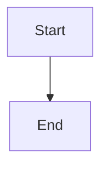

# Branch synchronization service and structured lifecycle merge failures

## Parent Epic

epic_016

## Scope

## Intent

Provide one safe domain service for inspecting and updating active integration branches, and make existing task, feature, and epic merges return actionable structured failures.

## Scope

- Resolve the canonical integration checkout and tier-aware base: product trunk for epics, persisted dispatch/review base for features, and parent feature branch for tasks.
- Compute ahead/behind counts from local refs.
- Under the shared lifecycle process lock, require an active idle item on its expected branch and a fully clean worktree, including untracked files.
- Merge base into the work branch with a normal merge; already-current retries succeed without creating a commit.
- On failure, collect repository-relative unmerged paths, abort, verify merge-state cleanup, and return typed dirty_index, local_changes, branch_conflict, busy, or invariant failures without raw command output.
- Route task/feature integration and epic promotion through the same preflight/diagnostic contract while preserving only the existing activation-pointer conflict exception.
- Do not add War Room controls in this feature.

## Acceptance criteria

- Clean updates and no-op retries succeed for epic, feature, and task integration worktrees without touching the operator checkout.
- Feature base selection honors a persisted stacked predecessor even if room settings later change.
- Staged changes report dirty_index; tracked unstaged or untracked changes report local_changes; neither state is modified.
- Genuine conflicts report exact validated paths, leave no MERGE_HEAD, and leave the pre-update branch commit checked out.
- Update and lifecycle merge attempts are serialized; an in-flight work item is refused as busy.
- Task merge, feature rollup merge, and epic close preserve state on failure and expose the structured reason.
- The activation-created epic pointer remains the sole automatically resolved conflict.
- Focused integration tests cover the above contracts without duplicating lower-level cases already exercised end to end.

## Data structures

TBD.

## API contracts

TBD.

## Logic flow

## Task breakdown
- task_016_001_003
- task_016_001_002
- task_016_001_001

_(empty — Feature Team mints tasks after dispatch)_

## Risks & upward questions

None.

## Decision log

None yet.

## Closeout

Completed child work: `task_016_001_001` (Implement branch synchronization domain service), `task_016_001_002` (Route lifecycle merges through structured synchronization preflight), `task_016_001_003` (Add focused integration coverage for synchronization and lifecycle failures).
