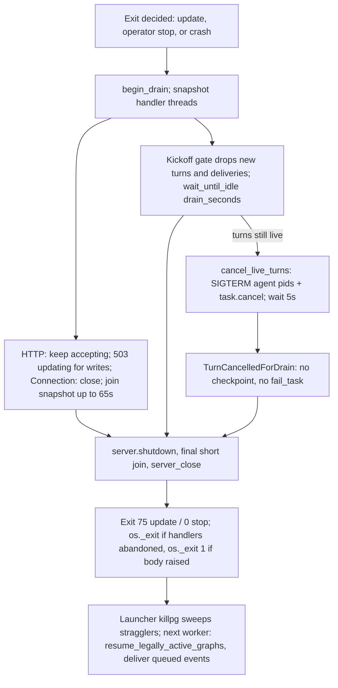

# Graceful worker drain: reject new writes as updating, finish in-flight requests and turns, recover the rest from checkpoints

## Parent Epic

epic_018

## Scope

## Intent

When the worker decides to exit for an update or operator stop, it enters **draining**: it stops starting new work, lets accepted work finish within a bound, cancels what is left safely, and leaves it to the existing checkpoint resume path (`resume_legally_active_graphs`) in the next worker. Because resume re-runs an interrupted role node from the start, every board tool must be replay-safe and every board write must survive a kill (epic dec_005, dec_007).

## Acceptance

### HTTP drain (epic dec_006)

- While draining, mutating HTTP requests (POST/PUT/PATCH/DELETE) get `503` with `Retry-After` and body `{"error":"updating"}`; GETs keep working until the join finishes.
- Every response while draining sets `Connection: close`, so idle keep-alive connections do not hold handler threads.
- Handler threads become tracked, non-daemon threads (bounded by `MAX_CONCURRENT_REQUESTS`) and are joined with a bound of the longest route deadline plus margin (about 65s). Handlers still running after that are logged and abandoned. An accepted write within its route deadline is never cut off mid-handler.

### Turn drain and cancellation (epic dec_007, refined by dec_010/dec_011)

- The watchdog and the background kickoff runner stop starting new model turns and queue deliveries once draining begins.
- In-flight model turns get a bounded drain window (default 120s, `cascade.toml` override). At expiry the worker sends SIGTERM to each live agent **pid** (not a process group; agents stay in the worker's group per epic dec_010), cancels each live turn's asyncio task, waits 5s, then exits 75 (0 for operator stop). The launcher's `killpg` of the worker group (feature 1) covers anything left. HTTP join and turn drain run concurrently.
- Cancelled turns are resumed once by the next worker from durable checkpoints. Queued events that arrive during drain stay in their durable queues and are delivered by the next worker.

### Replay-safe board effects (epic dec_005, dec_007)

- `record_decision`: an identical entry (same section and choice) already in the log returns the existing id and appends nothing.
- `mint_feature`: a child with the same title under the same parent returns the existing id; `append_event` fires only on actual creation.
- `reply_comment`: an identical body by the same author on the same comment returns the existing reply id.
- `resolve_amendment`: an already-resolved amendment is a no-op.
- `write_doc` keeps its `sha` compare-and-swap; `board/store.py` doc writes become atomic (temp file in the same directory, then `os.replace`).
- A resumed model choosing different wording is not deduplicated; that is accepted behavior.

### Integration tests (real `cascade up` subprocess, fake provider)

- (a) A write in flight when the update triggers is persisted and acknowledged; a write arriving during drain gets `503 updating`.
- (b) Replay contract: a fake-provider turn calls `record_decision` and `mint_feature`, outlives the drain window, is cancelled, and is resumed once after restart; the board shows exactly one decision and one feature.
- (c) A queued event during drain is delivered after restart.
- No per-tool idempotency unit-test matrix and no unit test for the atomic write; test (b) covers both paths.

## Out of scope

Zero-downtime overlap of old and new workers. Per-tool-call checkpointing and a durable cross-worker effect journal (cut in epic). Stale `index.lock` sweep (feature 1). Any change to the launcher loop in `cascade/workspace/launcher.py` (epic dec_011).

## Data structures

Grounded in merged feat_018_001 code (`cascade/workspace/worker.py::run_worker`, `EXIT_UPDATE = 75`) and task_018_002_002's merged server changes (`55a51af`). All state is process-local; nothing new is persisted. Durable recovery stays with graph checkpoints and queue cursors.

**Drain flag** — `cascade/workspace/drain.py` (new; implemented on task_018_002_003's branch per dec_015, originally assigned to 005 by dec_014). One module-level `threading.Event`, importable by `kickoff.py`, `server.py` and `worker.py` without import cycles, and safe to read outside a worker (it is just unset):

```python
_draining = threading.Event()

def begin_drain() -> None: ...      # idempotent; sets the event
def is_draining() -> bool: ...
def draining_event() -> threading.Event: ...   # passed to serve(draining=...)
def reset_drain_for_tests() -> None: ...
```

This replaces the raising `worker_draining_event()` accessor and the local `draining` event in 002's merged code; `run_worker` calls `begin_drain()` where it currently calls `draining.set()`.

**Live-turn registry** — `cascade/agent/turn_registry.py` (new, owned by task_018_002_003). Every model turn for every provider registers here at the single `run_role` choke point in `cascade/agent/adapter.py`:

```python
@dataclass
class LiveTurn:
    turn_id: str                       # uuid4 hex
    role: str
    loop: asyncio.AbstractEventLoop    # the turn thread's loop (asyncio.run in graph_turn)
    task: asyncio.Task[Any]            # the run_role task
    pid: int | None = None             # provider CLI child (claude/codex); None for cursor-sdk and fake
    cancelled: bool = False

_live: dict[str, LiveTurn]             # guarded by a threading.Lock
```

`pid` is set by `run_subprocess_turn` right after `create_subprocess_exec` through a `contextvars.ContextVar[LiveTurn | None]` that `run_role` sets; Cursor's bridge pid is SDK-private and is not read.

**Cancellation error** — `cascade/agent/errors.py`: `class TurnCancelledForDrain(Exception)`. It is an `Exception` (not `CancelledError`) so it crosses `asyncio.run` and thread boundaries predictably and is distinguishable from provider errors.

**Config** — `cascade.toml`:

```toml
[worker]
drain_seconds = 120   # float > 0; turn drain window
```

`cascade/watchdog/config.py::worker_drain_seconds(root: Path) -> float`. Missing table/key gives 120.0. A non-positive, bool or non-numeric value logs a warning and gives 120.0. Drain is a safety path, so it must not raise. It is read once in `run_worker` before serving.

**Constants**

| Name | Module | Value |
|---|---|---|
| `HTTP_HANDLER_JOIN_TIMEOUT_S` | `cascade/war_room/server.py` | `EPIC_CLOSE_DEADLINE_S + 5.0` (65s) |
| `DRAIN_RETRY_AFTER_S` | `cascade/war_room/server.py` | `5` |
| `CANCEL_GRACE_S` | `cascade/workspace/worker.py` | `5.0` |
| `EXIT_UPDATE` | `cascade/workspace/worker.py` | `75` (exists) |

**Server handler tracking** — `WarRoomHTTPServer._handler_threads: set[threading.Thread]` under `_handler_threads_lock`, added on spawn and discarded in the thread's `finally` (as in 002's diff). `daemon_threads = False`; the `_request_slots` semaphore still bounds the set to `MAX_CONCURRENT_REQUESTS`.

## API contracts

### HTTP (task_018_002_002)

While `is_draining()`:

- `POST|PUT|PATCH|DELETE <any path>` → checked after `parse_request()` and before dispatch, so no body is read and no handler runs:

  ```
  HTTP/1.1 503 Service Unavailable
  Content-Type: application/json; charset=utf-8
  Cache-Control: no-store
  Retry-After: 5
  Content-Length: 20
  Connection: close

  {"error":"updating"}
  ```

- `GET` → served normally.
- Every response (including GETs, the `server busy` 503 and `100 Continue` final responses) carries `Connection: close`, set in `end_headers` when draining, and the handler sets `close_connection = True`.
- A write whose handler started before draining runs to completion under its existing route deadline (10s, 60s for approvals/epic close). Its 2xx is sent normally with `Connection: close`.
- The listener **keeps accepting** for the whole drain. `server.shutdown()` is called only after both HTTP join and turn drain finish, so clients see 503/GET responses rather than a stalled backlog. Between worker exit and the next worker's `serve`, the launcher-held socket queues connections (feature 1).

### Server (task_018_002_002; snapshot join on task_018_002_003's branch per dec_015)

```python
serve(*, root, host=..., port=..., handler_class=..., listen_socket=None,
      draining: threading.Event | None = None) -> WarRoomHTTPServer

WarRoomHTTPServer.snapshot_handler_threads() -> list[threading.Thread]   # live tracked handlers only
WarRoomHTTPServer.join_handler_threads(
    threads: list[threading.Thread], *, timeout: float = HTTP_HANDLER_JOIN_TIMEOUT_S
) -> list[str]   # names of threads still alive at the deadline; each is logged to stderr
```

The join waits on the **snapshot taken when draining begins**, not on every live thread. War Room UI polling would otherwise keep the set non-empty and run every drain to the full 65s with spurious "abandoned" warnings. GET handlers started during drain are short-lived (10s deadline) and are covered by a final `join_handler_threads(snapshot_handler_threads(), timeout=REQUEST_DEADLINE_S)` after `shutdown()`.

### Turn admission gate (task_018_002_003)

- `run_watchdog` already returns when `stop_when()` is true; no watchdog change beyond that.
- `cascade/workspace/kickoff.py`: `_submit_background` drops the job when `is_draining()`, and `_drain_background` checks `is_draining()` before running each dequeued job. A dropped job is skipped (still `task_done()`), logged at info, and never executed. This covers turns started from HTTP-triggered deferred kickoffs and follow-up kickoffs chained from a finishing turn, not only watchdog ticks.
- A dropped job advances no queue cursor and writes no checkpoint, so the next worker's `resume_legally_active_graphs` / `deliver_queue_kickoffs` re-derive it from durable state. If 003 finds a job kind that is not re-derivable from a graph queue or in-flight checkpoint, it raises an upward question instead of persisting new state.

### Turn registry and cancellation (task_018_002_003)

```python
# cascade/agent/turn_registry.py
@contextmanager
def register_turn(role: str) -> Iterator[LiveTurn]   # used inside run_role; must be entered inside the running task
def set_current_turn_pid(pid: int) -> None            # no-op when no turn is registered
def live_turns() -> list[LiveTurn]
def wait_until_idle(timeout: float) -> bool           # True when no live turns remain
def cancel_live_turns() -> list[LiveTurn]
```

`cancel_live_turns()` handles each live turn as follows:

1. Set `cancelled = True`.
2. If `pid` is set, `os.kill(pid, SIGTERM)`, ignoring `ProcessLookupError`.
3. Call `loop.call_soon_threadsafe(task.cancel)`. For cursor-sdk, this unwinds `async with AsyncClient.launch_bridge(...)`, which closes the bridge.

No `killpg` and no `start_new_session` (epic dec_010).

`run_role` converts the outcome of a turn whose `cancelled` flag is set into `raise TurnCancelledForDrain(role)`. This applies whether it ended by `CancelledError`, by a non-zero CLI exit after SIGTERM (`status="error"`), or by an SDK error. Required propagation, so that the node is **not** recorded as finished or failed:

- `cascade/agent/graph_turn.py`: `TurnCancelledForDrain` is not caught by the provider/startup `except` clauses and is not turned into `run_error_message` text. It propagates out of the role node before any node-boundary checkpoint is written.
- `cascade/task/swe_turn.py`: the same rule for SWE turns.
- `kickoff._run_background_kickoff`: catches `TurnCancelledForDrain` first, logs at info, and does **not** call `fail_task` or `append_transcript_message`.

### Worker shutdown (task_018_002_003, per dec_013/dec_014)

Task 002 merged without `drain_and_shutdown`; task 003 implements all of it, including the HTTP side below, the shutdown order and the `os._exit` path. Per dec_015 it also carries `drain.py` and the snapshot join.

Feature 1 shipped its shutdown as the inline `finally` in `run_worker`, not as a named entry point with a reason. This feature factors it into one function in `worker.py`. That change is additive and leaves the launcher untouched:

```python
def drain_and_shutdown(
    server: WarRoomHTTPServer,
    server_thread: threading.Thread,
    *,
    root: Path,
    reason: Literal["update", "stop", "crash"],
    drain_seconds: float,
) -> bool   # True when any handler thread was abandoned
```

Sequence:

1. `begin_drain()`, then `snapshot = server.snapshot_handler_threads()`.
2. Run concurrently, each in its own thread:
   - **HTTP**: `server.join_handler_threads(snapshot)` with a 65s bound.
   - **Turns**: `wait_until_idle(drain_seconds)`. If turns are still live, call `cancel_live_turns()` and then `wait_until_idle(CANCEL_GRACE_S)`.

   For `reason="crash"` the turn drain window is 0: cancel immediately and wait for the grace period.
3. Join both: `server.shutdown()`; final short join; `server.server_close()`; `server_thread.join(timeout=10)`.
4. Log one stderr line with the reason, elapsed time, and the counts of joined, abandoned and cancelled turns and handlers.

The worst case is about `max(65, drain_seconds + 5) + 10` seconds. Feature 1's launcher waits for the worker without a short timeout (epic dec_010), so no launcher change is needed.

**Exit codes:** `run_worker` returns 75 for update and 0 for operator stop (unchanged). Abandoned handler threads are non-daemon and would block interpreter exit. If `drain_and_shutdown` returns True, `main()` flushes stdio and calls `os._exit(code)` instead of `raise SystemExit(code)`. 003's branch returns `(code, handlers_abandoned)` from `run_worker` to carry this to `main()`; that is accepted (no other callers). The rule also holds whenever the **body raised**, whatever the shutdown reason: if `run_worker`'s body raised (`abnormal_exit`) and handlers were abandoned, the worker prints the traceback, flushes stdio and calls `os._exit(1)` rather than re-raising into an interpreter shutdown that waits on non-daemon threads. The guard is `abnormal_exit and handlers_abandoned` only; it is not narrowed to `reason == "crash"`, because a body that raises after an operator stop or source change is set would otherwise still re-raise and hang. On `feat/feat_018_002` this is in place: 006 merged the path (`ba4e852`) with a narrowed guard and 007 widened it (`b667be3`) (dec_017 through dec_020).

### Test seams (task_018_002_004; env gate in task_018_002_008)

- **Fake provider.** None existed before this feature; 004 adds it. `cascade/agent/fake_provider.py::run_fake_role(turn)` is dispatched from `adapter._dispatch_role` when `provider == "fake"`, so it runs through `run_role`, registers in the turn registry with `pid=None`, and is cancelled through `task.cancel`. Test (b) uses this path. It is **test-only and env-gated** (dec_018): it is enabled only when `CASCADE_ENABLE_FAKE_PROVIDER=1`, which the `cascade up` harness sets on the subprocess. 004 merged without the gate; 008 added it (dec_022), merged as `da55ce0`.
  - `ALL_PROVIDER_IDS` stays `("cursor", "claude", "codex")`. `probe_providers()` and the War Room provider list never show `fake`, and the existing `tests/agent/test_providers.py` assertions about three providers stay unchanged.
  - `parse_provider_id("fake")` succeeds only when enabled; otherwise it raises the existing `unknown provider id` error. `[providers.fake]` model tables are read only when enabled.
  - When enabled, `resolve_credential("fake")` returns a dummy credential and `planning_turn` treats `fake` like `cursor` (in-process tool-effect collector).
  - No unit tests for the fake provider or the gate; the integration tests exercise it.
- Tests set `[worker] drain_seconds` small, for example 2, in the fixture `cascade.toml`, and poll board state and HTTP responses rather than sleeping.
- Update is triggered by touching a file under `cascade/` in the subprocess's source tree, as feat_018_001's relaunch test does.

## Logic flow



## Task breakdown

- task_018_002_001 — Replay-safe board tools and atomic doc writes. No dependencies; can land before feat_018_001. **Merged.**
- task_018_002_002 — Worker draining state and HTTP drain: 503 updating, `Connection: close`, tracked non-daemon handler threads, `serve(draining=...)`. **Merged** (`55a51af`) without `drain.py`, the snapshot join or `drain_and_shutdown`; those moved to 005 and 003 (dec_014).
- task_018_002_003 — Turn drain, bounded cancellation, and exit 75. Owns `cascade/agent/turn_registry.py`, the kickoff admission gate, `TurnCancelledForDrain` propagation, `[worker] drain_seconds`, and the whole `drain_and_shutdown` (shutdown order, final short join, `os._exit`). Depends on task_018_002_002. Its commit `bde148e` also contains `drain.py`, the snapshot join and the `join_http_handlers` removal, which are authoritative per dec_015. **Merged** (`97dcdec`) without the crash-path `os._exit`; that moved to 006 (dec_017).
- task_018_002_005 — HTTP drain conformance (`drain.py`, snapshot join). Superseded by 003 (dec_015) and marked do-not-merge (dec_016), but **merged anyway** (`74ba53e` = `cef0f05`). Verified harmless (dec_021): the merge kept the feature branch's side everywhere except `WarRoomHTTPServer.snapshot_handler_threads`, which took 005's docstring and its `is_alive()` filter. The join already skips dead threads, so behaviour is unchanged. `tests/war_room` and `tests/workspace` pass on the merged branch apart from pre-existing failures that also fail before the merge (see Risks). No follow-up.
- task_018_002_004 — Drain integration tests (a), (b), (c) against a real `cascade up` subprocess, plus the fake provider (see Test seams). Depends on 001, 002 and 003, all merged. **Merged** (`634df7b`, head `60bc228`) without the dec_018 env gate; the gate moved to 008 (dec_022). The harness, integration tests, fake provider, adapter dispatch and `planning_turn` branches stay as merged.
- task_018_002_006 — `os._exit(1)` when the `run_worker` body raised and drain abandoned handler threads. `cascade/workspace/worker.py` only; no new test (dec_017). **Merged** (`ba4e852` = `3e8a230`) with the narrowed guard; the widening moved to 007 (dec_020).
- task_018_002_007 — Widen the raised-body `os._exit(1)` guard to `abnormal_exit and handlers_abandoned` by deleting the `not operator_stop.is_set()` and `not source_changed` conditions. `cascade/workspace/worker.py` only; no new test (dec_020). **Merged** (`b667be3` = `c37e1df`).
- task_018_002_008 — Gate the fake provider behind `CASCADE_ENABLE_FAKE_PROVIDER=1`: `fake_provider_enabled()` in `providers.py`; `ALL_PROVIDER_IDS` back to three; `parse_provider_id`, `probe_provider` and `resolve_credential` accept `fake` only when enabled; harness sets the env var next to `CASCADE_DRAIN_INTEGRATION`; `tests/agent/test_providers.py` restored to `b667be3`. No dependencies, no new tests; verified by `tests/agent/test_providers.py` and the drain integration test (dec_022). It also touches `cascade/watchdog/config.py` so `read_providers_config` parses a `[providers.fake]` table only when the gate is on, since `ALL_PROVIDER_IDS` no longer lists `fake`; that is in scope (dec_023). **Merged** (`da55ce0` = `2abce25`): the feature branch differs from `2abce25` only by 009's one test line, and `tests/agent/test_providers.py` matches `b667be3`.
- task_018_002_009 — Add `self.pid = None` to `_FakeProc.__init__` in `tests/agent/test_claude_codex_cli.py`, fixing the three tests 003 broke (dec_023). Test file only; no production change, no new test. No dependencies: it shares no file with 008, so the two can merge in either order (dec_024). Verified by `pytest tests/agent/test_claude_codex_cli.py` passing all 12. **Merged** (`05d817d` = `44e93b2`): the merge adds exactly that one line, and all 12 tests in `tests/agent/test_claude_codex_cli.py` pass on `feat/feat_018_002`.

**All tasks are merged; the feature's work is complete.** Verified on `feat/feat_018_002` after `da55ce0`: `tests/agent`, `tests/workspace`, `tests/war_room` and `tests/watchdog` pass apart from the two pre-existing sidecar failures listed under Risks.

## Risks & upward questions

- The replay-safe tools and atomic writes do not depend on feature 1's launcher. If feature 1 slips, the Feature Team may land them first as a standalone task; they also fix duplicate effects after ordinary crashes.
- **task_018_002_002 merged non-conforming** (`55a51af`, which contains `065d1e0` unchanged). These parts already conform: the `503 updating` response and headers, the mutating-method check after `parse_request()`, tracked non-daemon handler threads, the constants, `serve(draining=...)` and `Connection: close`. The rest of the checklist was reassigned by dec_014. Every item is now on the feature branch:
  1. Flag in `cascade/workspace/drain.py`; `worker_draining_event()` / `_worker_draining` deleted. **Done** (003, `97dcdec`).
  2. `server.shutdown()` only after both joins, inside `drain_and_shutdown`. **Done** (003).
  3. `snapshot_handler_threads()` plus `join_handler_threads(threads, *, timeout) -> list[str]`; `join_http_handlers` dropped; final short join after `shutdown()`. **Done** (003; `is_alive()` filter from 005's merge `74ba53e`).
  4. `drain_and_shutdown(...)` and the `os._exit` path, including a raised body after a stop or update was signalled. **Done** (003, 006 `ba4e852`, 007 `b667be3`).
- **Raised-body exit hang: closed.** Verified on `feat/feat_018_002` after `b667be3`: the `os._exit(1)` guard in `run_worker`'s `finally` is `if abnormal_exit and handlers_abandoned:`. The remaining `abnormal_exit and not operator_stop.is_set() and not source_changed` check a few lines above it only chooses `shutdown_reason = "crash"` and is correct. No test covers this path, by choice (dec_017).
- **005 merged against dec_016: closed, harmless** (dec_021). See the task breakdown.
- **Fake provider exposed on the feature branch: closed** (owner: task_018_002_008). 004 merged (`634df7b`) ungated: `"fake"` was in `ProviderId` and `ALL_PROVIDER_IDS`, `probe_provider("fake")` and `resolve_credential("fake")` were unconditional, and `tests/agent/test_providers.py` asserted four providers. Architect review of `2abce25` found it conforming: `tests/agent/test_providers.py` identical to `b667be3`, `ALL_PROVIDER_IDS` is cursor/claude/codex, and `tests/agent/test_providers.py` (17) and `tests/workspace/test_feat_018_002_drain_integration.py` (3) pass. **008 merged (`da55ce0`)**; the fake provider now works only with `CASCADE_ENABLE_FAKE_PROVIDER=1`.
- **Regression from 003: `tests/agent/test_claude_codex_cli.py` fails (owner: task_018_002_009, dec_023/dec_024).** `test_claude_prompt_cwd_and_wait`, `test_codex_exec_with_mcp_uses_inline_config_and_preserves_codex_home` and `test_nonzero_exit_is_role_result_error` failed on `feat/feat_018_002` with `AttributeError: '_FakeProc' object has no attribute 'pid'` because 003 added `set_current_turn_pid(proc.pid)` in `cascade/agent/cli_common.py`. Production is unaffected. Fixed in the test double with `self.pid = None`. **Closed:** 009 merged (`05d817d`); all 12 pass on `feat/feat_018_002`.
- **Pre-existing test failures (not this feature):** `tests/war_room/test_sidecar_toasts.py::test_attach_detach_and_chat_store_without_reply` and `tests/war_room/test_sidecar_toasts.py::test_chat_empty_when_missing_sidecar` both fail at the feature's base `47f19ba` and on `feat/feat_018_002` after all merges (`da55ce0`). They are not in this feature's scope.
- Cancellation correctness depends on the node-boundary checkpoint not being written when a role node raises (the premise of epic dec_005). Test (b) is the proof; if it fails because a node checkpoints on exception, raise it upward rather than adding per-tool checkpoints.
- Cursor-sdk turns are cancelled by `task.cancel` (bridge closed by the SDK's context manager), not by pid, because the bridge pid is SDK-private. The launcher's `killpg` is the backstop.

## Decision log

- `dec_001` · 2026-10-23 · Feature Lead · **Task breakdown**
  Chose Four tasks: replay-safe board tools (001), draining state + HTTP drain (002), turn drain + exit 75 (003, after 002), integration tests a/b/c (004, after all). New tests live only in 004..
  Rationale: 001 has no dependencies and also fixes duplicate effects after ordinary crashes, so it can land first. 002 owns the single draining flag so 003 has one signal to consume instead of two competing ones. Test (b) needs both replay safety and turn cancellation, and all three tests share one cascade-up harness, so one test task is cheaper than spreading the harness across the implementation tasks.
  Honors: epic dec_005, dec_006, dec_007; feature acceptance 'no per-tool unit-test matrix'.

- `dec_008` · 2026-10-23 · Feature Architect · **API contracts**
  Chose Cancel turns through a process-local live-turn registry entered at run_role (all providers): SIGTERM the CLI pid when known plus task.cancel via call_soon_threadsafe, surfaced as TurnCancelledForDrain that graph_turn/swe_turn re-raise and _run_background_kickoff swallows without fail_task or transcript. A kickoff admission gate drops new jobs while draining..
  Rationale: Code shows a SIGTERM'd CLI returns status=error, which graph_turn turns into message text (node completes, no resume), and background failures call fail_task, so a plain kill would mark cancelled work done or failed. Cursor-sdk's bridge pid is SDK-private, so pid-only cancellation misses the default provider. Kickoff background threads keep starting queued jobs after the watchdog stops, so the gate must sit in kickoff.py, not only the watchdog loop.
  Honors: epic dec_005, dec_007, dec_010 (SIGTERM pids, no new process groups), dec_011 (drain inside the shutdown path, launcher untouched); cancelled turns resumed once from checkpoints..

- `dec_012` · 2026-10-23 · Feature Architect · **Data structures**
  Chose Drain flag lives in a new cascade/workspace/drain.py module-level Event (not a raising accessor in worker.py). The listener keeps accepting through the whole drain; HTTP joins the handler snapshot taken at drain start (65s) concurrently with the turn drain ([worker] drain_seconds, default 120, invalid -> warn + default), and server.shutdown() runs only after both. One drain_and_shutdown(reason) function in worker.py replaces 001's inline finally; os._exit when handlers are abandoned..
  Rationale: kickoff.py must read the flag outside run_worker without import cycles. Shutting the server first (as 002's current diff does) stalls drain-time writes in the backlog instead of returning 503 updating and stops GETs. Joining all live threads lets UI polling hold every drain to 65s. Abandoned non-daemon threads would block interpreter exit and hang the worker. 001 shipped no named shutdown entry point, so adding one in worker.py is additive.
  Honors: epic dec_006 (503 updating, Connection: close, bounded join), dec_009/dec_011 (single shutdown path, no launcher loop changes); accepted writes not lost; drain is a safety path that must not raise..

- `dec_013` · 2026-10-23 · Feature Lead · **Task breakdown**
  Chose Revised tasks 003 and 004 to the dec_008/dec_012 contracts (SIGTERM agent pids, turn registry, kickoff gate, TurnCancelledForDrain, [worker] drain_seconds). Task 002 could not be revised while active, so the feature spec's API contracts and Risks govern it, and task 003 starts by checking 002's merge and finishes any missing drain_and_shutdown or os._exit wiring..
  Rationale: Active tasks are locked against revision, and reworking or retrying 002 mid-flight would cost more than a merge check. The contracts and the two required fixes (no early server.shutdown, join the drain-start snapshot) are already explicit in the feature spec. Putting the fallback in 003, which depends on 002, keeps the gap from reaching task 004's integration tests.
  Honors: feature dec_001, dec_008, dec_012; epic dec_006, dec_010, dec_011.

- `dec_014` · 2026-10-23 · Feature Lead · **Task breakdown**
  Chose Task 002 merged (55a51af = commit 065d1e0) with none of the review checklist fixed. Minted task_018_002_005 (no deps) for the HTTP-side items: create cascade/workspace/drain.py, delete worker_draining_event()/_worker_draining, add snapshot_handler_threads() and join_handler_threads(threads) -> list[str], drop join_http_handlers. Task 003 keeps drain_and_shutdown, which now explicitly includes the shutdown order (server.shutdown() only after both joins), the final short join and os._exit. Task 004 must not start until 005 merges (stated in its body; the board cannot add dependencies to minted tasks)..
  Rationale: Merged code was checked directly: the raising accessor, shutdown-before-join and join-all-live-threads are all still present. Task 003 is active and locked, and its doc tells it to escalate HTTP-side problems rather than rework server.py, so leaving them would block its kickoff gate (it needs drain.py) and fail test (a). Retrying 002 is unnecessary: the fix is about 3 files, smaller than a redo. Splitting by file (005: drain.py and server.py plus the flag swap in run_worker; 003: the drain_and_shutdown body) keeps the two tasks from editing the same block.
  Honors: feature dec_001, dec_012, dec_013; epic dec_006 (503 updating, bounded join), dec_011 (launcher untouched).

- `dec_015` · 2026-10-23 · Feature Architect · **Data structures**
  Chose Task 003's commit bde148e is the authoritative implementation of drain.py, snapshot_handler_threads() and join_handler_threads(threads) -> list[str]; task 005 is superseded and must not commit its equivalent uncommitted diff. run_worker returning (code, handlers_abandoned) to main() is accepted. On the crash path, abandoned handlers must still lead to os._exit(non-zero)..
  Rationale: Reviewed bde148e against the spec: drain.py matches the contract, the join takes the drain-start snapshot and returns abandoned names, join_http_handlers is gone, and server.shutdown() runs only after both joins. 005's worktree has a functionally equivalent diff to the same blocks of server.py and worker.py, so merging both would conflict for no gain. In 003's crash path the abandoned result is discarded as the exception propagates, so interpreter exit would wait on non-daemon handler threads.
  Honors: feature dec_012, dec_013, dec_014; epic dec_006 (bounded join), dec_011 (launcher untouched).

- `dec_016` · 2026-10-23 · Feature Lead · **Task breakdown**
  Chose Task 005 committed cef0f05 (drain.py, snapshot join, flag swap) after dec_015 marked it superseded. 005 must not be merged into feat/feat_018_002: its reviewer should reject the merge request, and 005 completes with an empty diff. If cef0f05 lands anyway, 003 rebases onto it and resolves every conflict in drain.py, server.py and worker.py by taking 003's side (bde148e) in full. No new task and no retry..
  Rationale: Compared cef0f05 with bde148e: the two are functionally equivalent (docstring wording, an is_alive filter in snapshot_handler_threads, and how the abandoned list is built), but a three-way merge produces 12 conflict hunks across the three files, including run_worker's shutdown block. 003 is the larger change and already depends on these symbols, so 003's version wins and 005 adds nothing. The board has no cancel tool and active tasks can't be revised, so the instruction has to sit at the merge gate, with a cheap take-003 fallback in case the gate misses it.
  Honors: feature dec_014, dec_015; frugal rule: smallest change that keeps the system honest.

- `dec_017` · 2026-10-23 · Feature Lead · **Task breakdown**
  Chose Task 003 merged (97dcdec) without the crash-path os._exit. Minted task_018_002_006 (no deps, cascade/workspace/worker.py only, no new test): when the run_worker body raises and drain_and_shutdown reports abandoned handlers, print the traceback, flush stdio and os._exit(1). Task 004 proceeds unchanged in parallel. 005 stays do-not-merge; if cef0f05 is ever merged, keep the feature branch's side of every conflict..
  Rationale: Checked the merged feature branch directly: run_worker's finally discards handlers_abandoned when the body raises and main() re-raises, so the worker can hang at exit on non-daemon handler threads. It is a one-file fix, so a small task is cheaper than retrying 003, and 004's integration tests do not touch worker.py or exercise the crash path, so the two can run in parallel. No test is added because the path is rare and the fix is a few lines checked in review.
  Honors: feature dec_012, dec_015, dec_016; frugal rules: smallest change that keeps the system honest, tests must earn their keep.

- `dec_018` · 2026-10-23 · Feature Architect · **API contracts**
  Chose The fake provider added by task 004 is test-only and env-gated: enabled only when CASCADE_ENABLE_FAKE_PROVIDER=1 (set by the cascade up harness). ALL_PROVIDER_IDS stays cursor/claude/codex, probe_providers() and the War Room never list it, parse_provider_id accepts 'fake' only when enabled, and existing provider tests are unchanged. Task 006's raised-body os._exit(1) guard is `abnormal_exit and handlers_abandoned`, not narrowed to reason == crash..
  Rationale: No fake provider existed; 004's diff adds 'fake' to ALL_PROVIDER_IDS as always installed and authenticated, which would show it in the War Room provider panel, let real workspaces set default = 'fake' and silently run canned turns, and it rewrites existing provider tests plus adds a unit test. An env gate keeps the integration seam at near-zero cost. 006's diff also requires not operator_stop and not source_changed, so a body that raises after a stop or update is signalled still re-raises into an interpreter exit that waits on abandoned non-daemon handler threads.
  Honors: feature dec_001 (no extra unit tests), dec_012, dec_015, dec_017; epic dec_011 (launcher untouched); frugal rule: smallest change that keeps the system honest..

- `dec_019` · 2026-10-23 · Feature Lead · **Task breakdown**
  Chose Task 006 committed 3e8a230 with the narrowed guard (abnormal_exit and not operator_stop and not source_changed and handlers_abandoned). It must not merge as-is: its reviewer sends it back to delete the operator_stop/source_changed conditions so the guard is abnormal_exit and handlers_abandoned. If 3e8a230 merges unchanged, the feature lead mints a one-line follow-up for the deletion; no retry of 006, no new test. Task 004's diff is still not env-gated; dec_018's review requirement stands unchanged..
  Rationale: The uncovered case is realistic: a SIGTERM or source change sets the flag mid-tick and the tick then raises, so main() re-raises and interpreter exit waits on abandoned non-daemon handler threads. On the update path the launcher waits without a timeout (epic dec_010), so the workspace would stay down until someone kills it. The fix is deleting two lines, cheaper at review than a follow-up task, and a follow-up is still cheaper than a retry if the gate misses it.
  Honors: feature dec_017, dec_018; epic dec_010; frugal rules: smallest change that keeps the system honest, tests must earn their keep.

- `dec_020` · 2026-10-23 · Feature Lead · **Task breakdown**
  Chose Task 006 merged (ba4e852 = 3e8a230) with the narrowed guard. Per dec_019, minted task_018_002_007 (no deps, cascade/workspace/worker.py only, no new test): delete the `not operator_stop.is_set()` and `not source_changed` conditions so the raised-body os._exit(1) guard is `abnormal_exit and handlers_abandoned`. No retry of 006. Runs in parallel with 004, which does not touch worker.py..
  Rationale: Checked the feature branch directly: the guard at run_worker's finally still carries both extra conditions, so a body that raises after a stop or update is signalled re-raises and hangs at interpreter exit on abandoned non-daemon handler threads, and on update the launcher waits without a timeout. A two-line deletion task is cheaper than retrying 006. 004's diff is unchanged and still not env-gated; dec_018's review requirement stands.
  Honors: feature dec_017, dec_018, dec_019; epic dec_010; frugal rules: smallest change that keeps the system honest, tests must earn their keep.

- `dec_021` · 2026-10-23 · Feature Lead · **Task breakdown**
  Chose Task 005 merged (74ba53e = cef0f05) despite dec_016. Accept it as-is: the merge kept the feature branch's side everywhere except snapshot_handler_threads in server.py, which gained 005's is_alive() filter and docstring; behaviour is unchanged, so no revert, follow-up or retry. Task 004 committed 2f74427 without the dec_018 env gate. Its reviewer sends it back for the gate; if it merges ungated, the feature lead mints one follow-up task: gate fake behind CASCADE_ENABLE_FAKE_PROVIDER=1, restore ALL_PROVIDER_IDS to three, revert tests/agent/test_providers.py, set the env var in the cascade up harness. No retry of 004, no new tests..
  Rationale: Checked directly: git diff 73fb7b1 74ba53e touches only four lines of server.py, and join_handler_threads already drops dead threads, so filtering them at snapshot time is equivalent. tests/war_room and tests/workspace pass on the merged branch except test_sidecar_toasts::test_attach_detach_and_chat_store_without_reply, which also fails at b667be3 before the merge. Reverting four harmless lines costs more than keeping them. 004's ungated fake provider would show in the War Room provider panel and could be set as a real workspace default; a gate follow-up is a few lines and cheaper than retrying 004's harness and integration tests.
  Honors: feature dec_015, dec_016, dec_018; frugal rules: smallest change that keeps the system honest, tests must earn their keep..

- `dec_022` · 2026-10-23 · Feature Lead · **Task breakdown**
  Chose Task 004 merged (634df7b) without the dec_018 env gate. Per dec_021, minted task_018_002_008 (no deps, no new tests): fake_provider_enabled() reads CASCADE_ENABLE_FAKE_PROVIDER=1; ALL_PROVIDER_IDS back to cursor/claude/codex; parse_provider_id, probe_provider and resolve_credential accept 'fake' only when enabled; the harness sets the env var; tests/agent/test_providers.py restored to b667be3. No retry of 004..
  Rationale: Checked the feature branch directly: 'fake' is in ProviderId and ALL_PROVIDER_IDS, probe_provider('fake') is always installed and authenticated, resolve_credential('fake') is unconditional, test_providers.py asserts four providers, and nothing reads CASCADE_ENABLE_FAKE_PROVIDER. That exposes a canned-turn provider in the War Room panel and as a selectable workspace default. The gate is a few lines in two files plus one harness line; retrying 004 would redo its harness and integration tests for no gain.
  Honors: feature dec_018, dec_021; dec_001 (no extra unit tests); frugal rules: smallest change that keeps the system honest, tests must earn their keep..

- `dec_023` · 2026-10-23 · Feature Architect · **API contracts**
  Chose Task 008's commit 2abce25 conforms to dec_018/dec_022 and can merge; its cascade/watchdog/config.py change (read [providers.fake] only when the gate is on) is in scope. Separately, 003's set_current_turn_pid(proc.pid) in cascade/agent/cli_common.py broke three tests in tests/agent/test_claude_codex_cli.py because the _FakeProc test double has no pid. Fix the test double by adding self.pid = None to _FakeProc.__init__; no production change, no new test. It needs its own one-line task unless 008's engineer folds it in before merge..
  Rationale: Checked 2abce25 directly: test_providers.py is identical to b667be3, ALL_PROVIDER_IDS is cursor/claude/codex, and test_providers.py (17) plus the drain integration test (3) pass. The three CLI tests fail on feat/feat_018_002 with AttributeError on _FakeProc.pid but all 12 pass at base 47f19ba, so this feature caused it. Real asyncio Process always has pid, so production is fine; pid=None keeps the registry from SIGTERMing a real pid.
  Honors: feature dec_008 (pid set via set_current_turn_pid), dec_018, dec_022; dec_001 (no extra unit tests); frugal rules: smallest change that keeps the system honest, tests must earn their keep..

- `dec_024` · 2026-10-23 · Feature Lead · **Task breakdown**
  Chose The _FakeProc.pid regression from dec_023 goes to a new one-line task, task_018_002_009: add self.pid = None to _FakeProc.__init__ in tests/agent/test_claude_codex_cli.py. No dependencies, no production change, no new test. Task 008 is not held or reworked; its conforming commit 2abce25 merges as is..
  Rationale: Confirmed on feat/feat_018_002: test_claude_codex_cli.py is 3 failed, 9 passed, all AttributeError on _FakeProc.pid. 008 is active and committed, so its doc can't be revised, and folding an out-of-scope test fix into it would cost a review round on a commit that already conforms. 009 touches only that test file, which 008 does not touch, so the two merge independently in either order.
  Honors: feature dec_001 (no extra unit tests), dec_022, dec_023; frugal rules: smallest change that keeps the system honest..
## Closeout

Completed child work: `task_018_002_001` (Replay-safe board tools and atomic doc writes), `task_018_002_002` (Worker draining state and HTTP drain), `task_018_002_003` (Turn drain, bounded cancellation, and exit 75), `task_018_002_004` (Drain integration tests against a real cascade up subprocess), `task_018_002_005` (HTTP drain conformance: drain.py flag and drain-start snapshot join), `task_018_002_006` (Crash-path os._exit when drain abandons handler threads), `task_018_002_007` (Widen raised-body os._exit guard to abnormal_exit and handlers_abandoned), `task_018_002_008` (Gate the fake provider behind CASCADE_ENABLE_FAKE_PROVIDER=1), `task_018_002_009` (Give the CLI test double _FakeProc a pid so test_claude_codex_cli.py passes again).
