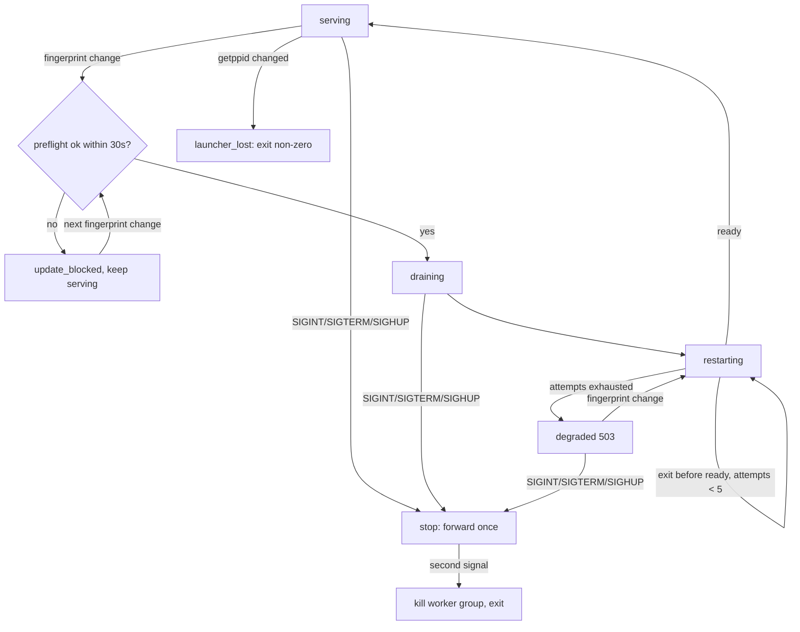

# Update failure containment: preflight, bounded backoff, degraded responder, and health status

## Parent Epic

epic_018

## Scope

## Intent

Make a bad update visible and survivable rather than silent downtime.

## Builds on feat_018_001 and feat_018_002 (both merged; epic dec_012, dec_013, dec_014, dec_015)

This feature is the only one that edits `cascade/workspace/launcher.py`. Already shipped by 001 and usable as is: the worker is spawned as its own session with `start_new_session=True`, the War Room serves on the inherited fd before resume, crashes restart after a fixed `CRASH_RESTART_DELAY_S` delay, and `post_worker_exit` calls `sweep_stale_git_locks` after every group kill. 002 shipped `worker.drain_and_shutdown(..., reason="update"|"stop"|"crash")` as the single shutdown function called from `run_worker`'s `finally`. 002's source-change branch of `should_stop` calls `begin_drain()` as soon as the fingerprint differs.

001 and 002 did **not** ship these seams, so this feature adds them as part of its own work (do not reopen 001 or 002):

- **Launcher state-transition function.** Add one function that every launcher state change goes through. It logs one stderr line and writes `supervisor_status.json`. It replaces the ad hoc `print` calls.
- **Readiness means serving.** Move the single `_write_readiness` call in `run_worker` to just after the server thread starts, ahead of `resume_legally_active_graphs`. Backoff and the 60s reset depend on it.
- **Stdlib-only fingerprint.** Move `_source_fingerprint` out of `cascade/workspace/up.py`, which imports Cascade modules, into a stdlib-only module. `up.py` re-exports it for the worker, and the launcher imports it once at start for the degraded responder.
- **Sweep returns data.** `sweep_stale_git_locks` returns the removed lock paths and any product-trunk lock path instead of `None`.
- **Forward once, escalate on a second signal.** While stopping, the launcher currently re-sends SIGTERM every 0.2s and never escalates. Forward the stop to the worker once. A second operator SIGINT/SIGTERM/SIGHUP must call `_kill_worker_group` at once.
- **SIGHUP is an operator stop (dec_013).** Handle SIGHUP exactly like SIGINT/SIGTERM in every launcher state.
- **Launcher-loss detection in the worker (dec_014; 002 did not ship it).** The worker records the launcher pid at start and checks `os.getppid()` as the first line of `should_stop` and in drain waits. On a change it shuts down through `drain_and_shutdown` with reason `launcher_lost`: no drain or turn window, SIGTERM agent pids, 5s grace, then a non-zero exit (never the trailing `return 0`).
- **Worker shares the supervisor lock (dec_015).** `_spawn_worker` passes the `SupervisorLock` fd via `pass_fds` and its number in the handshake. The worker keeps it open until it exits and never passes it to agents (keep `close_fds=True`). `SupervisorLock.release()` only closes its handle and never calls `LOCK_UN`.
- **Preflight placement.** Run the preflight in the source-change branch of `should_stop`, **before** `begin_drain()`. Do not edit 002's `finally` block or the existing exit codes.

## Acceptance

- **Preflight:** before draining for a source update, the running worker launches a short-lived subprocess that imports the Cascade entry modules from the new source and runs `prepare_up` (which validates only and does not take the supervisor lock). The preflight has a hard timeout of about 30s, because it blocks watchdog dispatch while it runs; a timeout counts as a failure. If it fails, the old worker keeps serving (no drain), status shows `update_blocked` with the error output, and it retries on the next fingerprint change (the failed fingerprint is remembered so it does not retry every second). Operator stop and launcher loss skip the preflight.
- **Backoff:** if a new worker exits before reporting ready, the launcher retries with exponential backoff (1s doubling, capped at 30s, at most 5 consecutive attempts; the counter resets after a worker stays ready for 60s). This replaces the fixed 1s crash delay.
- **Degraded mode:** after attempts are exhausted the launcher stays alive holding the lock and socket, answers every request itself with `503` and a JSON/HTML diagnostic (last exit code, stderr tail, next action), and launches again automatically on the next source fingerprint change. SIGHUP is not a retry trigger; it stops the launcher like any operator signal. To retry without a source change, the operator stops and reruns `cascade up`.
- **Status:** `.cascade/supervisor_status.json` (see Data structures) includes any product-trunk `.git/index.lock` warning from the sweep's returned data. `GET /api/health` returns it from both the worker and the degraded responder, and the War Room shows a banner whenever state is not `serving` or a trunk lock warning is present. Every launcher transition is logged on stderr with one line.
- **Operator stop escalation:** a second operator signal while stopping kills the worker group immediately and the launcher exits.
- **Launcher loss:** if the launcher is killed with `kill -9`, the worker stops serving and exits non-zero within seconds, and until it exits `cascade up --port <other>` on the same workspace is refused.
- Integration tests: (a) a syntax error introduced into the source triggers `update_blocked` and the old worker keeps answering; (b) a worker that crashes on startup produces bounded retries, then degraded 503 with diagnostics; fixing the source recovers to `serving` without an operator; (c) `kill -9` of the launcher: the worker exits non-zero within seconds and `cascade up --port <other>` is refused until then; a second SIGTERM while stopping kills the worker group at once. `/api/health` payloads are asserted inside these tests. The seam changes ride on these tests; no separate unit tests for them.

## Out of scope

HTTP and turn drain, the `drain_and_shutdown` body and its existing exit codes, replay-safe board tools and atomic doc writes (all shipped by feat_018_002).

## Data structures

`.cascade/supervisor_status.json`, written atomically (tmp + `os.replace`) by one stdlib-only helper shared by the launcher and the worker (dec_016):

```json
{
  "state": "serving|draining|restarting|update_blocked|degraded",
  "worker_pid": 1234,
  "restart_count": 0,
  "last_error": {"exit_code": 1, "stderr_tail": "...", "message": "..."},
  "next_action": "...",
  "trunk_lock_warning": "/path/to/product/.git/index.lock",
  "since": "ISO-8601",
  "updated_at": "ISO-8601"
}
```

The launcher writes serving/draining/restarting/degraded. The worker writes only `update_blocked`, and writes `serving` again after a successful preflight. The launcher pipes worker stderr, forwards each line to its own stderr, and keeps a bounded tail for `stderr_tail`.

## API contracts

- `GET /api/health` returns the status JSON above with 200 from the worker (also while draining) and 503 from the degraded responder.
- Degraded responder: every other request gets 503; `/api/*` gets a JSON diagnostic and anything else gets an HTML page.

## Logic flow



## Task breakdown

1. `task_018_003_001`: status foundation (stdlib fingerprint, sweep return data, status helper, launcher transition function).
2. `task_018_003_002`: supervisor lifetime (shared lock fd, launcher-loss exit, SIGHUP, forward once, escalation, test c). Depends on 001.
3. `task_018_003_003`: readiness-on-serve, bounded backoff, degraded responder (test b). Depends on 001 and 002.
4. `task_018_003_004`: update preflight and update_blocked (test a). Depends on 001 and 002.
5. `task_018_003_005`: worker `/api/health` and War Room banner. Depends on 001.

## Risks & upward questions

- 002 is merged, so this feature rebases onto it. Keep 002's `finally` block and exit codes. Any new stop path (launcher_lost) must exit non-zero.
- Tasks 002, 003, and 004 all edit `run_worker` / `should_stop` or `launcher.py`. They are chained after 002 to keep conflicts small. 003 and 004 touch different files and lines and can run in parallel.

## Decision log

See board decisions dec_001 (scope sync with epic dec_014/dec_015) and dec_016 (status file ownership and stderr tail).

## Closeout

Completed child work: `task_018_003_001` (Status foundation: stdlib fingerprint, sweep return data, launcher state transitions and supervisor_status.json), `task_018_003_002` (Supervisor lifetime: shared lock fd, worker launcher-loss exit, SIGHUP, forward stop once, second-signal escalation), `task_018_003_003` (Readiness-on-serve, bounded backoff, and degraded 503 responder in the launcher), `task_018_003_004` (Update preflight in should_stop with update_blocked status), `task_018_003_005` (Worker GET /api/health and War Room status banner).
