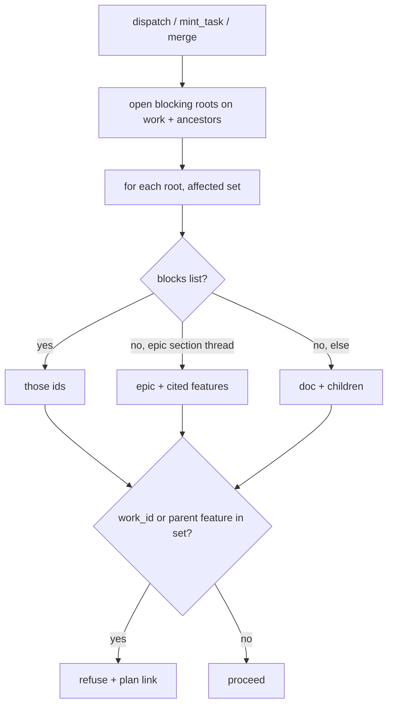

# Scoped dispatch gates

## Parent Epic

[epic_002](../../epics/2_active/epic_002_plan_view_review_threads.md) — Plan-view review threads.

Depends on: [feat_016](../3_completed/feat_016_comment_read_api_and_war_room_wiring.md) (`Comment.blocks`, `section`, `section_slug()`). Implementation may start after feat_016. **Do not merge or close out before feat_018** (dec_013).

Cites (this feature adds the frontmatter field; until then record here): `epic_002#intent`, `epic_002#cross-module-constraints`, `epic_002#feature-breakdown`.

Constraints this feature must honor:

- Dispatch law unchanged: epic activate = human only; feature/task dispatch = human or Boss; agents cannot dispatch themselves.
- One gate, no bypass, no `force` flag (dec_004). Human unblocks by resolving (feat_018).
- Merge order (dec_013): this feature must not merge before feat_018. Until resolve is human-only, agents can still `resolve_comment` and bypass the gate. Parallel implementation against feat_016's comment contract is fine.
- Scope precedence locked (dec_003). Do not infer citations from spec prose.
- Completion rollup unchanged: any open human thread still blocks closeout, blocking or not.
- Slugs come from feat_016 `cascade.comments.section_slug`. Do not fork it and do not import amendment/filename sluggers.
- Section vs doc-level is dec_008 (heading match), not an empty `section` field.
- Inverse lookup is dec_010: scan comments on the work **and its ancestors**. Epic-section threads live on the epic sidecar.

## Scope

**In**

- Add `blocking_threads_for(work_id, *, root) -> GateResult` in one module (`cascade/comments/gate.py`). Every path below calls it; a second checker is a defect.
- **Load** open blocking *roots* (`parent is null`, `state=open`, `blocking=true`) from:
  1. comments on `work_id` itself,
  2. if `work_id` is a task, comments on its parent feature,
  3. comments on the parent epic (feature's parent, or task's grandparent).
  Then apply scope (below) and keep threads whose affected set includes `work_id` (tasks also match if their parent feature is in the affected set).
- Call the gate from:
  - `dispatch_feature` / `dispatch_task` (human War Room and Boss),
  - `mint_task` (**replace** `_refuse_blocking_human_comments`; do not stack a second check),
  - `merge_task_branch` / `merge_feature_branch`.
- Do **not** gate `mint_feature`, `activate_epic`, or `confirm_epic_complete`.
- Affected work for an **open blocking** root thread, in order:
  (a) `blocks` non-empty → exactly those work ids (unknown ids ignored);
  (b) else *section thread* on an **epic** (dec_008: `section` matches a current `##+` heading on that epic) → that epic plus child features whose `cites` includes `{epic_id}#{section}`;
  (c) else *section thread* on a **feature**, or any *doc-level* thread → that doc and all its children.
  Tasks inherit from their parent feature. Replies never carry scope; only the root matters.
- Optional `cites: [str]` on **feature** frontmatter (`WorkMeta.cites`, default `[]`). Serde/parse must accept it and ignore unknown extra keys still. Epic Team / Feature Team fill it at mint/edit. Missing `cites` is a known limitation: that feature is not blocked by epic-section threads (dec_003).
- Refusal: `DispatchResult.reason` / merge `reason` / `FeatureToolDenied` text lists each thread's `id`, `doc_id`, `section`, and link `/plan/{doc_id}#plan-comments`. Do not add a new field on `DispatchResult` in v1. Cites that match no current heading on the cited doc are returned as `warnings` (do not fail closed on a stale cite). Warnings may be appended to the same reason string.
- War Room / Boss dispatch responses already have a refusal string; put the list there. No new toast type required; reuse `blocked` if a toast already fires.

**Out**

- Inferring citations from markdown links or heading text.
- A human `force` / override flag.
- Gating `mint_feature` or epic activate.
- Changing closeout rules (still: any open human thread).
- Plan viewer chrome (feat_017) or resolve (feat_018).
- Rewriting historical comment `section` strings to slugs.
- A linter that features must have `cites`.
- Merging before feat_018 (dec_013).

## Data structures

```text
WorkMeta.cites: [str]     # feature only; e.g. ["epic_002#cross-module-constraints"]
                          # empty on epic/task; default []

GateResult
  blocked: bool
  threads: [{id, doc_id, section, blocking}]
  warnings: [str]         # unmatched cites
```

Helper (same module, used by (b)/(c)):

```text
is_section_thread(doc_id, section, *, root) -> bool
    True iff section == section_slug(h) for some current ## or deeper heading
    on that doc's live body. H1 / general / unmatched => False (doc-level).
```

## API contracts

```text
blocking_threads_for(work_id, *, root) -> GateResult
    only open + blocking roots count
    scans work_id + parent feature + parent epic (dec_010)
    author may be human (only humans can set blocking today)

dispatch_feature / dispatch_task
    if gate.blocked: ok=false, reason lists threads + plan links

mint_task(feature_id, ...)
    if gate.blocked for that feature: FeatureToolDenied with the same text
    replaces _refuse_blocking_human_comments

merge_task_branch / merge_feature_branch
    if gate.blocked for the merged work (task inherits feature): refuse
```

## Logic flow



## Task breakdown
- task_085
- task_084
- task_083

Feature Team mints after dispatch. Suggested slice:

1. **`cites` on WorkMeta** — optional list, default empty; parse/serde/round-trip. One board schema test.
2. **`blocking_threads_for` + `is_section_thread`** — table-driven cases for (a)/(b)/(c), task inherit, ancestor epic-section hitting a citing feature, unmatched-cite warning, historical free-text section treated as doc-level. This is the high-signal test; do not duplicate it per caller.
3. **Wire the four callers** — dispatch, mint_task (replace existing refuse), both merges. One API/system test per caller that the refusal text includes thread id and `/plan/` link.

## Risks & upward questions

- `cites` is a new `WorkMeta` field. Keep it optional so existing features keep parsing.
- A feature that forgets `cites` will not be gated by an epic-section thread. Accepted (dec_003). Do not add a linter in v1.
- Historical comments store free-text sections (`Open questions`). Those will not match `##+` slugs, so they classify as doc-level and block all children of that doc. That is stricter than a slug match, safer than silently dropping them. Do not migrate old sidecars.
- Merge-gating a task because its parent feature is in scope may surprise operators. Same human gate as Intent; resolve the thread to merge.
- Merging the gate before feat_018 leaves `resolve_comment` on agent tools. That is a bypass of dec_004. Closeout of this feature waits for feat_018 (dec_013).

## Decision log

- **D1 — `mint_feature` and `activate_epic` are not gated.** Smallest set that matches Intent (mint **tasks**, dispatch, merge). Blocking mint_feature would freeze planning itself.
- **D2 — One function, four callers.** Boss has no flag. Matches dec_004.
- **D3 — Unmatched cites warn, they do not block.** A renamed heading should not freeze the board; the operator still has `blocks:` and doc-level threads.
- **D4 — Scan ancestors (dec_010).** The function is "threads that block this work", not "threads stored on this work".
- **D5 — Historical free-text sections are doc-level.** Safer than inventing a migration; new comments slug on write (feat_016).
- **D6 — Do not merge before feat_018 (dec_013).** `depends_on` stays feat_016 (schema). Human-only resolve must land first or the gate is leakable.

## Closeout

Completed child work: `task_083` (Add optional `cites` field to WorkMeta (feature frontmatter)), `task_084` (Implement blocking_threads_for + is_section_thread in cascade/comments/gate.py), `task_085` (Wire gate into dispatch_feature/dispatch_task, mint_task, and both merge paths).
