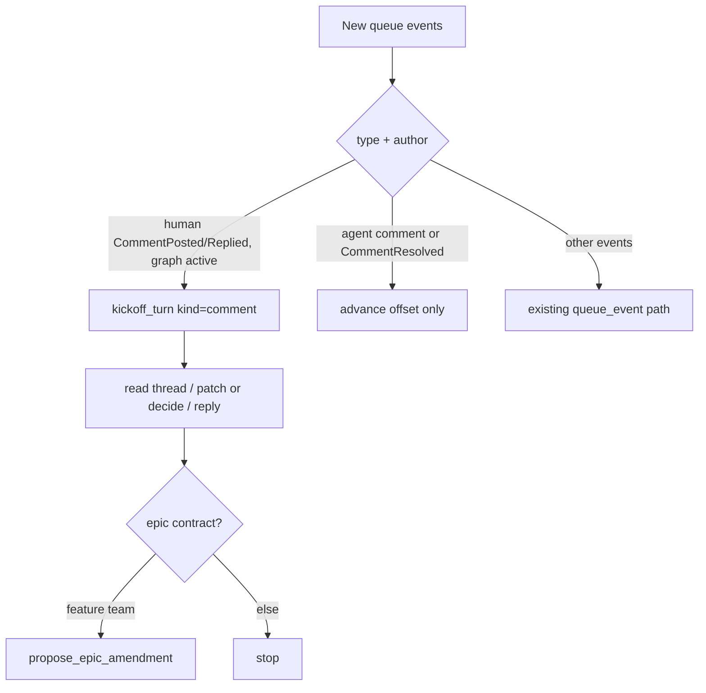

# Agent review turns

## Parent Epic

[epic_002](../../epics/2_active/epic_002_plan_view_review_threads.md) — Plan-view review threads.

Depends on: [feat_016](../3_completed/feat_016_comment_read_api_and_war_room_wiring.md) (completed 2026-10-20).

Cites (promote to frontmatter `cites:` when feat_019 lands): `epic_002#macro-architecture`, `epic_002#intent`.

Constraints this feature must honor:

- Kickoff edges only (feat_014). A model turn starts on an authorized edge, not on a watchdog poll with no new event.
- Owning graph only: epic-tier `doc_id` → `epic_{id}`; feature-tier → `feat_{id}`. Tasks have no comment room.
- Agents reply and may `write_doc` / `record_decision` / `propose_epic_amendment`. They do not resolve (feat_018) and do not set blocking.
- No timer polling for new comments.
- Delivery is watchdog-only (dec_011, epic dec_012). HTTP POST enqueues only. feat_016 D5 did **not** add `kickoff_graph_queue_event` to `_handle_comment`. Do **not** add an HTTP eager turn. If other work merged that call, remove it so only the watchdog starts a turn.

## Scope

**In**

- When a **human** `CommentPosted` or `CommentReplied` is ingested for an active owning graph, start **one** planning turn via existing `kickoff_turn(kind="comment")`. `KickoffReason.message` is a **dict**, same shape as `ingest_human`: `{"role": "human", "content": "cmt_NNN on {doc_id} #{section} [blocking]\n{body}" }` (cap `content` at ~2k chars; tell the agent to read the sidecar for the rest). This must work even when the graph has no prior chat messages. Today's `kickoff_graph_queue_event` → `kind=queue_event` path no-ops without `latest_input`; that is the bug this feature fixes.
- Agent-authored `CommentReplied` / `CommentPosted` must **not** request another comment-kind turn. Ingest the queue offset so it is not re-delivered, then stop. A reply loop is a defect.
- `CommentResolved` must **not** start a turn (feat_018 D2, dec_011). Ingest the offset only.
- HTTP `_handle_comment` is enqueue-only (watchdog `deliver_queue_kickoffs` delivers). feat_016 did not add an eager turn; do not add one. If `_handle_comment` currently calls `kickoff_graph_queue_event`, remove that call. One helper shared by watchdog; HTTP must not fire a turn for the same `comment_id`.
- Playbook (short addition to existing epic/feature role skills, **not** a new skill file). `epic_manager` and `feature_lead` already load `skills/roles/product_manager/SKILL.md`; put the bullets there (and a one-liner in `frugal_engineering` only if needed):
  1. Read the thread (`read_doc` + comments).
  2. Answer, patch the owning spec, or `record_decision` (include `In reply to: cmt_NNN` when locking a choice).
  3. `reply_comment` with what changed or why not.
  4. If a **feature** turn needs an epic contract change: `propose_epic_amendment`, do not silently edit the epic.
  5. Never `resolve_comment`.
- One system test: human comment on an activated epic with empty chat → exactly one kickoff. Agent reply in that thread → no second kickoff. Human resolve → no kickoff. HTTP POST + subsequent watchdog tick → still exactly one kickoff.

**Out**

- New queue event types.
- Polling `/api/comments` from the watchdog.
- Auto-resolve after a patch.
- Plan viewer chrome, HTTP schema, or dispatch gates (feat_016–019).
- A new role or a dedicated "reviewer" graph.
- A new skill path / new role-skill default list.
- Re-adding an HTTP `kickoff_graph_queue_event` turn (dec_012).

## Data structures

```text
KickoffReason.kind == "comment"   # already exists
  work_id: owning graph id
  by: human | watchdog
  message: {role: "human", content: str}   # dict, not a raw string
```

No new persistence.

## API contracts

```text
kickoff_human_comment(doc_id, comment_id, *, root) -> bool
    no-op if author != human
    no-op if event type is CommentResolved
    no-op if owning graph is not 2_active
    otherwise kickoff_turn(kind="comment", message={role, content})
    called from deliver_queue_kickoffs when new events include human comments
    not called from POST /api/comment (enqueue only)

CommentPosted / CommentReplied queue payloads stay as they are
    (doc_id, comment_id, author, section?)
```

`deliver_queue_kickoffs` today calls `kickoff_graph_queue_event` (kind=`queue_event`) on any offset advance. This feature must inspect the new events: human comment → `kind=comment`; everything else keeps existing queue_event behavior **except** comment events (human or agent) and `CommentResolved`, which must not use the empty-chat-breaking `queue_event` path as a substitute for `kind=comment`.

## Logic flow



## Task breakdown
- task_089
- task_088

Feature Team mints after dispatch. Suggested slice:

1. **Shared human-comment kickoff** — one helper; watchdog delivers; HTTP enqueue-only; skip agent authors and CommentResolved. The empty-chat vs agent-reply vs resolve vs double-HTTP+watchdog system test is the acceptance test.
2. **Playbook blurb** — five bullets on `skills/roles/product_manager/SKILL.md`. No new skill path.

## Risks & upward questions

- Double kickoff: feat_016 D5 left HTTP without an eager turn, but uncommitted main work may still add `kickoff_graph_queue_event`. Lock: watchdog-only delivery. Never leave both HTTP and watchdog starting a turn for the same comment.
- Staging the full comment body into the turn can be long. Cap at 2k chars.
- A human reply on an already-busy graph should still get one turn, not be dropped on `resume_inflight`. If an inflight turn is running, queue the comment as the next `kind=comment` after it finishes (existing inflight rules); do not drop the event.
- Other non-comment queue events must keep working (amendments, decisions). Do not make `deliver_queue_kickoffs` comment-only.

## Decision log

- **D1 — Human comments use `kind=comment`, not `queue_event`.** `queue_event` requires prior chat input and misses the first review on a quiet graph.
- **D2 — Agent replies never kickoff.** Prevents a reply loop; the human comes back if they want another round.
- **D3 — No new skill file.** Five bullets on `product_manager` (already loaded by epic_manager and feature_lead) are enough.
- **D4 — Message is a dict `{role, content}`.** Matches `ingest_human` / `KickoffReason.message`; a raw string would fail `_stage_human_message`.
- **D5 — Watchdog delivers; HTTP only enqueues (dec_011).** One edge, no double turn, resolve does not start a turn.
- **D6 — Do not add HTTP kickoff (epic dec_012 / feat_016 D5).** feat_016 shipped without `kickoff_graph_queue_event` on POST `/api/comment`. This feature implements watchdog delivery from that base; if merge reintroduces the HTTP call, delete it.

## Closeout

Completed child work: `task_088` (Shared human-comment kickoff via watchdog (HTTP enqueue-only)), `task_089` (Playbook: review-turn bullets in product_manager skill).
