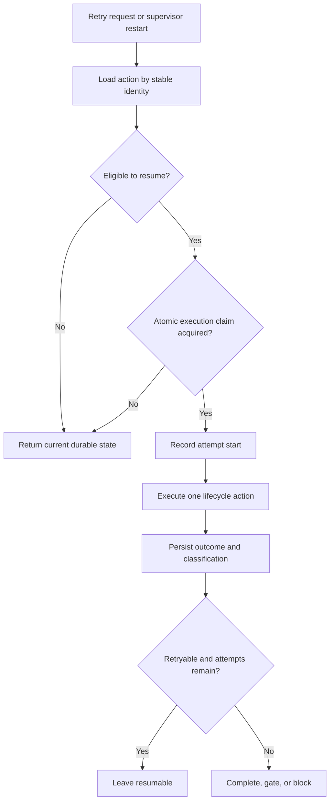

# Durable action recovery state

## Parent Epic

epic_026

## Objective

Persist and safely resume one logical lifecycle action across retries and supervisor restarts.

## Scope

- Stable action identity and durable recovery state.
- Failure classification: deterministic repair, transient retry, owner decision, human gate, terminal blocker.
- Serialized execution, bounded attempts, idempotent resume, and append-only attempt history.
- Integration proof that restart and concurrent retry requests do not duplicate downstream effects.

## Acceptance

- A logical action retains the same identity, current state, attempt count, failure classification, and attempt history after supervisor restart.
- Only one execution claim for an action may proceed at a time.
- Retry requests are bounded and idempotent; repeated or concurrent requests cannot duplicate team turns, reviews, merges, or completion events.
- Each attempt outcome is durably recorded, and terminal or gated classifications do not continue automatically.
- Restart and concurrent-retry integration tests demonstrate these semantics end to end.

## Out of scope

- Recovery implementations for every lifecycle action.
- War Room presentation changes.
- Generic workflow orchestration.
- Redundant mock-heavy unit coverage already exercised by integration tests.

## Data structures

A durable action record for one logical lifecycle action containing:

- Stable action identifier and action kind.
- Current recovery state and failure classification.
- Attempt count and configured attempt bound.
- Execution-claim/serialization metadata sufficient to prevent concurrent execution.
- Idempotency information for downstream effects.
- Append-only attempt entries with start, outcome, classification, and completion metadata.

Exact storage types and names follow existing repository conventions and are owned by task_026_001_001.

## API contracts

- Create or load an action by stable identity without producing a second logical action.
- Atomically claim an eligible action for execution; concurrent claims yield at most one executor.
- Persist attempt start and outcome together with the resulting recovery state.
- Resume an action idempotently after retry or restart.
- Stop automatic execution when the attempt bound is reached or classification requires owner/human intervention or is terminal.

Internal signatures follow existing lifecycle and persistence interfaces; this feature does not introduce a generic public orchestration API.

## Logic flow

## Task breakdown

1. task_026_001_001 — Persist stable action identity, recovery state, and attempt history.
2. task_026_001_002 — Implement serialized, bounded, idempotent action resume.
3. task_026_001_003 — Prove restart and concurrent-retry recovery semantics.

Dependencies are linear: task_026_001_002 depends on task_026_001_001; task_026_001_003 depends on task_026_001_002.

## Risks & upward questions

- Existing persistence and lifecycle boundaries may constrain where atomic claiming and idempotency are enforced; implementation should reuse those boundaries rather than introduce a parallel orchestration layer.
- No upward contract change is currently required.

## Decision log

No additional feature-level decisions beyond the approved scope.

## Closeout

Completed child work: `task_026_001_001` (Persist stable action identity, recovery state, and attempt history), `task_026_001_002` (Implement serialized, bounded, idempotent action resume), `task_026_001_003` (Prove restart and concurrent-retry recovery semantics).
