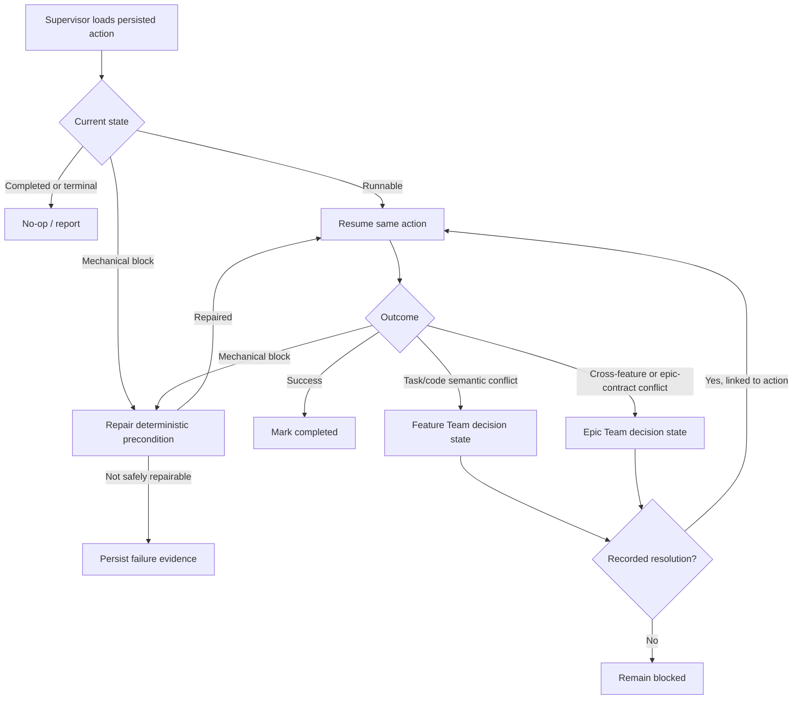

# Supervisor repair and owning-team handoff

## Parent Epic

epic_026

## Objective

Repair deterministic lifecycle failures within the supervisor boundary and hand semantic decisions to the correct owning team.

## Scope

- Resume an interrupted Task run.
- Restore a missing integration checkout from authoritative repository/ref metadata.
- Retry the original queued merge after mechanical preconditions recover.
- Route semantic task/code conflicts to the Feature Team.
- Route cross-feature or epic-contract conflicts to the Epic Team.
- Resume the same persisted action after a recorded resolution.

## Acceptance

- Interrupted Task execution resumes the original action and can complete without minting a replacement.
- A missing integration checkout is restored with the expected repository/ref identity, after which the original queued merge is retried.
- Repeated supervisor evaluation is idempotent: completed work is not duplicated and terminal states do not regress.
- Task/code semantic conflicts enter a Feature Team-owned decision state.
- Cross-feature or epic-contract conflicts enter an Epic Team-owned decision state.
- A recorded resolution resumes the exact blocked action across supervisor restarts.
- Task worker Git and forge permissions remain unchanged.

## Out of scope

- Automatic semantic conflict resolution.
- New Task worker Git or forge permissions.
- General-purpose workflow recovery unrelated to Task execution, integration checkout restoration, or queued feature merges.
- Broad persistence or merge subsystem redesign.

## Data structures

Use the existing durable lifecycle record, extended only as necessary with:

- A stable action identity and action kind for the interrupted Task run or queued merge.
- The authoritative inputs required to replay that action, including repository/ref or checkout identity where applicable.
- A state discriminator separating runnable, mechanically blocked, decision-blocked, completed, and terminal-failure states.
- Mechanical failure/repair metadata sufficient for deterministic retry.
- For decision-blocked actions: owning tier (Feature Team or Epic Team), relevant conflict evidence, and a reference to the recorded resolution.
- Idempotency/version information needed to prevent duplicate execution and stale state regression.

Existing persisted records must remain readable or receive a focused migration.

## API contracts

The supervisor boundary must provide behavior equivalent to these contracts, using existing repository conventions rather than introducing a parallel framework:

1. **Inspect:** load a persisted action and classify it as runnable, mechanically repairable, semantically blocked, completed, or terminal.
2. **Repair:** recreate deterministic missing prerequisites from authoritative persisted inputs. Repeated repair after success is a no-op.
3. **Retry/resume:** invoke the original persisted action identity; never infer or mint a replacement action.
4. **Handoff:** persist the blocked action, evidence, and owning tier. Ambiguous ownership fails closed instead of selecting an owner or resolving content.
5. **Resolve:** accept an explicit recorded resolution linked to the blocked action, then transition that same action back to runnable.
6. **Observe:** preserve enough outcome detail for supervisor-level acceptance tests and operational diagnosis.

## Logic flow

## Task breakdown

1. `task_026_002_001` — Persist supervisor repair and resumable-action state.
2. `task_026_002_002` — Repair interrupted Task runs and missing integration checkouts.
3. `task_026_002_003` — Retry mechanically blocked queued merges.
4. `task_026_002_004` — Route semantic conflicts to the owning team and resume after resolution.
5. `task_026_002_005` — Verify supervisor recovery and handoff acceptance scenarios.

Dependencies are intentionally ordered so the state contract lands first, recovery and retry build on it, ownership routing follows retry classification, and the final task verifies the integrated scenarios.

## Verification strategy

Prefer a compact supervisor-level scenario suite over redundant unit coverage:

- Interrupted Task resumes and repeated supervision does not duplicate execution.
- Missing checkout is restored, then the queued merge resumes.
- Mechanical merge blockage retries; semantic conflict does not auto-resolve.
- Both ownership routes are selected correctly.
- A linked resolution resumes the same action after restart.
- Existing relevant regressions pass and worker permission boundaries remain unchanged.

## Risks & upward questions

- Persisted-state compatibility is the main implementation risk; use the smallest additive schema change or a focused migration.
- Conflict classification must fail closed when ownership is ambiguous.
- No epic amendment is currently required; the plan stays within the approved feature boundary.

## Decision log

Board decisions are recorded through Cascade's decision log.

- `dec_001` · 2026-10-26 · Feature Lead · **Supervisor recovery boundary**
  Chose Persist and resume the same stable action identity; automatically repair only deterministic mechanical preconditions, while routing semantic conflicts to the Feature Team or Epic Team according to scope..
  Rationale: This is the smallest reliable design that supports restart-safe recovery and idempotent retry without granting Task workers new permissions or allowing the supervisor to make product or contract decisions.
  Honors: Feature scope and acceptance criteria for feat_026_002; frugal-engineering preference for minimal state and high-signal supervisor-level tests..

## Closeout

Completed child work: `task_026_002_001` (Persist supervisor repair and resumable-action state), `task_026_002_002` (Repair interrupted Task runs and missing integration checkouts), `task_026_002_003` (Retry mechanically blocked queued merges), `task_026_002_004` (Route semantic conflicts to the owning team and resume after resolution), `task_026_002_005` (Verify supervisor recovery and handoff acceptance scenarios).
