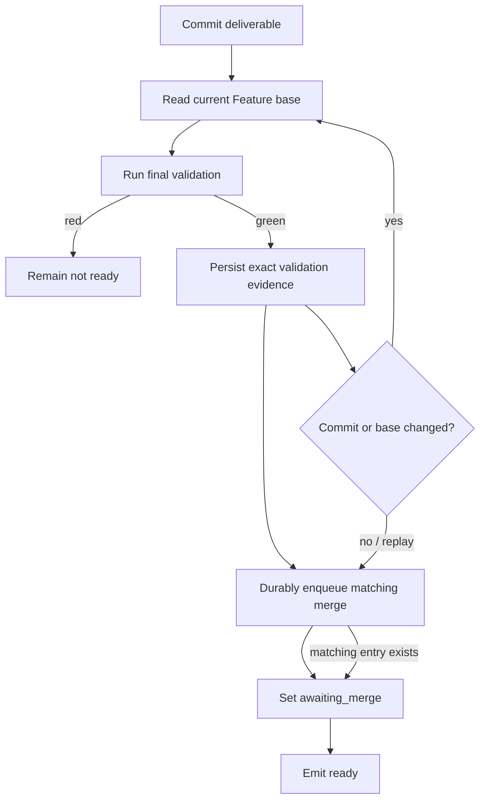

# Enforce the durable Task delivery boundary

## Parent Epic

epic_027

## Scope

Implement the epic's commit-first final-validation contract for Task delivery. A Task may enter `awaiting_merge` and emit ready only after its deliverable commit is validated against the current Feature base and a matching merge request is durably queued.

Persist and compare Task ID, deliverable SHA, and Feature-base SHA. Revalidate whenever either SHA changes, reject red or stale validation, and make restart/replay idempotent.

## Data structures

Use the existing Task execution/checkpoint state and pending merge queue.

- Final-validation evidence is keyed by Task ID, deliverable SHA, and Feature-base SHA.
- A pending merge request carries the same identity so replay can recognize the already queued delivery.
- No new scheduler, status store, or parallel queue is introduced.

## API contracts

No new public API is required.

The internal delivery transition must enforce:

1. `swe_commit` produces the deliverable commit.
2. Final validation records the exact Task ID, deliverable SHA, and current Feature-base SHA.
3. The matching pending merge request is durably recorded.
4. Only then may execution enter `awaiting_merge` and emit the ready notification.

A validation failure or identity mismatch leaves the Task short of merge-ready state. Replaying unchanged evidence must not create a duplicate pending merge.

## Logic flow

## Task breakdown

1. `task_027_001_001` — Persist exact delivery evidence and enforce durable queue insertion before `awaiting_merge` or ready.
2. `task_027_001_002` — Invalidate stale evidence on deliverable/base changes, block red validation, and make replay idempotent.
3. `task_027_001_003` — Add high-signal integration coverage for commit/validation drains, red validation, changed evidence, and duplicate prevention.

Dependencies are linear: `task_027_001_002` depends on `task_027_001_001`; `task_027_001_003` depends on `task_027_001_002`.

## Acceptance criteria

- Persisted final-validation evidence identifies the Task, deliverable commit, and Feature-base commit.
- No `awaiting_merge` state or ready event occurs without a durable pending merge matching that evidence.
- A deliverable or Feature-base SHA change requires fresh final validation.
- Red or stale validation never advances delivery.
- Restart/replay produces at most one matching pending merge and converges on the correct visible state.
- Integration tests exercise drains after commit and after validation, red validation, changed evidence, and duplicate-queue prevention through the real persistence/queue/state path.

## Risks & upward questions

- Crash boundaries between evidence persistence, queue insertion, and visible state must converge from durable state without relying on an in-memory phase label.
- Queue deduplication must use the full delivery identity; Task ID alone would incorrectly suppress a later valid delivery after a SHA change.
- No upward contract change is required.

## Out of scope

- Orphan detection, worker resume, or manual recovery tooling (Feature 2 and Feature 3).
- A new scheduler, merge queue, status store, or generic Git repair path.
- Unrelated notification, lease, checkpoint, or merge behavior.

## Decision log

Decisions are recorded through the board decision log.

- `dec_001` · 2026-10-31 · Feature Lead · **Delivery boundary implementation**
  Chose Use the existing execution/checkpoint state and pending merge queue, keyed by Task ID, deliverable SHA, and Feature-base SHA; order commit, exact final validation, durable queue insertion, awaiting_merge, then ready..
  Rationale: This is the smallest restart-safe implementation of the epic contract. The full evidence identity supports stale-evidence rejection and safe replay without introducing a second queue or state store.
  Honors: Epic delivery contract, cross-module constraints, and the feature acceptance criteria for changed-evidence revalidation and duplicate prevention..

## Closeout

Completed child work: `task_027_001_001` (Persist delivery evidence and queue merge before ready state), `task_027_001_002` (Revalidate changed delivery evidence and make replay idempotent), `task_027_001_003` (Add integration coverage for the durable delivery boundary).
