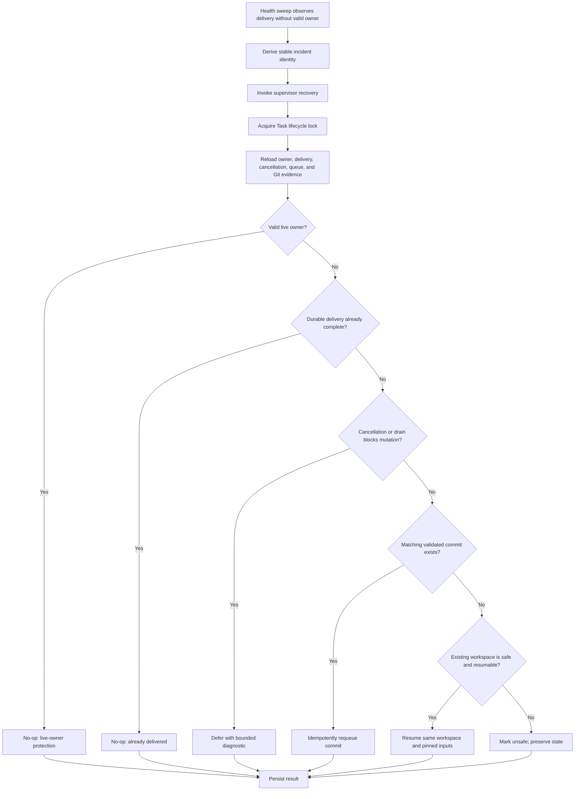

# Detect and recover orphaned Task delivery

## Parent Epic

epic_027

## Scope

Extend the direct-report health sweep and a shared supervisor recovery operation. Under the Task lifecycle lock, derive a stable incident, recheck ownership and durable delivery evidence, then requeue a matching validated commit or resume the existing branch, worktree, checkpoint, and pinned execution inputs. Preserve dirty state. Cover restart replay, live-owner protection, bounded cancellation, unsafe or missing Git state, drains before commit or queue, and concurrent requests.

## Data structures

- **OrphanDeliveryIncident**: stable identity derived from task ID plus the abandoned delivery attempt/generation. Records the observed owner/lease state, delivery phase, branch and worktree identity, checkpoint, pinned execution inputs, candidate commit, first/last observation, and disposition.
- **RecoveryDecision**: one of `no_op_live_owner`, `already_delivered`, `requeue_commit`, `resume_workspace`, `defer_draining`, or `unsafe`, with machine-readable reason and durable evidence references.
- **RecoveryResult**: incident identity, selected decision, whether a mutation occurred, resulting queue/attempt identity when applicable, and diagnostics suitable for health-sweep logging.
- Incident and recovery records are durable and idempotency-keyed so restart replay and concurrent callers converge on one outcome.

## API contracts

### Shared supervisor recovery operation

Input: task ID and optional observed incident/generation from the health sweep.

Under the Task lifecycle lock, the operation must:

1. Reload current ownership, cancellation/drain state, delivery evidence, attempt metadata, and Git/worktree state.
2. Return a no-op when a valid live owner exists or durable evidence proves delivery already completed.
3. Requeue only when the candidate commit matches the task's recorded branch/worktree lineage and passes the existing delivery validation.
4. Otherwise resume the same branch, worktree, checkpoint, and pinned execution inputs without cleaning or overwriting dirty state.
5. Refuse mutation for missing, ambiguous, or unsafe Git state and return diagnostics.
6. Be idempotent for the same incident and serialize concurrent recovery requests.

It must not create a fresh workspace, silently discard changes, bypass bounded cancellation, or enqueue while cancellation/drain state forbids it.

### Direct-report health sweep

The sweep detects stable orphan delivery only after ownership/liveness evidence and lifecycle state satisfy the existing stability window. It invokes the shared operation outside broad sweep iteration but lets that operation acquire the per-Task lifecycle lock and revalidate all evidence. A stale observation is therefore harmless.

## Logic flow

## Task breakdown

1. `task_027_002_001` — Model stable orphan-delivery incidents and recovery decisions.
2. `task_027_002_002` — Implement the guarded, idempotent supervisor recovery operation; depends on 001.
3. `task_027_002_003` — Extend the direct-report health sweep to detect stable incidents and invoke recovery; depends on 002.
4. `task_027_002_004` — Verify the full orphan-delivery recovery lifecycle, including restart replay and concurrency; depends on 003.

## Risks & upward questions

- Existing delivery evidence may not uniquely bind a commit to a task attempt; recovery must fail closed until lineage is provable.
- Lock ordering between the health sweep, Task lifecycle lock, cancellation, and queue operations must follow existing ordering to avoid deadlock.
- Worktree disappearance or branch movement is diagnostic/unsafe state, not permission to recreate or reset it.
- No upward decision is currently required; implementation should reuse the lifecycle lock, validation, drain, and cancellation primitives established by `feat_027_001`.

## Decision log

Recorded through Cascade decisions.

- `dec_001` · 2026-10-31 · Feature Architect · **Recovery serialization and revalidation**
  Chose Serialize recovery under the existing per-Task lifecycle lock and re-read all mutable evidence before choosing an action..
  Rationale: Health-sweep observations can become stale, and concurrent or replayed requests must converge without stealing work from a live owner or duplicating delivery.
  Honors: Feature scope requirements for live-owner protection, restart replay, and concurrent requests..

- `dec_002` · 2026-10-31 · Feature Architect · **Recovery priority**
  Chose Prefer a matching validated commit for idempotent requeue; otherwise resume the existing workspace, checkpoint, and pinned inputs..
  Rationale: A proven commit is the least expensive safe recovery path, while workspace resumption preserves uncommitted progress when no deliverable commit exists.
  Honors: Feature scope requirements to requeue validated delivery or resume existing execution state while preserving dirty state..

- `dec_003` · 2026-10-31 · Feature Architect · **Unsafe state handling**
  Chose Fail closed with durable diagnostics when Git/worktree lineage is missing, ambiguous, or unsafe; never clean, reset, or synthesize a replacement workspace..
  Rationale: Automated reconstruction could discard or misattribute user work, whereas a diagnostic disposition preserves evidence for bounded manual recovery.
  Honors: Feature scope requirements for dirty-state preservation and unsafe or missing Git state..

## Closeout

Completed child work: `task_027_002_001` (Model stable orphan-delivery incidents and recovery decisions), `task_027_002_002` (Implement guarded supervisor recovery operation), `task_027_002_003` (Extend direct-report health sweep to recover orphaned delivery), `task_027_002_004` (Verify orphan-delivery recovery lifecycle).
