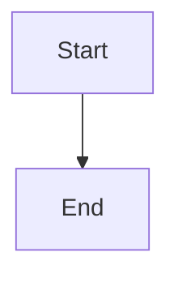

# Expose scoped Task recovery and recovery state

## Parent Epic

epic_027

## Scope

Add Feature Team recover_task(task_id) for direct children using the shared supervisor recovery operation. Return precise outcomes and surface incidents through existing parent blockage provenance and War Room state, including semantic merge conflicts; clear only the matching derived blocker. Cover scope authorization, simultaneous tool/sweep requests, outcome rendering, and blocker lifecycle.

## Data structures

TBD.

## API contracts

TBD.

## Logic flow

## Task breakdown
- task_027_003_003
- task_027_003_002
- task_027_003_001

_(empty — Feature Team mints tasks after dispatch)_

## Risks & upward questions

None.

## Decision log

None yet.

## Closeout

Completed child work: `task_027_003_001` (Implement scoped Feature Team recover_task command), `task_027_003_002` (Project Task recovery incidents and blocker lifecycle), `task_027_003_003` (Add end-to-end coverage for scoped recovery behavior).
