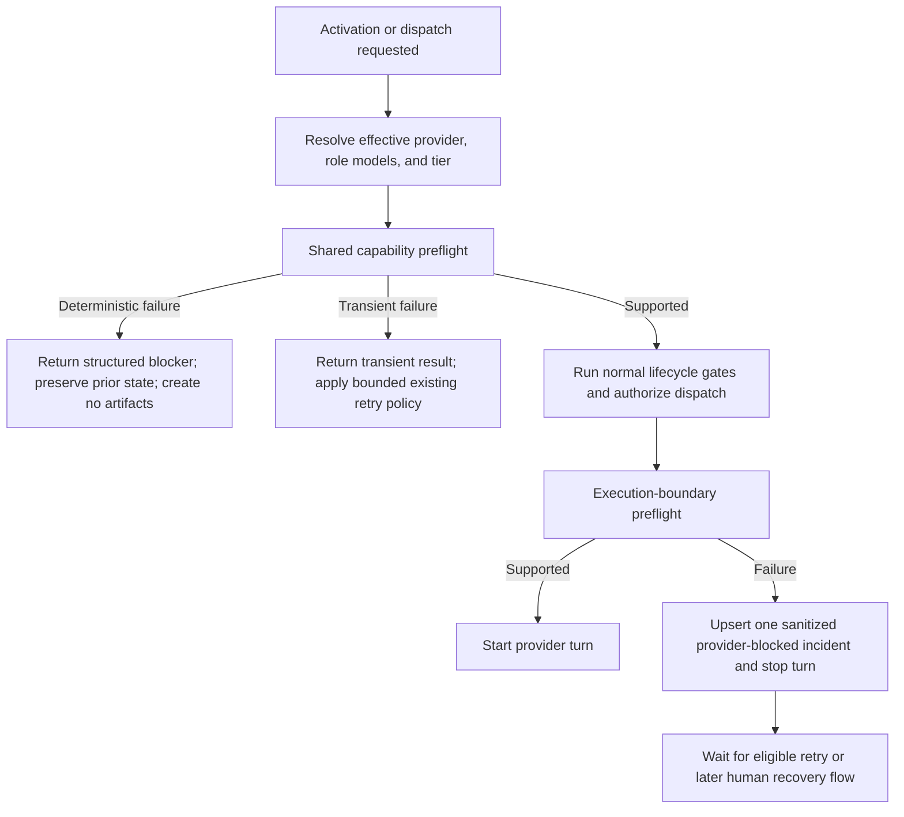

# Provider preflight and durable blocker state

## Parent Epic

epic_029

## Scope

Add one shared, read-only capability preflight for the effective pinned provider, every affected role model, and selected service tier (including flex). Run it before Epic activation, before Feature or Task dispatch, and again immediately before execution. Failed early checks leave the item in its prior lifecycle state and create no worktree, checkpoint, or dispatch artifacts.

When availability is lost after work has started, persist one sanitized, restart-visible provider-blocked incident per work item. Deterministic configuration failures wait for an explicit human retry or provider change; transient transport/setup failures may use existing bounded retry behavior. Do not silently change provider, model, or tier, and do not affect sibling or child work.

Provider-changing recovery controls, checkpoint migration/reconciliation, and War Room UI are owned by later features.

## Data structures

### Provider capability request

- Work ID and lifecycle boundary.
- Effective pinned provider.
- Affected role-to-model selections.
- Effective tier/flex selection.

The request is derived from existing provider/model resolution and contains no credential values.

### Provider capability result

A structured result with:

- outcome: supported, deterministic blocker, or transient failure;
- affected roles and rejected provider/model/tier fields;
- stable safe reason code and operator-safe summary;
- recommended remedy (retry setup, disable flex, or choose another provider/model);
- attempt timestamp.

Raw provider payloads and secrets are never persisted or returned to the room.

### Provider-blocked incident

One durable record keyed by work ID, updated rather than appended on repeated equivalent failures. It stores the work ID, affected roles, provider, safe reason/classification, last attempt, and recommended remedy. Successful preflight clears or supersedes the active blocker through the existing state mechanism while retaining any required audit history.

## API contracts

- The shared preflight is side-effect free: it reads installed/authenticated capability and validates all role models plus tier settings.
- Callers receive a structured supported/blocking/transient result; they do not infer failure type from exception text.
- Epic activation and Feature/Task dispatch must call preflight before lifecycle mutation or artifact creation.
- The execution launcher must recheck after dispatch authorization and immediately before starting a provider turn.
- A failed execution-boundary check records or refreshes the single work-item blocker and prevents the turn.
- Deterministic failures are not automatically repeated. Transient failures may use the existing bounded backoff policy.
- Existing lifecycle locks and ownership checks remain authoritative; preflight does not grant dispatch or recovery permission.
- Unrelated work continues normally and keeps its own pinned selection.

## Logic flow

## Task breakdown

1. `task_029_001_001` — Implement the reusable capability request/result contract and provider/model/tier check.
2. `task_029_001_002` — Gate Epic activation and Feature/Task dispatch before lifecycle mutation or artifact creation.
3. `task_029_001_003` — Recheck immediately before execution and upsert the durable sanitized blocker.
4. `task_029_001_004` — Add high-signal lifecycle and restart coverage after tasks 002 and 003 integrate.

Dependencies: tasks 002 and 003 depend on task 001; task 004 depends on tasks 002 and 003.

## Acceptance criteria

- Unsupported provider, model, or tier is rejected before Epic activation or Feature/Task dispatch mutates state or creates a worktree/checkpoint.
- Availability is rechecked immediately before execution, preventing a turn when capability changed after initial preflight.
- Deterministic and transient failures produce distinct structured classifications and retry behavior.
- Repeated failures for one item update one safe provider-blocked incident that survives refresh and restart.
- Blocker content includes the required safe operational fields without credential values or raw provider payloads.
- Supported configurations preserve existing activation/dispatch behavior.
- Sibling and child work are unaffected.
- Integration coverage proves supported, deterministic, transient, no-artifact, deduplication, and restart-visible behavior; lower-level tests are added only where integration tests cannot economically exercise the contract.

## Risks & upward questions

- Provider inventories may report incomplete tier support until turn startup. The execution-boundary check must convert an actual tier rejection into the same actionable deterministic blocker.
- Artifact creation ordering may differ across Epic, Feature, and Task paths. Each caller must prove preflight precedes its first durable dispatch mutation.
- Existing persistence may not support a natural unique key. Use the smallest compatible upsert mechanism keyed by work ID rather than introducing a parallel incident store.

No upward contract change is requested.

## Decision log

- Provider preflight uses a shared structured result and remains read-only; lifecycle callers own state mutation.
- A work item has at most one active provider-blocked incident, refreshed on repeated failure and safe across restart.
- This feature stops at detection, gating, and durable blocker state; human provider change, checkpoint reconciliation, and recovery UI remain in features 2 and 3.

- `dec_001` · 2026-11-02 · Feature Lead · **Preflight ownership**
  Chose Use one shared structured, read-only provider capability preflight; lifecycle callers remain responsible for state changes..
  Rationale: A single contract prevents divergent provider/model/tier classification while keeping capability checks safe before dispatch authorization.
  Honors: Epic requirement to reuse provider inventory, keep startup checks read-only, and preserve lifecycle gates..

- `dec_002` · 2026-11-02 · Feature Lead · **Blocker identity**
  Chose Maintain at most one active provider-blocked incident per work item and refresh it on repeated failures..
  Rationale: A work-ID-keyed upsert provides restart visibility and prevents duplicate incidents or repeated failure noise.
  Honors: Epic requirement for one durable safe incident with no secret or raw provider payload exposure..

- `dec_003` · 2026-11-02 · Feature Lead · **Feature boundary**
  Chose Limit this feature to capability detection, lifecycle gating, execution recheck, and durable blocker state..
  Rationale: Provider selection changes, checkpoint reconciliation, retry controls, and War Room UI have distinct atomicity and presentation concerns assigned to features 2 and 3.
  Honors: Approved epic sequencing and the smallest independently shippable slice..

## Closeout

Completed child work: `task_029_001_001` (Implement shared provider capability preflight), `task_029_001_002` (Gate Epic activation and Feature/Task dispatch), `task_029_001_003` (Recheck at execution boundary and persist provider blockers), `task_029_001_004` (Verify provider preflight lifecycle behavior).
