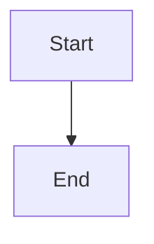

# Atomic active-item provider recovery

## Parent Epic

epic_029

## Scope

Implement one human-authorized recovery command across Epic, Feature, and Task. Serialize with lifecycle activity, validate every affected role plus reasoning/tier/flex selection, preserve plan/progress/worktree/dirty files, atomically reconcile persisted selection and checkpoint pins, and either resume proven-compatible state or reconstruct a fresh role turn. Keep child selections unchanged and make retry idempotent.

## Data structures

TBD.

## API contracts

TBD.

## Logic flow

## Task breakdown
- task_029_002_003
- task_029_002_002
- task_029_002_001

_(empty — Feature Team mints tasks after dispatch)_

## Risks & upward questions

None.

## Decision log

None yet.

## Closeout

Completed child work: `task_029_002_001` (Implement atomic active-item provider recovery engine), `task_029_002_002` (Wire human-authorized recovery command into lifecycle serialization), `task_029_002_003` (Verify cross-tier recovery preservation and retry behavior).
