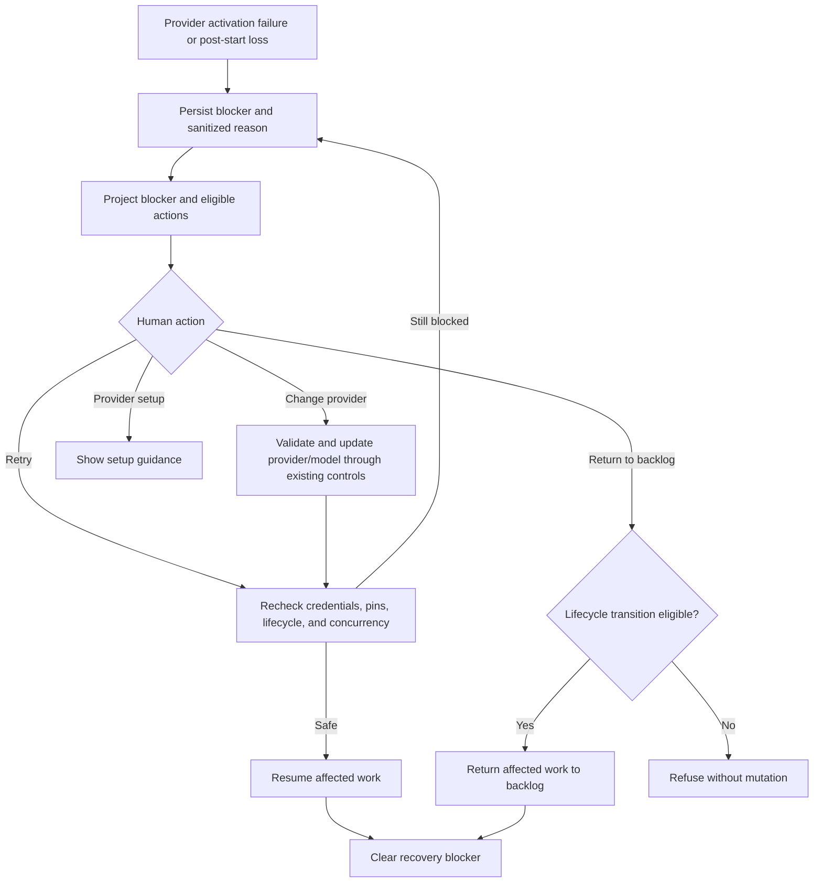

# War Room provider recovery controls and lifecycle proof

## Parent Epic

epic_029

## Scope

Project the durable provider blocker and safe reason on board and War Room; expose human-only Change provider and Retry using existing provider/model controls, with provider setup and eligible Return to backlog kept distinct. Add focused API/browser/restart/lifecycle coverage for activation failure, post-start loss, active Epic/Feature/dirty Task recovery, stale pins, concurrency, restored credentials, non-stoppable turns, and unaffected siblings/children.

## Data structures

- A durable provider-recovery record is associated with the affected work item and survives process restart.
- The record carries the blocked lifecycle context, the selected provider/model context needed to detect stale pins, and a sanitized human-readable reason suitable for board and War Room projection.
- Recovery projections expose explicit action eligibility rather than requiring clients to infer it: Change provider, Retry, provider setup guidance, and Return to backlog remain distinct outcomes.
- Recovery state is scoped to the affected work item. Siblings and children are not mutated as a side effect.

## API contracts

- Read surfaces return the durable blocker, safe reason, and server-computed eligible actions consistently to board and War Room clients.
- Change provider is human-only, reuses existing provider/model controls, and is validated against the current recovery state.
- Retry is human-only and rechecks credentials, current provider/model selection, lifecycle state, and concurrency before resuming.
- Missing credentials or provider configuration returns provider setup guidance; it is not represented as Return to backlog.
- Return to backlog is offered only for lifecycle states where that transition is safe, including clean/dirty Task distinctions.
- Non-stoppable turns refuse unsafe recovery actions. Stale pins and concurrent or repeated requests produce deterministic, safe responses.
- Authorization and lifecycle eligibility are enforced server-side; UI visibility is not an authorization boundary.

## Logic flow

## Task breakdown

1. `task_029_003_001` — Define and persist provider-recovery state and API contract. **Completed.**
2. `task_029_003_002` — Implement human-only provider change and retry recovery controls. **Completed; depends on 001.**
3. `task_029_003_003` — Project recovery blocker and controls in board and War Room. **Completed; depends on 001 and 002.**
4. `task_029_003_004` — Prove provider-recovery lifecycle, restart durability, and isolation. **Completed; depends on 002 and 003.**

## Risks & upward questions

- Safe recovery depends on server-side lifecycle and concurrency checks remaining authoritative across all clients.
- Sanitized reasons must be useful to humans without leaking credential or provider internals.
- Browser coverage should prove projection and action wiring; lifecycle, restart, concurrency, and isolation behavior should stay in focused API/integration tests to avoid redundant brittle coverage.
- No upward contract change is currently required.

## Decision log

Decisions are recorded through the Cascade decision log.

- `dec_001` · 2026-11-02 · Feature Lead · **Provider recovery actions**
  Chose Keep Change provider, Retry, provider setup guidance, and Return to backlog as distinct server-computed actions; enforce human authorization and lifecycle eligibility on the server..
  Rationale: These actions have different prerequisites and side effects. Keeping them distinct prevents clients from inferring unsafe transitions and preserves the epic's human-only recovery boundary.
  Honors: Feature scope and Task 001 provider-recovery contract.

- `dec_002` · 2026-11-02 · Feature Lead · **Delivery and verification**
  Chose Deliver in the existing dependency order 001 → 002 → 003 → 004, using focused API/integration coverage for lifecycle, restart, concurrency, and isolation, with browser coverage limited to projection and control wiring..
  Rationale: The sequence stabilizes durable state and server behavior before UI projection, then proves the complete lifecycle with high-signal tests and minimal redundant maintenance.
  Honors: Minted task graph, frugal-engineering testing guidance, and feature acceptance scope.

## Closeout

Completed child work: `task_029_003_001` (Define and persist provider-recovery state and API contract), `task_029_003_002` (Implement human-only provider change and retry recovery controls), `task_029_003_003` (Project recovery blocker and controls in board and War Room), `task_029_003_004` (Prove provider-recovery lifecycle, restart durability, and isolation).
