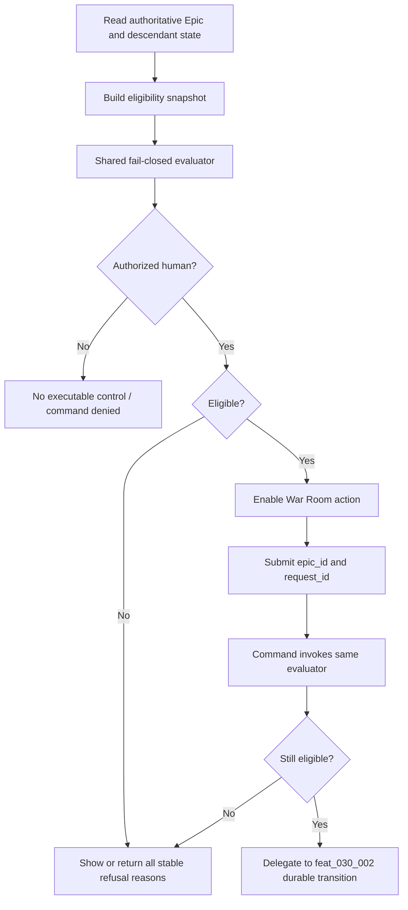

# Eligibility contract and operator control

## Parent Epic

epic_030

## Scope

Deliver the read-only safety and operator-control slice for returning an active Epic graph to backlog:

- one fail-closed eligibility evaluator over authoritative Epic, descendant, provenance, lifecycle, turn, and Git-retention state;
- stable machine-readable refusal codes plus operator-readable explanations, reporting all failures in one result;
- a human-authorized API/command boundary that reuses the evaluator and is side-effect free on refusal;
- a War Room Epic-row control whose availability and refusal detail come from the same result;
- focused predicate tests and integration coverage for presentation/enforcement parity and the failed-startup/no-substantive-mutation case.

This feature defines and exposes the safety contract. It does not perform the graph-wide lifecycle mutation, journaling, locking, preservation, or backlog publication owned by feat_030_002.

## Data structures

### Eligibility input

A read-only snapshot assembled from authoritative persisted state:

- Epic identity, tier, lifecycle state, and conflicting-transition state;
- complete descendant membership with stable IDs, parent links, source revisions, approvals, comments, and review provenance;
- in-flight turn/quiescence capability and conflicting lifecycle state for every graph member;
- activation/source provenance required for deterministic restoration;
- plan, amendment, checkpoint, and substantive-change preservation facts;
- branch/worktree retention facts for every graph member;
- availability of deterministic graph-wide lifecycle lock ordering.

Unknown, missing, stale, or unreadable required facts fail closed.

### Eligibility result

`ReturnEligibility` contains:

- `eligible: boolean`;
- `reasons: ReturnRefusal[]`, deterministically ordered and containing every detected failure;
- each refusal has a stable `code` and safe operator-facing `message`;
- optional non-authoritative display metadata may be added, but command enforcement depends only on authoritative reevaluation.

Reason codes are API compatibility surface. The initial code set covers wrong tier/state, conflicting transition, incomplete or changed graph, missing restoration provenance, turn not quiesceable, conflicting descendant lifecycle, unpreservable history, unpreservable Git state, unavailable lock order, and unknown/unreadable required state. Names should follow existing repository conventions while retaining these distinct meanings.

Approved plans, descendants, review history, failed provider startup, dirty files, or unmerged commits are not failures by themselves. Refuse only when the graph or artifacts cannot be proven preservable/restorable.

## API contracts

### Read eligibility

The War Room/API read model exposes the evaluator result for an active Epic and the current actor. Unauthorized actors do not receive an executable control. Refusal messages must be actionable without exposing credentials, transcript content, or other secrets.

### Return command boundary

`return_epic_to_backlog(epic_id, request_id)`:

- requires an authenticated, authorized human actor;
- rejects non-Epic targets and unauthorized callers;
- invokes the shared evaluator rather than duplicating predicate logic;
- returns the stable refusal list when ineligible;
- performs no substantive mutation on authorization or eligibility refusal;
- hands an eligible request to the durable transition capability supplied by feat_030_002.

The final transition must reevaluate after quiescence while holding lifecycle locks; that mutation protocol is not implemented in this feature.

### War Room row

For each active Epic row:

- authorized humans see the Return to backlog capability;
- eligibility controls enabled state;
- ineligible state surfaces every refusal explanation rather than silently hiding the capability;
- invoking the control sends `epic_id` and a request ID through the command API;
- command refusal remains authoritative if state changed after rendering.

## Logic flow

## Acceptance criteria

- Every parent eligibility predicate has a table-driven case, including missing/unknown inputs and multiple simultaneous failures.
- The evaluator returns all failures in deterministic order and never treats unknown safety state as eligible.
- Existing children, approved/reviewed plans, and preservable substantive history remain eligible.
- A provider startup failure that made no substantive mutation remains eligible when all other predicates pass.
- API command and War Room presentation consume the same evaluator contract; an integration test proves parity.
- Human authorization is enforced server-side, and refusals cause no substantive mutation.
- Stable refusal codes and safe messages are exposed consistently by API and War Room.
- No code in this feature attempts graph transition, cleanup, trunk switching/reset, provider fallback, or active provider/model editing.

## Task breakdown

1. task_030_001_001 — Implement shared fail-closed return eligibility evaluator.
2. task_030_001_002 — Enforce authorized return command and API contract. Depends on task 001.
3. task_030_001_003 — Add War Room Epic-row return control. Depends on tasks 001 and 002.
4. task_030_001_004 — Verify eligibility consistency and failed-startup behavior. Depends on tasks 002 and 003.

## Verification strategy

Prefer high-signal coverage:

- one table-driven evaluator suite for predicate truth cases, unknown state, aggregation, and ordering;
- API/authorization tests for denial and side-effect-free refusal;
- one integration path proving the row and command agree on the same authoritative result;
- one failed-startup fixture proving credential/provider startup failure without substantive mutation is eligible.

Do not duplicate evaluator truth tables in UI tests; UI coverage should verify contract rendering and invocation.

## Risks & upward questions

- Repository-native reason-code naming and authorization abstractions should be reused during implementation; semantic coverage above is fixed.
- feat_030_002 must provide the eligible-command handoff and locked reevaluation. Until then, eligible execution must fail safely rather than simulate a transition.
- No epic amendment is required: this plan narrows directly to the approved Feature 1 contract.

## Decision log

Board decisions are recorded through Cascade.

- `dec_001` · 2026-11-01 · Feature Lead · **Eligibility result contract**
  Chose Return all detected eligibility failures in deterministic order using stable reason codes, and treat unknown or unreadable required state as ineligible..
  Rationale: Operators need one actionable response, API/UI parity, and fail-closed behavior without predicate duplication.
  Honors: Epic eligibility contract; stable refusal reasons; presentation/enforcement consistency; side-effect-free refusal..

- `dec_002` · 2026-11-01 · Feature Lead · **Feature boundary**
  Chose Limit feat_030_001 to read-only eligibility, authorization, API contract, and War Room control; delegate all lifecycle mutation and locked reevaluation to feat_030_002..
  Rationale: This is the smallest shippable contract slice and prevents a partial, non-durable transition implementation from entering the operator path.
  Honors: Epic feature breakdown; durable-transition ownership; frugal scope; no simulated or partial mutation..

## Closeout

Completed child work: `task_030_001_001` (Implement shared fail-closed return eligibility evaluator), `task_030_001_002` (Enforce authorized return command and API contract), `task_030_001_003` (Add War Room Epic-row return control), `task_030_001_004` (Verify eligibility consistency and failed-startup behavior).
