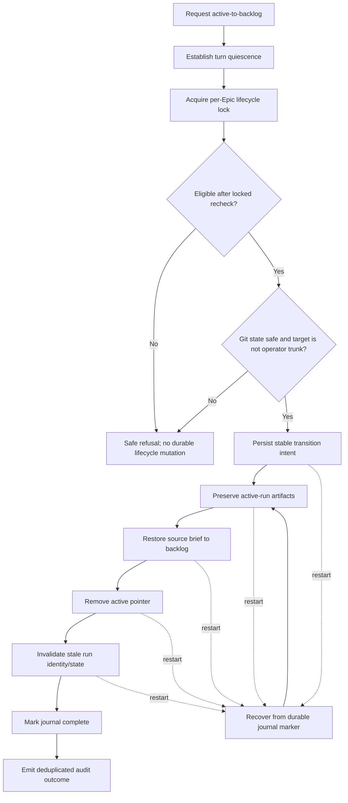

# Durable idempotent active-to-backlog transition

## Parent Epic

epic_030

## Scope

Deliver turn quiescence, per-Epic lifecycle locking and locked eligibility recheck, a durable replay-safe transition journal, active-run artifact preservation, source-brief restoration, active-pointer removal, stale-run invalidation, recovery, and deduplicated audit emission. Verify concurrent/repeated requests, restart at each durable boundary, racing turns, Git safety refusals, and no operator-trunk mutation.

## Data structures

- **Lifecycle lock:** one serialization boundary per Epic, held from the eligibility recheck through transition completion or safe refusal.
- **Transition journal:** a stable transition identity plus ordered durable step markers sufficient to distinguish intent, artifact preservation, source-brief restoration, active-pointer removal, stale-run invalidation, and completion.
- **Audit identity:** derived from the stable transition identity so retries and recovery emit one logical outcome.
- **Preserved run artifacts:** immutable evidence from the former active run; they are retained independently of the restored backlog brief.

Exact storage types and paths follow existing repository conventions discovered during implementation; this feature does not introduce a second lifecycle store.

## API contracts

- A transition request first establishes turn quiescence, then acquires the Epic lifecycle lock and rechecks eligibility while locked.
- Ineligible or Git-unsafe requests refuse without partial durable lifecycle mutation.
- Repeating or concurrently issuing the same logical request converges on the same result.
- Once durable intent exists, restart recovery resumes or safely finalizes from journal state.
- Success preserves active-run artifacts, restores the source brief as the backlog representation, removes the active pointer, invalidates stale run identity/state, and emits one deduplicated audit record.
- No transition or recovery path mutates operator trunk.
- Existing lifecycle behavior outside active-to-backlog remains unchanged.

## Logic flow

## Task breakdown

1. `task_030_002_001` — Implement lifecycle gate and locked eligibility recheck.
2. `task_030_002_002` — Implement the journaled active-to-backlog transaction; depends on 001.
3. `task_030_002_003` — Add transition recovery and deduplicated audit emission; depends on 002.
4. `task_030_002_004` — Verify durability, races, and Git safety with focused integration coverage; depends on 003.

## Risks & upward questions

- The implementation must reuse existing lifecycle and Git-safety conventions. If the repository has no stable transition-identity convention or cannot preserve artifacts without touching operator trunk, escalate before inventing a competing store or workflow.
- The precise wait-versus-refuse behavior for non-quiescent work remains governed by the existing lifecycle contract.

## Decision log

Board decision entries are recorded separately through Cascade.

- `dec_001` · 2026-11-01 · Feature Lead · **Transition architecture and delivery order**
  Chose Use one per-Epic locked, journaled, replay-safe active-to-backlog transaction, delivered in the dependency order lifecycle gate → durable mutation → recovery/audit → focused integration verification..
  Rationale: The transition spans multiple durable boundaries and must survive retries, races, and restarts without partial state or duplicate audit effects. A single serialized transaction model is the smallest design that keeps the lifecycle honest; sequencing the tasks prevents recovery and verification from targeting an unstable contract.
  Honors: Feature scope; existing lifecycle and Git-safety conventions; artifact preservation; stale-run invalidation; deduplicated audit emission; no operator-trunk mutation..

## Closeout

Completed child work: `task_030_002_001` (Implement lifecycle gate and locked eligibility recheck), `task_030_002_002` (Implement journaled active-to-backlog transaction), `task_030_002_003` (Add transition recovery and deduplicated audit emission), `task_030_002_004` (Verify transition durability, races, and Git safety).
