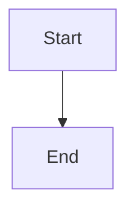

# Reviewed edit and clean reactivation journey

## Parent Epic

epic_030

## Scope

Connect the restored Epic to the existing MR-backed backlog edit/refresh path and ensure later activation creates a fresh run identity with freshly resolved role pins. Provide the epic_028 end-to-end journey from Cursor credential failure through reviewed provider/model change to Codex activation, proving archived checkpoints are ignored and reviewed/child-work cases refuse.

## Data structures

TBD.

## API contracts

TBD.

## Logic flow

## Task breakdown
- task_030_003_003
- task_030_003_002
- task_030_003_001

_(empty — Feature Team mints tasks after dispatch)_

## Risks & upward questions

None.

## Decision log

None yet.

## Closeout

Completed child work: `task_030_003_001` (Connect restored epics to the reviewed backlog edit and refresh path), `task_030_003_002` (Create a clean activation run with freshly resolved role pins), `task_030_003_003` (Prove the Cursor-failure to Codex-reactivation journey end to end).
