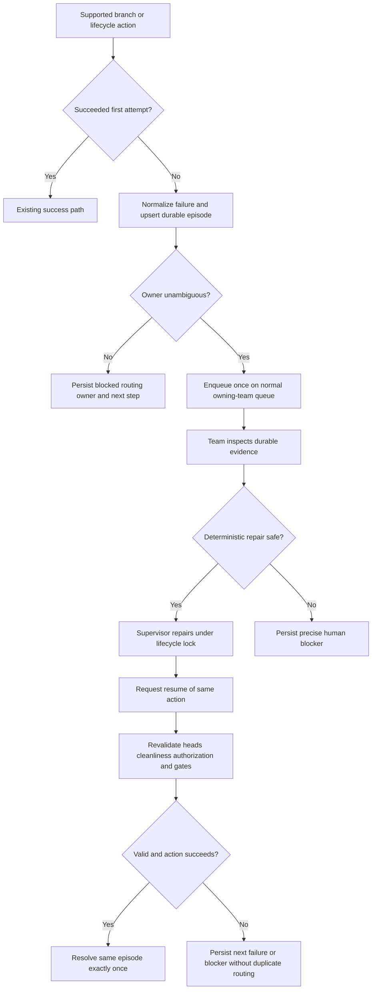

# Durable branch-action recovery and owning-team handoff

## Parent Epic

epic_031

## Outcome

Route the first unsuccessful supported branch or lifecycle action through one durable recovery episode, preserve the original action identity and evidence, and durably queue exactly one investigation for the owning Feature or Epic Team. The same action can then be repaired and resumed safely under the lifecycle lock, or remain blocked with a precise human next step.

## Scope

- Extend the existing `epic_026` recovery record and transition model; do not create a parallel incident or notification system.
- Apply one shared recovery boundary to operator and supervisor branch updates, Task-to-Feature merges, Feature-to-Epic merges, and Epic promotion/close merges.
- Normalize typed unsuccessful results and thrown failures at the first failed attempt.
- Route Feature-local work to the Feature Team and Epic-targeted or cross-feature work to the Epic Team through their normal durable queues.
- Provide bounded deterministic supervisor repair and a command to resume the original action.
- Persist recovery state, attempts, routing markers, evidence, provenance, and precise blockers across supervisor restart.

Review reconciliation for accepted stacked changes that have not reached the intended Epic branch belongs to `feat_031_003`. War Room/API projection and operator-facing warning behavior belong to `feat_031_002`; this feature provides their durable source state.

## Acceptance criteria

1. A supported action's first typed failure or thrown error upserts one recovery episode keyed by stable original action identity before returning control.
2. The episode survives refresh and supervisor restart with authorization reference, action kind, work identity, source and intended target refs/revisions, owning checkout, normalized reason, safe summary, conflicting paths when available, attempt count, checkout/abort state, recovery state, next step, and evidence/provenance intact.
3. Existing `epic_026` records remain readable and in-flight records can progress without destructive migration.
4. Ownership is derived from the intended integration boundary: Task and Feature-local actions route to the Feature Team; Epic targets and cross-feature integration route to the Epic Team. Missing or conflicting ownership becomes a durable routing blocker.
5. One recovery episode creates at most one owning-team investigation. Repeated clicks, retries, polling, queue delivery attempts, and restarts do not duplicate the episode, investigation, underlying action, or completion signal.
6. A queued investigation contains the recovery/action reference plus sufficient safe evidence to diagnose the failure. State must not imply an investigation is active until durable enqueue succeeds.
7. The supervisor may perform only bounded deterministic mechanics under the lifecycle lock: validate/repair the owning checkout, confirm or restore clean abort state, refresh branch heads, perform allowed safe synchronization, and retry.
8. Resume revalidates checkout cleanliness, current heads, authorization, lifecycle state, and required review/approval gates, then continues the same recorded action rather than creating a replacement.
9. Semantic conflicts, dirty unrelated files, permission failures, ambiguous ownership, stale authorization, or unmet human gates stop recovery without discarding files or bypassing approval and persist an owner plus exact next step.
10. Successful resume transitions the same episode to resolved exactly once while preserving its history, provenance, and original identity.

## Data structures

Extend the shared recovery record with the minimum optional, backward-compatible fields needed by this feature:

- **Identity:** stable recovery episode ID, original action ID, action kind, affected work ID/tier, authorization reference, and lifecycle operation.
- **Integration context:** source ref/revision, actual target when known, intended target ref/revision, owning checkout, and review identity when supplied by the caller.
- **Failure evidence:** normalized failure code, operator-safe summary, restricted diagnostics reference, conflicting paths, whether an in-progress merge was aborted, checkout cleanliness, and evidence timestamps.
- **Ownership and delivery:** owning team kind/ID, routing status, durable queue item ID or idempotency key, first-enqueued timestamp, and routing blocker.
- **Recovery state:** state, attempt count, last-attempt timestamp, next step, blocker owner/detail, and resolution timestamp/result.

Use optional/defaulted fields or an equivalent compatible migration so legacy `epic_026` records load safely. Keep safe summaries separate from sensitive diagnostics.

### State model

`failed -> routing -> investigating -> repairing -> ready_to_resume -> resuming -> resolved`

Any nonterminal state may move to `blocked` with a precise owner and next step. A blocked episode may return only to the appropriate prior recovery step after its gate is satisfied. Transition writes are durable and compare against current state so duplicate workers cannot advance or resolve twice.

## API contracts

- **Capture/upsert:** accept original action identity, action kind, intended integration context, normalized failure, evidence, and checkout outcome; return the existing or newly created episode.
- **Route:** derive the owner from affected work and intended target, then enqueue with an episode-scoped idempotency key. Persist enqueue success before reporting investigation in progress.
- **Inspect/status:** expose the durable recovery state and safe evidence needed by team tooling and later API/UI projection; restricted diagnostics remain internal.
- **Repair:** accept an episode and one allowlisted mechanical repair operation, execute under the lifecycle lock, record the attempt and outcome, and stop at the configured bound.
- **Resume:** accept the episode ID, lock the lifecycle operation, revalidate current gates and heads, and invoke the original action with its preserved identity and authorization. It must not mint a new logical action.

Exact internal names may follow existing `epic_026` conventions; behavior and idempotency are the contract.

## Logic flow

## Task breakdown

1. `task_031_001_001` — Extend durable recovery records for branch and lifecycle actions.
2. `task_031_001_002` — Route first branch-action failure once to the owning team. Depends on task 001.
3. `task_031_001_003` — Implement bounded supervisor repair and same-action resume. Depends on task 002.
4. `task_031_001_004` — Verify durable recovery, routing idempotency, and safe resume. Depends on task 003.

This dependency order is intentional: persistence establishes the contract, routing consumes it, repair/resume consumes both, and focused integration tests verify the complete slice.

## Test strategy

Prefer high-signal integration and supervisor/API boundary tests over duplicate mock-heavy unit tests.

- Parameterize representative update and merge action classes through the shared first-failure boundary.
- Verify persistence and reload across restart, including legacy-record compatibility.
- Race repeated capture, click, poll, retry, and queue delivery paths; assert one episode and one owning-team queue item.
- Verify Feature Team versus Epic Team routing and durable ambiguous-owner blocking.
- Exercise safe checkout repair and same-action resume under the lifecycle lock with head/gate revalidation.
- Assert dirty unrelated files, semantic conflict, permission failure, and unmet review gates remain untouched and produce precise blockers.
- Assert original authorization, review/evidence provenance, user files, approvals, and completion idempotency are preserved.

Lower-level unit tests are warranted only for isolated normalization or transition rules not reliably exercised by these integration cases.

## Out of scope

- Autonomous semantic conflict resolution.
- Force-push, destructive checkout cleanup, discarding unrelated user files, or bypassing authorization/review gates.
- War Room presentation, toast behavior, or general notification redesign.
- Stacked-review intended-branch reconciliation and reviewed follow-up integration.
- General forge incident management or failures unrelated to branch/lifecycle actions.
- A new queue, incident store, or parallel recovery framework.

## Risks & upward questions

- **Duplicate delivery or resume:** use stable episode/action identities, queue idempotency keys, durable delivery markers, and guarded state transitions.
- **Stale retry mutates the wrong heads:** hold the lifecycle lock and revalidate refs, revisions, checkout, authorization, and gates immediately before mutation.
- **Migration strands legacy recovery:** use backward-compatible optional fields/defaults and restart coverage.
- **Unsafe diagnostics exposure:** separate operator-safe summaries from restricted evidence.
- **Over-broad automation:** keep repair allowlisted, bounded, deterministic, and reversible; everything else becomes a precise blocker.

No blocking upward question. Implementation must inspect the existing `epic_026` schema and queue idempotency mechanism before choosing field names or migration form, while preserving this behavioral contract.

## Decision log

- `dec_001` · 2026-11-03 · Feature Lead · **Recovery contract**
  Chose Use one backward-compatible extension of the epic_026 durable recovery episode for capture, owning-team delivery, repair, resume, and resolution..
  Rationale: A single stable episode preserves original action identity and idempotency across retries and restarts without creating a second incident system.
  Honors: Epic required behaviors 1-4; feature acceptance criteria 1-6; implementation boundary to extend existing recovery paths..

- `dec_002` · 2026-11-03 · Feature Lead · **Routing idempotency**
  Chose Derive ownership from the intended integration boundary and enqueue once with an episode-scoped durable idempotency key; ambiguous ownership becomes blocked..
  Rationale: The intended target identifies the team able to resolve the problem, while durable enqueue markers prevent duplicate turns and false investigation status.
  Honors: Epic ownership-routing decision; feature acceptance criteria 4-6..

- `dec_003` · 2026-11-03 · Feature Lead · **Repair and resume boundary**
  Chose Allow only bounded deterministic supervisor repair under the lifecycle lock, then resume the same original action after revalidating heads, cleanliness, authorization, and human gates..
  Rationale: This automates reversible mechanics while protecting user files, approvals, provenance, and semantic decisions.
  Honors: Epic automated-repair decision; feature acceptance criteria 7-10..

- `dec_004` · 2026-11-03 · Feature Lead · **Verification strategy**
  Chose Use focused integration and supervisor/API boundary tests as the primary evidence, adding lower-level tests only for rules not exercised there..
  Rationale: Cross-boundary failures, restart durability, and idempotency are best verified at their real seams while avoiding redundant brittle test cost.
  Honors: Frugal engineering guidance; task_031_001_004; feature test strategy..

## Closeout

Completed child work: `task_031_001_001` (Extend durable recovery records for branch and lifecycle actions), `task_031_001_002` (Route first branch-action failure once to the owning team), `task_031_001_003` (Implement bounded supervisor repair and same-action resume), `task_031_001_004` (Verify durable recovery, routing idempotency, and safe resume).
