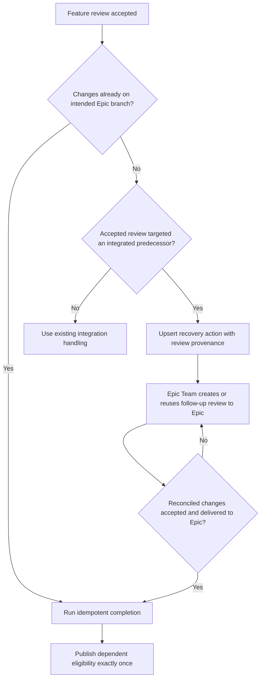

# Reconcile stacked reviews into the intended Epic branch

## Parent Epic

epic_031

## Outcome

Keep an accepted stacked Feature review pending until its changes reach the intended Epic branch through a reviewed path, then complete the Feature and release dependents exactly once.

## Scope

- Detect an accepted Feature review whose PR targeted a predecessor branch that has already integrated into the intended Epic branch.
- Persist that integration gap through the existing recovery-action model, assign it to the Epic Team, and retain the originating accepted-review provenance.
- Create or reuse one actionable follow-up review targeting the intended Epic branch.
- Complete only after the reconciled changes reach the Epic branch; make retries and duplicate callbacks converge without duplicate completion or dependent release.

## Acceptance focus

Reproduce the feat_029_002 predecessor-already-integrated race and verify:

- The accepted Feature does not complete while an integration gap remains.
- The gap is persisted and routed to the Epic Team with original review provenance.
- A reviewed reconciliation path delivers the accepted changes to the intended Epic branch.
- Duplicate events and retries do not create duplicate follow-up reviews.
- Feature completion and dependent eligibility each occur exactly once.

## Data structures

Use the existing recovery-action model as the durable record of the integration gap. Store or link enough stable identity to correlate the Feature, intended Epic branch, predecessor-targeted accepted review, and reconciliation work so repeated processing resolves to the same action.

Do not introduce a parallel recovery state machine solely for stacked reviews.

## API contracts

- Detection emits or upserts one recovery action for a stable stacked-review integration-gap identity.
- Epic Team recovery consumes that action and creates or reuses one follow-up review targeting the intended Epic branch.
- Reconciliation callbacks preserve a link to the originating accepted review and are safe to replay.
- Completion is gated on confirmed delivery to the intended Epic branch.
- Completion and dependent-eligibility publication are idempotent.

## Logic flow

## Task breakdown

1. `task_031_003_001` — Detect and persist stacked-review integration gaps.
2. `task_031_003_002` — Create the reviewed reconciliation path to the Epic branch. Depends on `task_031_003_001`.
3. `task_031_003_003` — Finalize reconciled Features and release dependents exactly once. Depends on `task_031_003_002`.

## Risks & upward questions

- Stable deduplication keys must survive retries without conflating distinct reconciliation attempts.
- Existing recovery actions may not currently carry every provenance link required; extend minimally if needed.
- No Epic contract change is currently required.

## Decision log

Decisions are recorded through Cascade's decision log.

- `dec_001` · 2026-11-03 · Feature Lead · **Recovery model**
  Chose Represent a stacked-review integration gap with the existing recovery-action model rather than a new state machine..
  Rationale: This is the smallest durable extension, keeps ownership in the established Epic Team recovery workflow, and avoids parallel lifecycle semantics.
  Honors: Feature scope: persist the integration gap as the same recovery action model and route it to the Epic Team..

- `dec_002` · 2026-11-03 · Feature Lead · **Reconciliation identity**
  Chose Use a stable identity linking the Feature, intended Epic branch, predecessor-targeted accepted review, and reconciliation work so retries reuse one recovery action and one follow-up review..
  Rationale: The acceptance contract requires retries and duplicate events to converge without duplicate reconciliation work.
  Honors: Feature scope: preserve original review provenance and make reconciliation idempotent..

- `dec_003` · 2026-11-03 · Feature Lead · **Completion gate**
  Chose Keep the Feature pending until reconciled changes are confirmed on the intended Epic branch; make completion and dependent-eligibility publication idempotent..
  Rationale: Acceptance of a review targeting an already-integrated predecessor does not itself deliver changes to the Epic and must not prematurely release dependents.
  Honors: Feature outcome and acceptance focus: no premature completion; completion and dependent eligibility fire once..

## Closeout

Completed child work: `task_031_003_001` (Detect and persist stacked-review integration gaps), `task_031_003_002` (Create the reviewed reconciliation path to the Epic branch), `task_031_003_003` (Finalize reconciled Features and release dependents exactly once).
