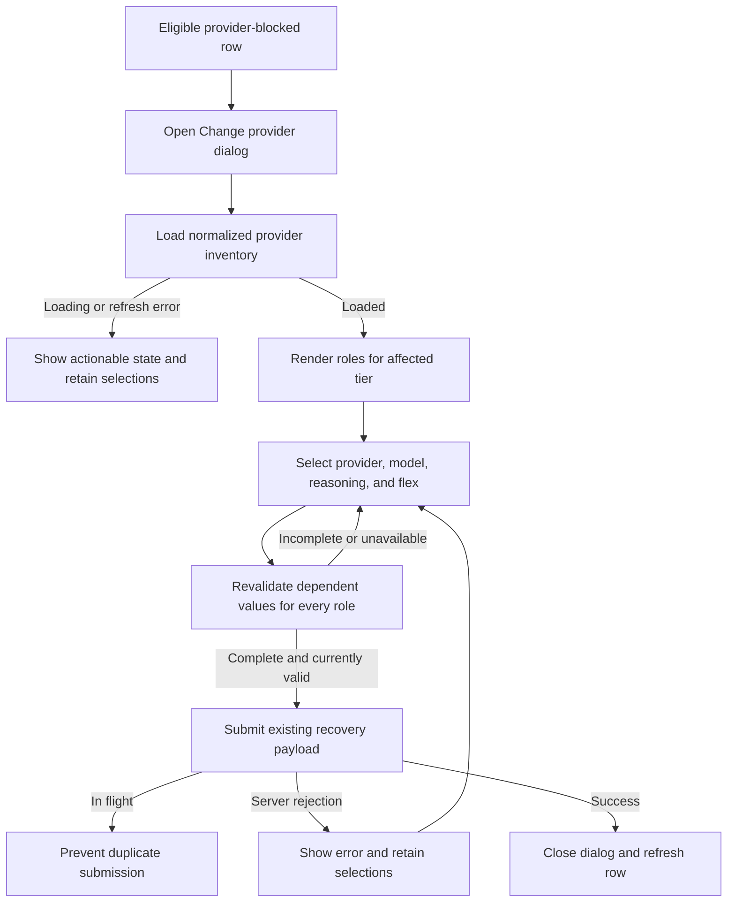

# Inventory-backed provider recovery dialog

## Parent Epic

epic_032

## Scope

Deliver the operator-facing provider-replacement dialog for provider-blocked active Epic, Feature, and Task rows, backed by the existing normalized inventory and existing recovery command. This feature covers the dialog, its recovery-flow integration, and focused regression tests only.

## Intent

Replace the free-text `Change provider` prompts for provider-blocked active work with a dialog that uses the same discovered provider, model, reasoning, and flex controls as brief creation, scoped to the affected Epic, Feature, or Task roles.

## Acceptance criteria

- Clicking `Change provider` on an eligible provider-blocked row opens a modal; it never asks for provider IDs or model JSON through browser prompts.
- Provider choices come from the existing normalized provider inventory. Model and optional reasoning choices update from the selected provider/model, and flex mode is shown only when supported.
- The dialog renders only the roles owned by the selected work tier: Epic Manager/Architect, Feature Lead/Architect, or SWE.
- The saved selection is visible even when now unavailable, but submission is enabled only for a currently valid complete replacement. Loading, empty inventory, refresh failure, cancel, in-flight submission, and server rejection are actionable and do not lose the operator's selection.
- Submission uses the existing human-only active-item recovery endpoint and recovery command. The server revalidates all affected roles; the client remains advisory. Success closes the dialog and refreshes the row; failure keeps the dialog open with its selections intact.
- Focused UI tests cover tier-specific roles, provider/model revalidation, unavailable saved values, flex/reasoning controls, valid payload construction, cancellation, double-submit prevention, and error retention. Existing recovery API tests continue to prove authoritative rejection, atomic mutation, and lifecycle safety.

## Constraints

Reuse the provider inventory and brief selector primitives rather than adding a static catalog or a second discovery service. Do not change recovery eligibility, lifecycle/checkpoint semantics, child selections, provider setup, retry behavior, or brief authoring. Credentials and raw provider errors must not reach the browser.

## Data structures

- Reuse the normalized provider inventory and selector option types already used by brief creation; introduce no second provider catalog.
- Dialog state contains the affected work item and tier, inventory load/refresh state, submission state, an actionable sanitized error, and one replacement selection per owned role.
- Each role selection contains provider, model, optional reasoning, and flex mode. Provider/model changes clear or revalidate dependent values.
- Tier-to-role mapping is fixed to Epic Manager/Architect, Feature Lead/Architect, or SWE.
- A saved value absent from the current inventory remains renderable as unavailable, but does not satisfy replacement validity.

## API contracts

- Read provider/model/reasoning/flex choices through the existing normalized provider-inventory path used by brief creation. The browser receives no credentials or raw provider errors.
- Submit all tier-owned role replacements through the existing human-only active-item recovery endpoint and recovery command; add no recovery endpoint.
- The client enables submission only for a complete inventory-valid replacement and prevents concurrent duplicate submission.
- The server remains authoritative: it revalidates every affected role and applies the recovery atomically under existing lifecycle/checkpoint rules.
- Success closes the dialog and refreshes the affected row. Rejection returns an actionable sanitized error while preserving the dialog selections.

## Logic flow

## Task breakdown

1. `task_032_001_001` — Implement tier-scoped inventory-backed recovery dialog.
2. `task_032_001_002` — Integrate the dialog with the active-work recovery flow. Depends on `task_032_001_001`.
3. `task_032_001_003` — Add focused recovery-dialog UI and API regression coverage. Depends on `task_032_001_002`.

## Risks & upward questions

- Inventory can change between rendering and submission; unavailable values remain visible, client validity is advisory, and server revalidation is authoritative.
- Existing selector primitives may couple UI and brief-authoring state; adapt the smallest reusable surface rather than introducing a parallel discovery path.
- No upward contract change is required.

## Decision log

None yet.

## Closeout

Completed child work: `task_032_001_001` (Implement tier-scoped inventory-backed recovery dialog), `task_032_001_002` (Integrate recovery dialog with active-work recovery flow), `task_032_001_003` (Add focused recovery-dialog UI and API regression coverage).
