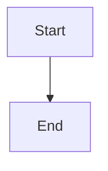

# Render complete plan threads and refresh incoming replies

## Parent Epic

epic_033

## Scope

## Outcome
Humans see every stored reply in its intended plan thread on initial load and as replies arrive, for Epic and Feature plans in inline and tray placements.

## Scope and acceptance
- Implement epic_033 success criteria 1–4 as one vertical slice using existing comment storage, API and event IDs; no queue redesign or historical data migration.
- Traverse complete parent chains; deterministic oldest-first ordering with comment ID as tie-breaker; retain immediate parent context. Missing parents, self-links and cycles must leave every valid comment visible once with safe fallback.
- Bound refresh work: target visibility within 5 seconds of successful API availability on a visible, connected page; no overlapping requests or accumulated timers, pause periodic requests while hidden, and refresh on visibility/reconnect. Retain last successful data on failures and retry with capped backoff. Discard stale responses across plan navigation/unmount.
- Update comment state without remounting the plan or losing drafts, focus/open controls, scroll position, placement or resolved/outdated styling. Refresh reads must never post comments or dispatch turns.
- Browser regression uses epic_028 cmt_001 → cmt_006 → cmt_007 and cmt_001 → cmt_008 → cmt_009/cmt_010; proves initial and asynchronous visibility, deep nesting, malformed/missing parents, both plan tiers and placements, and draft preservation. Verify one human post produces one event and one owning-team kickoff; repeated refresh/reconnect produces none.

## Implementation preparation
Before coding, inspect shared renderer/grouping, API response completeness, component state ownership and current post/event integration. Confirm stable comment identity and parent fields. Escalate any API/storage contract change to epic owners; keep the existing contract unless evidence requires amendment.

## Validation economics
Use a compact browser matrix and existing posting/queue regression coverage; add focused grouping cases for cycles/ties only where browser coverage is inefficient. No redundant test pyramid or new test framework.

## Data structures

TBD.

## API contracts

TBD.

## Logic flow

## Task breakdown
- task_033_001_003
- task_033_001_002
- task_033_001_001

_(empty — Feature Team mints tasks after dispatch)_

## Risks & upward questions

None.

## Decision log

None yet.

## Closeout

Completed child work: `task_033_001_001` (Render complete comment parent chains with safe deterministic fallback), `task_033_001_002` (Refresh incoming plan replies while preserving local UI state), `task_033_001_003` (Verify complete threads and safe asynchronous refresh end to end).
