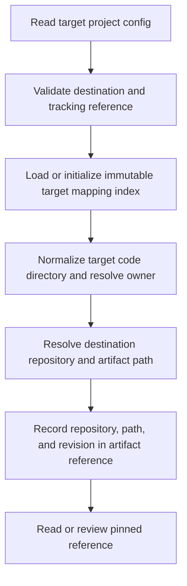

# Design guidance and configurable documentation destinations

## Parent Epic

epic_034

## Scope

Delivery slice A of epic_034; success criteria 1–2 and document-boundary constraints. epic_036 is the completed parent prerequisite.

Provide a concise design skill informed by /home/ubuntu/dev/automatik/skills and a DESIGN.md template with matching table of contents: requirements, decisions/rationale, interfaces, architecture links, and verification evidence. Preserve and reconcile the existing root design. Each requirement/decision has one owning design; parents summarize shared contracts and link to child detail. Meaningful directories own distinct behavior/state/interfaces; trivial/generated directories name their covering parent.

Extend RepositoryContext and target cascade.toml with [architecture] destination = "target" | "tracking", default target. Tracking requires epic_036's configured tracking repository. Resolve reads, proposals, links, reviews, and replay consistently. Target designs live at <code-directory>/DESIGN.md; tracking designs at design/<immutable-target-repository-key>/<code-directory>/DESIGN.md. Editable models/fragments live at architecture/<target-repository-key>/ in the selected destination. Persist stable target-directory mappings and ownership; never derive identity anew from a basename.

Acceptance: defaults, target and tracking modes, invalid combinations, root preservation, one-home references, and stable mapping after configuration changes. Existing review units must retain their fixed destination. Include focused integration checks and documentation closeout. Reuse existing configuration/routing services; no separate document service UI.

## Data structures

- `ArchitectureDestination`: the validated selection (`target` or `tracking`), resolved destination `RepositoryContext`, and immutable target repository key. The selected repository is a checkout role; its filesystem path is not the target identity.
- `ArchitectureMappingIndex`: schema-v1 JSON at `architecture/design-mappings.json` in the target repository, independently of the selected documentation destination. Its `target_repository_key` is immutable and opaque. The `designs` map is keyed by normalized target-code-relative directory; each row stores `code_directory`, `design_owner_directory`, and stable `artifact_id`. Root is `.`. Reload validates uniqueness and rejects a changed key or conflicting owner/path rather than generating a replacement. A destination edit does not rewrite this index or move existing artifacts.
- `ArchitectureArtifactRef`: target repository key, code-relative directory (or model/fragment key), owning work/team, destination repository identity, repository-relative path, and pinned Git revision. A new reference resolves the selected destination once. Persisted references are read by their recorded repository/path/revision, never by re-reading today's config. A review unit may contain plan, design, and model refs; Feature C owns the review-unit state and gates.
- Paths are normalized, relative, and confined to the recorded repository. Neither directory basenames nor an absolute checkout location supply durable identity. The mapping index and refs preserve target-code provenance even when documentation is in tracking.

## API contracts

- Parse `[architecture].destination` from the target project's `cascade.toml`, with omission selecting `target`. Accept only `target` and `tracking`. A tracking selection requires an explicit, successfully resolved epic_036 `tracking_repository`; colocated compatibility mode without that setting is not an implicit tracking choice. Report invalid values or missing tracking configuration before routing.
- Extend the existing `ProjectContext`/`RepositoryContext` and repository resolver with one architecture destination resolver. It returns the validated destination and target key; callers reuse the existing tracking resolution rather than opening a second repository service.
- Resolve a design for target-code-relative directory `d`: target mode uses `d/DESIGN.md` (root `DESIGN.md`); tracking mode uses `design/<key>/d/DESIGN.md` (root `design/<key>/DESIGN.md`). `ProjectContext.design_path()` and `editable_architecture_root` provide these locations; `resolve_design_ownership()` persists a row, `require_design_ownership()` rejects an unmapped write/review, and `load_design_ownerships()` reads existing rows. Resolve editable model workspace and owned fragments under `architecture/<key>/` in the same selected destination.
- `create_architecture_artifact_ref()` and `create_architecture_model_ref()` require a persisted design owner and create serializable `ArchitectureArtifactRef` records for designs and editable model/fragment paths. They capture the destination repository role/key, repository-relative path, target directory/key, owning work, and Git HEAD revision. A review/replay ref must identify a commit containing the reviewed bytes; Task 004 verifies this boundary.
- `resolve_artifact_ref_path()` routes a proposed edit to the ref's recorded repository and path. `read_architecture_artifact()` and `replay_architecture_artifact()` load committed bytes at the recorded revision, and `architecture_artifact_link()` derives a stable source reference only from recorded fields. Persist and reload refs with `ArchitectureArtifactRef.to_dict()`/`from_dict()`. Changing `cascade.toml` does not move an existing ref or cause a pinned read to use the working tree. Any migration is a separately reviewed operation.
- Routing conveys location and provenance only. Existing scoped tools and owner amendment rules continue to authorize edits, including shared designs and fragments. Feature B consumes these refs for rendering and semantic model processing; Feature C pins them in review units; Feature F adds tier-specific authoring and closure; Feature G uses pinned refs for historical replay.

## Logic flow

A later config edit changes only resolution for new references. Existing references retain their recorded destination and revision.

## Task breakdown

1. `task_034_001_001` — Design skill, matching template, and focused reconciliation of root `DESIGN.md`.
2. `task_034_001_002` — Configured destination, immutable target repository identity, and persisted directory ownership mappings. Implement the resolver, index, and reference contract above.
3. `task_034_001_003` — Route reads, proposals, links, reviews, and replay through fixed artifact references; depends on task 002.
4. `task_034_001_004` — Integration acceptance checks and documentation closeout; depends on tasks 001 and 003. Cover defaults, both destinations, invalid tracking, root preservation, stable mappings after destination edits, and fixed existing references.

## Risks & upward questions

The target-owned schema-v1 index is the persistent source of identity and ownership across destination edits. Task 002 chose `architecture/design-mappings.json` and documented its fields and invariants above. No epic contract change is needed.

## Decision log

- `dec_001` · 2026-11-09 · Feature Lead · **Data structures and API contracts**
  Chose Persist one immutable target repository key and directory ownership mapping in the target repository; new architecture references record their selected destination repository, path, and revision, while existing references remain pinned after configuration edits..
  Rationale: The target repository remains the code identity when documentation moves to tracking. A target-owned versioned mapping and fixed references prevent basename collisions and silent review retargeting.
  Honors: epic_034 Repository and document contract; Cross-module constraints; feat_034_001 Scope..

## Closeout

Completed child work: `task_034_001_001` (Add design guidance, template, and reconcile root DESIGN.md), `task_034_001_002` (Resolve architecture destination and persist stable design mappings), `task_034_001_003` (Route design artifacts through planning, review, and replay), `task_034_001_004` (Verify destination modes and close documentation).
