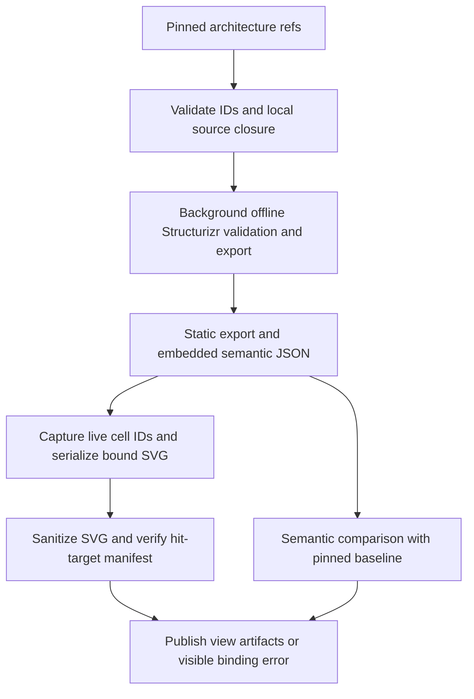

# Versioned C4 model and controlled local rendering

## Parent Epic

epic_034

## Scope

Delivery slice B of epic_034; success criteria 3 and 9, controlled execution, and the interaction prerequisite for D.

Implement versioned Structurizr workspace/fragments with ownership, nonempty workspace-unique semantic IDs for every reviewable element and relationship, and unique explicit view keys. Exporter numeric IDs are artifact-local. Rename continuity needs an explicit reviewed mapping. Derived relationships and dynamic occurrences need deterministic source/view/occurrence identity or a visible unsupported error.

The first acceptance checkpoint has a real-tool proof in `docs/task_artifacts/task_034_002_001_renderer_node_join.md`: the pinned renderer's live JointJS cells expose the exported model IDs for elements and relationships. A controlled adapter captures those IDs and adds `data-cascade-model-kind` and `data-cascade-export-id` before serializing the same live diagram. Its embedded workspace JSON is the model for that render. Stock SVG strips the required metadata and is unsupported for interaction. Preserve verified element/relationship hit-target bindings through sanitization via an artifact manifest or approved SVG attributes. Prove reordered source, identical labels across containers, parallel relationships, and removed targets. Never match by labels, coordinates, order, or transient SVG IDs; ambiguity blocks interactive review with a source diff.

Use the manifest-pinned Structurizr image for DSL validation, semantic JSON, and SVG with no network/pulls, bounded resources/time, and isolated outputs. Materialize only pinned allowed local includes under the documentation tree; reject escapes, out-of-scope symlinks, remote assets/includes/themes/extensions, plugins/scripts, and custom executable exporters. Rendering runs as a background artifact operation; sanitize SVG and use approved local viewer assets. Cache by source closure, digest, settings.

Semantic diff covers properties, relationships, containment, and view membership, excluding layout movement. Enumerate changed views and explicit first/empty/removed/error states. Include real-tool integration proof, invalid-ID/source cases, layout-only changes, and documentation closeout.

## Data structures

- **Pinned source closure:** recorded architecture destination and target repository key from feat_034_001, workspace/fragment artifact refs with Git revisions and owner, normalized local include graph, and a content digest. Only files in that validated closure enter the renderer input.
- **Identity index:** stable semantic IDs for elements and relationships, explicit unique view keys, source provenance, and any reviewed rename mapping. Exporter model IDs are recorded only within one render artifact. Derived relationships and dynamic occurrences require deterministic source/view/occurrence identity; otherwise validation returns an unsupported error.
- **Render artifact:** immutable closure hash, renderer image digest, render settings, source revisions, validation/JSON/SVG results, view inventory, and structured status/error. Cache keys include the closure, digest, and settings. A cache hit is valid only for the exact pinned inputs.
- **Hit-target manifest:** per-view live renderer cell ID, element/relationship kind, exported model ID, and semantic ID joined within the same static export, with serialized and sanitized SVG attribute verification. Missing, ambiguous, or removed bindings carry a reason and source-diff reference and are never interactive.
- **Semantic diff:** current/proposed artifact refs, added/removed/changed identities and properties, containment and relationship changes, view-membership changes, every changed view, textual summary, and explicit first-model, empty-baseline, empty-proposal, removed-view, unchanged, and error states. Layout-only movement does not create a semantic change.

## API contracts

- Resolve versioned workspace/fragments through feat_034_001's fixed architecture artifact refs. Reject unpinned or out-of-tree paths, symlink escapes, cycles, remote assets/includes/themes/extensions, plugins/scripts, and custom executable exporters before materializing an isolated local source closure.
- Validate semantic IDs and explicit view keys before export. Duplicate or empty IDs, ambiguous rename mappings, and unsupported derived/dynamic identities return actionable errors with source references. Identity never depends on labels, coordinates, file order, or exporter numeric IDs.
- Queue rendering as a background artifact operation. Invoke only the manifest-pinned Structurizr image by digest for DSL validation, JSON and static export, and controlled same-render bound SVG serialization with no pull/network, bounded resources and time, read-only container, non-root user, and isolated outputs. Publish artifacts atomically after validation; report failure/cancellation without a partial successful result.
- Use the pinned static export and a controlled adapter in the same offline, bounded render operation. Capture each live JointJS cell's exported model ID through the renderer's highlight API, add `data-cascade-model-kind` and `data-cascade-export-id`, and serialize that diagram. Join those IDs to the embedded workspace JSON, then to explicit `cascade.id` values; the proof supports container instances through `containerId` and derived relationships through `linkedRelationshipId`. Verify completeness and uniqueness, sanitize SVG, and compare surviving attributes to the manifest. Missing or ambiguous mappings disable interaction and expose the source diff. Stock SVG alone is not an interactive artifact.
- Compare two validated model artifacts by semantic IDs and view keys. Return changes to properties, relationships, containment, and membership, all affected views, and explicit empty/removed/error states. Source movement and automatic layout changes alone do not count. A rename is continuous only through a reviewed explicit mapping.
- Features C and D consume pinned render, binding, and diff artifacts; this feature does not implement proposal approval, paired viewer interaction, or semantic comment threads.

## Logic flow

Task 001 proved the controlled adapter with reordered declarations, repeated labels, parallel relationships, and removed targets. Task 005 must turn that proof into a complete artifact contract: reject any rendered hit target without a trusted mapping, broken identity chain, duplicate target, or SVG attribute mismatch. The source diff remains available when interaction is unsupported.

## Task breakdown

1. `task_034_002_001` — Prove the renderer-node metadata join with the real pinned tool (first acceptance checkpoint).
2. `task_034_002_002` — Versioned C4 source, ownership, IDs, view keys, and validation (independent of task 001).
3. `task_034_002_003` — Pinned, confined local source closure; depends on task 002.
4. `task_034_002_004` — Bounded offline background render and cache; depends on task 003.
5. `task_034_002_005` — Verified semantic hit-target bindings and sanitized SVG; depends on tasks 001 and 004.
6. `task_034_002_006` — Semantic model diff and complete changed-view states; depends on tasks 002 and 004.
7. `task_034_002_007` — Real-tool integration acceptance and documentation closeout; depends on tasks 005 and 006.

## Risks & upward questions

The stock SVG strips the metadata needed for interaction; the controlled same-render adapter is required. The proof currently covers ordinary elements, container instances, explicit and linked relationships. Other derived or dynamic identities remain unsupported until they have deterministic source/view/occurrence identity. Any unresolved ambiguity is a visible unsupported result with source diff. No additional dependency installation is authorized or planned.

## Decision log

- `dec_001` · 2026-11-09 · Feature Lead · **Renderer binding path after task_034_002_001 proof**
  Chose Use the pinned renderer's live JointJS cell metadata and same static export JSON to create bound SVG and a verified hit-target manifest; stock SVG remains unsupported for interaction..
  Rationale: The real-tool proof shows exported model IDs on live element and relationship cells, while stock SVG strips them. The controlled adapter preserves the IDs before serialization and was exercised with reordered source, repeated labels, parallel relationships, and removed targets.
  Honors: Epic success criteria 3 and 9, the first renderer-join acceptance checkpoint, source-diff fallback, and the existing pinned dependency and controlled execution contract..

## Closeout

Completed child work: `task_034_002_001` (Prove Structurizr renderer-node metadata join), `task_034_002_002` (Validate versioned C4 source and semantic identities), `task_034_002_003` (Materialize a pinned, confined C4 source closure), `task_034_002_004` (Run bounded offline Structurizr artifact rendering), `task_034_002_005` (Bind rendered hit targets to semantic model IDs), `task_034_002_006` (Compute semantic C4 diffs and changed-view states), `task_034_002_007` (Verify C4 rendering and diff integration, close documentation).
