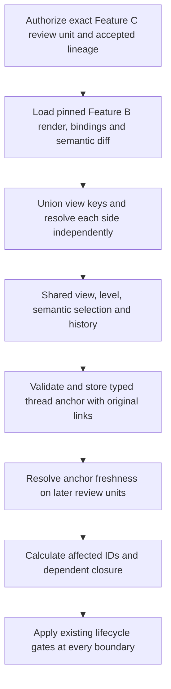

# Paired C4 review and semantic comment threads

## Parent Epic

epic_034

## Scope

Delivery slice D of epic_034; success criteria 7–10.

Extend the existing plan viewer with current/proposed diagrams for the same view/level, labeled by repository and pinned revision, adjacent to proposal text even across repositories. One synchronized state owns view/level, selected semantic target, and navigation history. Selecting elements OR relationships in either side highlights the counterpart; drill, view switching, and back navigation stay synchronized. Added/removed targets remain on their side with explicit absent counterparts. All changed views are reachable; include semantic change legend/summary, requirements/decisions, and source/model/plan diffs. Use B's proven semantic bindings; failures show an error/source diff, never a false match or static-only substitute.

Reuse existing review threads with requirement, view, element, and relationship anchors: semantic ID/key, current/proposed side, source repository, revision. Keep anchors distinct from heading slugs. Preserve threads/diff paths after changes; removed/renamed targets are outdated and blocking threads remain blocking until an authorized human resolves them.

Enforce blocking scope at approval and affected downstream mint/dispatch/integration/merge/closure boundaries using ownership/citations and explicit affected IDs/dependents. If narrower scope cannot be established, visibly hold the owner's subtree rather than unrelated epics.

Acceptance: browser scenarios for paired element/relationship focus, both-way navigation, all changed views, absent/empty/error states; all four anchors, outdated targets, exact revision gates and scoped blocking. No freehand/pixel annotation or general diagram editor. Include documentation closeout.

## Data structures

- **PairedReview v1** is keyed by Feature C's `ArchitectureReviewUnit.review_unit_id`, immutable reviewed tuple digest, integration lineage, and accepted baseline pointer/generation. Current uses the lineage's accepted model binding or explicit `empty_baseline`; proposed uses the unit's model binding or explicit `no_diagram_change`. Each side records its own repository key, pinned source revision/closure digest, renderer image/settings, semantic artifact digest, verified render reference, status, and source diff. A page request reads these pinned artifacts and never starts a render or substitutes live checkout bytes. A stale, pending, unreviewed, or tuple-mismatched unit has a visible non-approvable state.
- **ViewPair** is keyed by exact explicit view key and C4 level from the validated model. Inventory is the union of both pinned render inventories and every `C4SemanticDiff.changed_view_keys` entry; each side resolves independently to `ready|absent|first|empty|removed|error|unsupported` and retains its repository/revision label. The diff's identity, containment, membership, summary and state feed a semantic legend. Requirement/decision citations come from the unit; source, model, and plan diff links retain the exact reviewed refs. A missing, ambiguous, or mismatched same-render `C4HitTargetBinding` or sanitized SVG makes that side noninteractive with a reason and source diff.
- **PairedNavigation** has one `(view_key, level)`, optional `(element|relationship, semantic_id)` selection, and a history stack of those states. A selection made on either side resolves by kind and semantic ID against each side's verified manifest and view membership. A counterpart can be `present|absent|unsupported`; it is never guessed by label, exporter ID, order, position, or SVG shape. Drill, view change, and back push/restore one shared state.
- **SemanticThreadAnchor v1** is a typed `requirement|view|element|relationship` target with stable requirement ID, explicit view key/level, or model semantic ID as appropriate; source side, repository key, exact revision, review-unit ID/tuple digest, original source reference and diff link. It is stored beside the existing comment root, distinct from `section`, heading slug, line range, and document SHA. Anchor fields are immutable after creation. Read resolution compares the pinned target and reviewed continuity to the requested unit and returns `current|outdated` with reason and retained original links; missing, unreviewed rename, revision or repository drift is outdated. Thread `open/resolved` and `blocking` remain separate from anchor freshness.
- **BlockingScope** records thread ID, owning work ID, explicit affected IDs from the review unit/comment, ownership and cited work IDs, dependent closure, matched reason and boundary. Resolve against the board's current graph for each gate. When ownership or citations cannot establish a narrower set, hold the visible owning feature/epic subtree only; do not cross into unrelated epics. The scope result preserves running branches and already accepted work.

## API contracts

- `read_paired_review(owner, work_id, lineage, review_unit_id)` authorizes the same owner and lineage as Feature C's `read_architecture_state`; checks the exact unit tuple, baseline pointer/generation, accepted integration lineage and current freshness, then returns `PairedReview`. Use Feature B's validated `C4RenderArtifact`, same-render binding manifest and `C4SemanticDiff`. Include every changed view, even when one side is absent or failed, and expose explicit no-change/first/empty/removed/error states, semantic legend, citations, and exact source/model/plan diffs. A failed binding returns an actionable unsupported state and source diff; no static-only interactive fallback.
- `select_paired_target(view_key, level, kind, semantic_id, source_side)` accepts only a target present in that side's verified manifest and pinned semantic view membership. Return both side resolutions and a shared navigation transition; element and relationship targets, including parallel relationships with identical labels, use only stable semantic IDs. Both-way selection, drill and back use the same transition contract.
- `create_semantic_thread(review_unit_id, anchor, body, blocking)` and `read_semantic_threads(review_unit_id)` extend existing review comment storage, authorization and human resolution paths. Creation checks exact unit/side/repository/revision and type-specific target against the pinned payload; link the root to its original source/diff refs. Reads preserve old roots and resolve freshness without mutating original anchors. A removed/renamed/outdated open blocking thread remains blocking until the existing authorized human resolution action closes it.
- `affected_blocking_threads(work_id, boundary)` expands explicit affected work, ownership/citations and dependents, returns thread IDs, affected IDs, scope reason and fallback flag, and feeds Feature C's `validate_review_gate` plus existing board mint/dispatch, integration, merge and closure checks. A hold leaves lifecycle state unchanged, preserves already running branches and accepted work, and reports the owning subtree when scope is ambiguous. Exact reviewed revision and pending/stale states remain Feature C's authority; this feature adds semantic thread scope to those gates.

## Logic flow

## Task breakdown

1. `task_034_004_001` — Compose pinned paired C4 review data and changed-view inventory. Completed.
2. `task_034_004_002` — Build synchronized paired diagram review interaction; depends on task 001. Completed.
3. `task_034_004_003` — Persist semantic review-thread anchors and outdated state; depends on task 001. Completed.
4. `task_034_004_004` — Add semantic comment authoring and thread navigation; depends on tasks 002 and 003. Completed.
5. `task_034_004_005` — Enforce scoped blocking across approval and affected downstream boundaries; depends on task 003. Completed.
6. `task_034_004_006` — Verify paired review acceptance and close feature documentation; depends on tasks 002–005. Completed.

## Risks & upward questions

None.

## Decision log

None yet.

- `dec_001` · 2026-11-09 · Feature Lead · **Pinned paired review and scoped semantic threads**
  Chose Consume Feature C's exact reviewed tuple and accepted lineage with Feature B's verified same-render bindings and semantic diff; use one paired navigation state and typed immutable comment anchors; extend existing lifecycle gates with affected-scope holds..
  Rationale: The completed predecessor contracts already provide stable semantic identities, pinned revisions, render validation and revision-bound promotion. Reusing them prevents false diagram matches and stale review approval while keeping work in the owning subtree.
  Honors: epic_034 success criteria 7–10; completed Features B/C; Feature D paired interaction, four anchor kinds, outdated blocking and scoped lifecycle acceptance..

## Closeout

Completed child work: `task_034_004_001` (pinned paired review data and changed-view inventory), `task_034_004_002` (synchronized paired diagram interaction), `task_034_004_003` (semantic anchors and outdated state), `task_034_004_004` (comment authoring and thread navigation), `task_034_004_005` (scoped lifecycle blocking), and `task_034_004_006` (acceptance verification and documentation).

Verification: [`tests/war_room/task_034_004_006_verification.md`](../../../tests/war_room/task_034_004_006_verification.md) records the focused browser, API, anchor, and lifecycle scenarios. The integrated feature branch passed the documented six-file suite on 2026-11-10: **63 passed**. It covers cross-repository pinned labels; shared both-way element and parallel-relationship navigation; all changed views and absent, empty, error and unsupported states; all four semantic anchor kinds and outdated blocking; exact reviewed-revision invalidation; and scoped holds at approval, dispatch, integration, merge and closeout.

Limits: the deterministic DOM harness does not measure native browser layout. Feature B owns renderer geometry and binding validation; Feature C owns promotion recovery. Freehand annotation and general diagram editing remain outside this feature.
