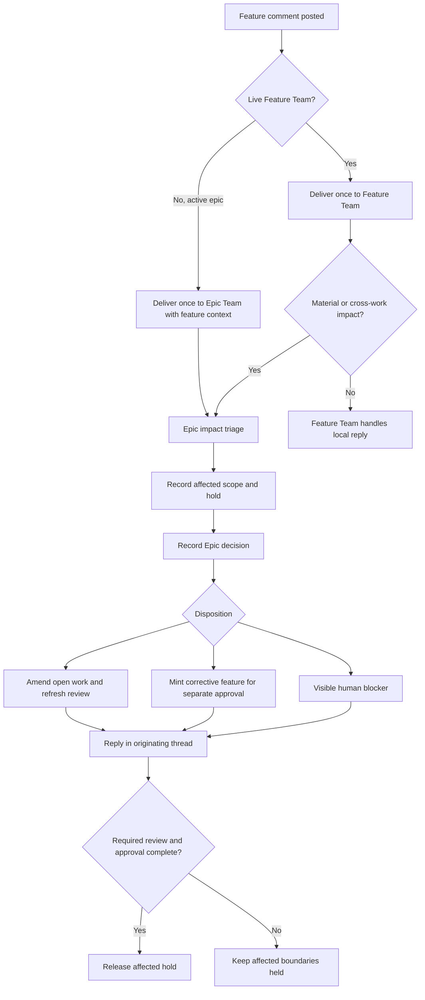

# Living epic revisions and accountable change-request routing

## Parent Epic

epic_034

## Scope

Delivery slice E of epic_034; success criteria 15–18. Extend the existing board, comment delivery, review, and lifecycle gates. An active feature comment reaches its live Feature Team once; a backlog or unstaffed feature comment under an active epic reaches the Epic Team with the feature and originating comment context. A material active-feature request reaches the Epic Team for impact triage after any sibling merges, even when it appears local, and also when it touches epic constraints, another feature, accepted work, or sequencing. The Epic Team records the decision and the responsible team relays the outcome in the original thread. Delivery and escalation each have one durable accountable handoff.

An active epic may revise remaining work without resetting the epic or changing completed feature IDs, commits, review history, decisions, or accepted architecture. A later proposal uses the latest accepted architecture on the epic integration lineage as current state. The smallest safe disposition is an amendment to open work, an epic/feature contract amendment, a separately reviewed corrective feature with explicit accepted-work dependencies, or a visible blocker requiring a human replacement/replanning decision. Changed work receives fresh revision-bound review and human approval. Prior epic approval does not cover corrective features.

A pending material request holds only affected minting, dispatch, task integration, feature merge, and closure at safe boundaries. Running tasks retain their branches and work, but held results do not integrate. Unrelated accepted siblings remain accepted. Resume only after the recorded decision and required revised review/approval have passed.

Acceptance: one merged sibling plus a changed active or backlog feature; one accountable escalation and originating-thread outcome; active tasks held then resumed only after authorized revised review; corrective feature separately approved; unsafe restart visibly blocked. Include integration coverage and documentation closeout.

## Data structures

- **ChangeRequestHandoff**: durable identity from originating root comment ID, source feature ID, affected work IDs, receiving team/owner, and purpose (initial delivery or Epic impact triage). Record delivery status and event/turn ID so retries do not fan out duplicate team turns. Replies retain the originating thread ID; feature context accompanies backlog delivery.
- **EpicImpactDecision**: request/handoff ID, accepted sibling IDs and lineage generation observed during triage, affected work IDs, materiality and impact reasons, disposition (open-work amendment, contract amendment, corrective feature, or human blocker), decision-log reference, and originating-thread reply reference. An unresolved or unrelayed decision remains visible.
- **ScopedChangeHold**: request ID, affected work IDs and descendants, explicit boundary set, reason, owner, status, and release evidence: resolved decision plus exact revised review/approval tuple where work changed. Persist against existing board/lifecycle records so a restart enforces the same hold. An uncertain narrow scope holds the owning proposal subtree with the reason shown.
- Preserve the accepted-lineage pointer and promotion journal from Feature C. A revision never rewrites accepted child records or advances the accepted architecture pointer before accepted promotion.

## API contracts

- Comment delivery classifies the feature's canonical lifecycle state at posting. Active/staffed comments enqueue one Feature Team turn. Backlog/unstaffed comments under an active epic enqueue one Epic Team turn carrying feature ID, comment ID, thread, and anchor/context. Deduplicate on durable handoff identity, including event replay. A live Feature Team may request Epic triage through one explicit escalation, rather than an implicit second comment delivery.
- Materiality and impact triage considers accepted sibling delivery, epic constraints, sibling contracts, accepted work, architecture baseline, and dependency sequencing. After a sibling has merged, every material feature-plan request requires an Epic decision. The Epic Team records the disposition before the responsible team replies or relays it in the original comment thread; agents never resolve a human thread on the human's behalf.
- An open-work amendment updates the owning reviewable proposal and affected dependency/revision links. Epic-contract changes use the existing amendment route. A corrective feature is a new backlog feature with explicit accepted-work dependencies and its own planning, sign-offs, and human approval. An unsafe replacement/restart remains a visible blocker until a human authorizes the path; no automatic backlog reset.
- The shared lifecycle hold check runs before minting, dispatch, task integration, feature merge, and closure, and rechecks under the existing lifecycle lock. It reports the request, affected work, reason, and release action. Work may continue on active task branches while held; delivery records stay pending. Release is scoped and requires the revised plan/model and review/approval tuple for changed work. Unrelated approved work is unaffected.
- New proposals read the latest accepted architecture for the epic integration lineage, including merged siblings, through Feature C's accepted-lineage API. A stale pending proposal rebases and is reviewed again. No revision operation deletes or resets completed siblings or substitutes target trunk for the accepted epic baseline.

## Logic flow

## Task breakdown

1. `task_034_005_001` — Route feature comments with durable accountable handoffs.
2. `task_034_005_002` — Triage material change requests and relay Epic decisions; depends on 001.
3. `task_034_005_003` — Enforce durable scoped change holds at lifecycle boundaries; depends on 001.
4. `task_034_005_004` — Revise remaining work against accepted epic architecture; depends on 002–003.
5. `task_034_005_005` — Create separately approved corrective work or visible human blocker; depends on 002–003.
6. `task_034_005_006` — Verify living revision scenarios and close documentation; depends on 004–005.

## Verification focus

Use integrated scenarios through real board/comment/event and lifecycle entry points. Check retries and event replay produce one accountable delivery; backlog feature comments reach the Epic Team; material active comments after a sibling merge require Epic triage and an original-thread outcome; accepted sibling commits/history and lineage current state survive revisions; affected running tasks retain branches but cannot integrate; review/approval refresh releases only affected work; a corrective feature needs its own human approval; a proposed restart stays blocked for human decision.

## Risks & upward questions

None. If implementation requires changing the epic contract or sibling scope, propose an epic amendment before applying it.

## Decision log

None yet.

- `dec_001` · 2026-11-10 · Feature Lead · **Accountable routing and triage**
  Chose Persist one initial delivery and one explicit Epic escalation per originating feature comment, with feature, affected-work and receiving-owner identity; after a sibling merge, every material feature-plan request receives Epic triage..
  Rationale: The existing comments and team event stream can carry the context without a second review service. Idempotent handoffs prevent replay from starting duplicate teams or losing backlog comments.
  Honors: epic_034 success criteria 15–17; feature E routing and original-thread outcome acceptance..

- `dec_002` · 2026-11-10 · Feature Lead · **Living revisions and scoped holds**
  Chose Preserve accepted siblings and the integration-lineage architecture baseline; hold affected lifecycle boundaries until a recorded disposition and fresh review/approval, while corrective features receive separate approval and unsafe restart remains a human blocker..
  Rationale: The accepted lineage already represents delivered architecture. Scoped holds protect active task work and prevent stale approval from integrating changed results without resetting unrelated accepted work.
  Honors: epic_034 success criteria 15, 17–18; Feature C review/lineage contract; feature E hold and corrective-work acceptance..

## Closeout

Completed child work: `task_034_005_001` (Route feature comments with durable accountable handoffs), `task_034_005_002` (Triage material change requests and relay Epic decisions), `task_034_005_003` (Enforce durable scoped change holds at lifecycle boundaries), `task_034_005_004` (Revise remaining work against accepted epic architecture), `task_034_005_005` (Create separately approved corrective work or visible human blocker), `task_034_005_006` (Verify living revision scenarios and close documentation).
