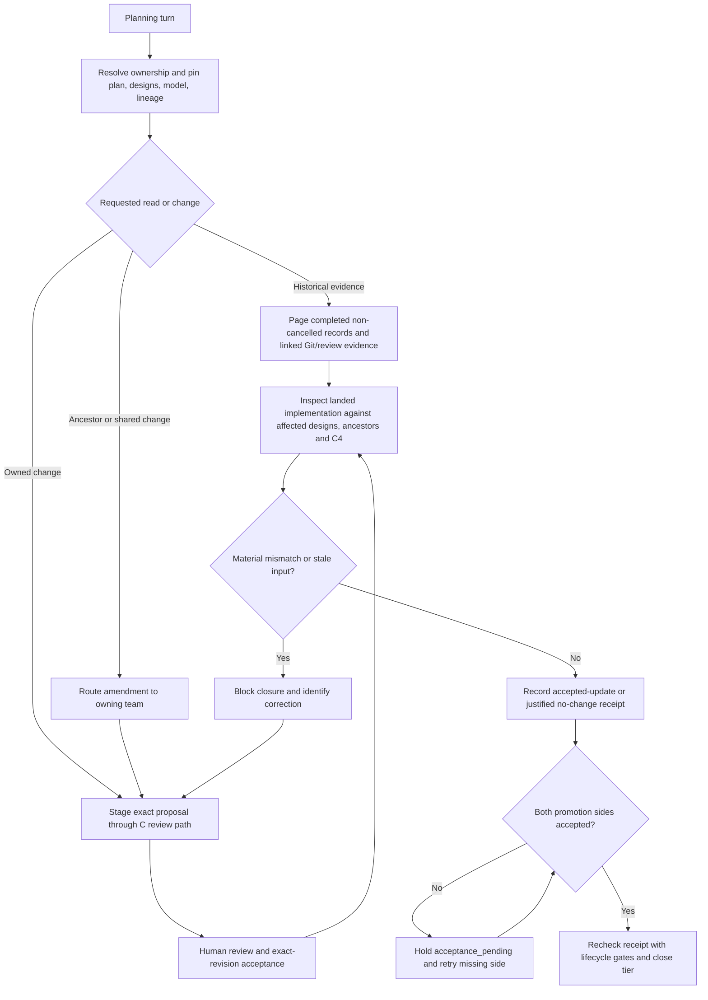

# Scoped design authoring and closure reconciliation

## Parent Epic

epic_034

## Scope

Delivery slice F of epic_034; success criteria 5 and 12. Extend C's existing owner-scoped staging and review path and its revision-bound lifecycle gates. A–E are the delivered baseline. G owns historical reconstruction and the final inventory; F supplies bounded evidence access for it.

Supply Epic, Feature, and Task planning context with pinned owned and ancestor designs and model fragments. Scope reads and staged proposals to the work's ownership and explicitly affected architecture. Parent summaries and shared fragments remain under their owners; route proposed changes through the existing upward amendment path, including Feature-to-Epic architecture changes and Task closeout proposals. Supply completed, non-cancelled history and associated target Git and authorized review descriptions as a bounded replay evidence set. Do not expose arbitrary other-team plans or repository files.

At Task, Feature, and Epic closure inspect the implementation against affected directory designs, ancestor summaries, and C4 views. Record exact inspected implementation and design/model revisions, affected designs and ancestors, and an accepted update or justified no-change result. Material mismatches block closure. A split-repository `acceptance_pending` promotion cannot satisfy a receipt.

## Data structures

- **Design context snapshot.** Key by work ID, tier, integration lineage and pin time. Include the owned plan's pinned document reference; target repository key and inspected target revision; fixed documentation destination; the applicable ownership-index rows; owned directory design references; read-only ancestor design references; and the relevant model contract/source fragment references. Each artifact keeps its destination repository key/role, repository-relative path, Git revision, owner, and content digest. Include the accepted architecture pointer/generation (or explicit empty baseline), review-unit IDs and affected requirement/decision/view IDs. Label unaccepted predecessor proposals as proposed context with their dependency, never as the accepted baseline. Missing or unreadable pinned context is an explicit unavailable result, not a silent latest-head fallback.
- **Replay evidence request/result.** Request names an owning Epic lineage, target repository key, fixed baseline/head range and a bounded selection of completed, non-cancelled Epic/Feature/Task IDs or a page cursor within that lineage. Result contains exact record revisions, reachable target commit IDs and provenance, and linked MR/PR IDs, descriptions and source revisions when authorized access exists. Return next cursor and explicit unavailable/truncated evidence reasons. Exclude cancelled plans as requirements sources; do not use the reader to fetch arbitrary work IDs, source files, branches or unrelated review bodies. Deduplicate commit/review links in the result. G decides whether a historical claim survives comparison with current code.
- **Authoring intent.** Name work ID, actor/role, owned directory and fragment IDs, affected requirement/decision/view IDs, base context generation, proposed artifact refs/digests and exact proposed bytes on an owned branch or immutable patch. Resolve ownership from the stable directory mapping and C4 fragment contract. The disposition is owner-staged review, routed owner amendment (with originating work/comment and affected IDs), or a specific denial. An ancestor/shared fragment is never made writable merely because it appears in context.
- **Closure reconciliation receipt.** Key by work ID, tier and exact implementation revision or integration result. Record target repository/lineage, inspected implementation commit(s)/head, affected code directories, mapped leaf designs and ancestor summaries, their pinned before/after references and digests, accepted baseline pointer/generation, inspected model closure/semantic artifact digest and affected C4 view keys. Outcome is either an accepted review-unit/promotion reference for exact documentation/DSL updates or a short justified no-change statement covering design and diagram impact. Include reconciliation state and mismatch reasons. The receipt is current only for the exact inspected implementation and design/model revisions; superseded or stale receipts remain evidence but cannot close newer work.

## API contracts

- `get_design_context(work_id, tier, pin)` returns the snapshot at exact plan, destination, design, model and accepted-lineage revisions. It resolves target/tracking paths through the existing `ProjectContext`, `ArchitectureArtifactRef`, ownership index and C review store. Epic sees its owned scope; Feature sees its own and pinned Epic context; Task sees its own and pinned Feature/Epic context. Ancestors are read-only. A caller cannot turn a path or work ID supplied in the request into broader access.
- `read_replay_evidence(scope, cursor, limit)` checks lineage, terminal completed/non-cancelled status and caller's authorized replay purpose before paging bounded work records, reachable target Git evidence, and linked descriptions through existing authorized forge access. Return unavailable evidence explicitly; preserve separate board-content authorization. This grants historical evidence, not general cross-owner plan browsing or writes.
- `stage_owned_architecture_change(intent)` validates ownership, pinned destination/revisions, current accepted baseline, changed artifact bytes and affected citations, then delegates to C's `stage_architecture_proposal` and existing human review/acceptance flow. Deny cross-owner staging before a write. For a parent or shared owner, create a scoped amendment request to that owner; only that owner may stage the resulting edit. Task closeout may propose an owned change and must route Feature/Epic-owned summaries upward. The review unit continues to bind exact plan/design/model inputs, impact reason and promotion state; F adds no parallel approval path.
- `record_reconciliation_receipt(work_id, inspected_revisions, outcome)` validates exact refs and affected-scope completeness under the existing lifecycle lock. `validate_reconciliation_closeout(work_id, tier)` runs at Task, Feature and Epic completion alongside C/D/E revision and blocking-thread gates. It requires a current receipt for the landed implementation, accepted documentation update or justified no-change, no unresolved material mismatch, and no `acceptance_pending` promotion. Return a stable blocking reason identifying stale input, missing/affected design, material mismatch or pending promotion. A corrected reviewed update and fresh receipt permit retry without rewriting accepted history.

These are scoped service contracts; implementation may adapt existing tool names and modules. All authoring remains on owned review branches or immutable patches, with normal human review and exact-revision promotion.

## Logic flow

## Task breakdown

1. `task_034_006_001` — Provide pinned tier-specific design context and bounded replay evidence.
2. `task_034_006_002` — Extend scoped design authoring and route shared amendments (depends on 001).
3. `task_034_006_003` — Enforce design reconciliation receipts at Task, Feature, and Epic closure (depends on 002).
4. `task_034_006_004` — Verify scoped authoring and closure flows and close documentation (depends on 001–003).

## Verification focus

Use a few integration checks across Epic, Feature and Task: owned context with exact revisions; cross-owner read/write denial and amendment routing; bounded completed/non-cancelled replay with reachable commits and available MR/PR descriptions; code-only justified no-change receipt; stale receipt and material mismatch blocking followed by reviewed correction; and a split-repository partial promotion that holds closure until both sides accept. Reuse C/D/E tests and gates instead of duplicating their validation matrix.

## Risks & upward questions

Coordinate edits to shared architecture/review and lifecycle modules with Feature E's delivered contracts. No epic contract change is proposed.

## Decision log

None yet.

- `dec_001` · 2026-11-10 · Feature Lead · **Pinned context and bounded replay**
  Chose Pin owned and read-only ancestor design/model context to exact repository revisions and accepted lineage generation; expose completed non-cancelled lineage history through a bounded evidence reader with explicit unavailable results..
  Rationale: Planning and G's later reconstruction need reproducible sources without granting arbitrary cross-owner board or repository access. Proposed predecessor context must remain distinct from accepted architecture.
  Honors: Epic 034 authoring and historical reconstruction contracts; Feature F task 001..

- `dec_002` · 2026-11-10 · Feature Lead · **Ownership and amendments**
  Chose Reuse C's exact-revision proposal and review path for owned edits; route ancestor and shared-fragment changes to their owning team through an amendment, including Task closeout and Feature-to-Epic changes..
  Rationale: Read-only context does not confer edit authority. Existing review units and lifecycle gates already bind the artifact tuple and human approval.
  Honors: Epic 034 ownership and amendment boundaries; Feature F task 002..

- `dec_003` · 2026-11-10 · Feature Lead · **Closure reconciliation**
  Chose Require a current implementation-to-design/model receipt at Task, Feature, and Epic closure, recording accepted exact-revision update or justified no-change; block material mismatch, stale evidence and acceptance_pending promotion..
  Rationale: A completed work item must prove that its affected directory designs, ancestor summaries and C4 views still describe the landed implementation, while preserving split-repository promotion safety.
  Honors: Epic 034 closure contract and existing C/D/E lifecycle gates; Feature F task 003..

## Closeout

Completed child work: `task_034_006_001` (Provide pinned tier-specific design context and bounded replay evidence), `task_034_006_002` (Extend scoped design authoring and route shared amendments), `task_034_006_003` (Enforce design reconciliation receipts at Task, Feature, and Epic closure), `task_034_006_004` (Verify scoped authoring and closure flows and close documentation).
