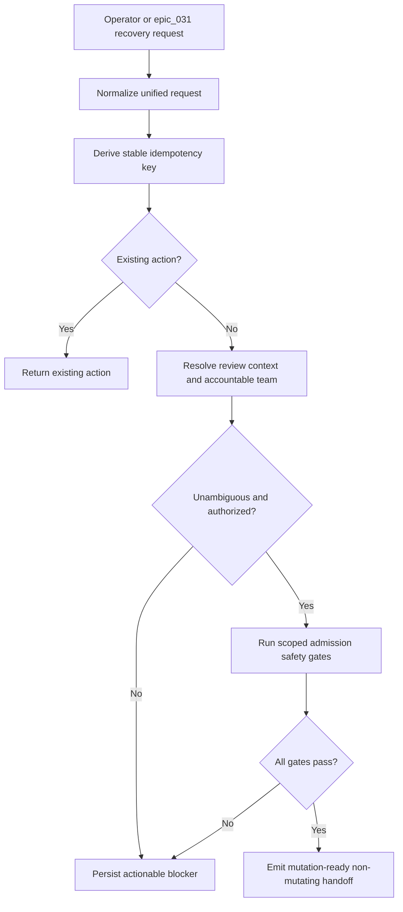

# Admit and route review-conflict resolution actions

## Parent Epic

epic_035

## Scope

### Objective

Unify explicit operator requests and epic_031 recovery requests under one durable resolution-action identity. Resolve the open review, refs, observed source SHA, worktree, and owning team; provide scoped read-only inspection; and persist actionable rejection/blocker state.

### Required outcomes

- One request contract and idempotency key covers both entry paths.
- Feature-owned reviews route to their Feature Team; Epic-owned and explicitly assigned child reviews route to the Epic Team.
- Cross-feature ambiguity selects one accountable owner or blocks.
- Closed reviews, unauthorized refs, stale heads, dirty unrelated files, missing metadata, credentials, or permissions do not reach mutation.
- War Room state identifies the failed checkpoint, observed refs/SHAs, affected paths, and a concrete resume action.
- High-signal tests cover routing, authorization, duplicate admission, and rejection boundaries.

### Non-goals

No rebase, conflict edit, force-with-lease push, general shell, or lifecycle-gate bypass in this feature.

## Data structures

- **ResolutionActionRequest:** normalized request shared by operator and epic_031 recovery entry paths; carries stable action identity, review/ref/source-head context, and requester or explicit-assignment metadata.
- **ResolvedReviewContext:** open review, authorized refs, observed source SHA, worktree, owning scope, accountable team, and the minimum read-only inspection surface needed by admission checks.
- **AdmissionResult:** either a mutation-ready handoff or an actionable blocker containing the failed checkpoint, observed refs/SHAs, affected paths when applicable, and a concrete resume action.

Exact field names remain an implementation detail of task_035_001_001; the contract must preserve stable identity and the rejection evidence required above.

## API contracts

1. Both entry paths normalize to the same request type before admission.
2. Admission derives a stable idempotency key and returns or reuses the existing action for duplicates.
3. Context resolution returns exactly one accountable team or a blocking result; it exposes read-only inspection only.
4. Safety gates return a mutation-ready handoff only after all checks pass. Rejections persist actionable War Room state.
5. No API in this feature performs review mutation, rebase, conflict editing, or push.

## Logic flow

## Task breakdown

1. **task_035_001_001 — Define unified resolution-action request and idempotent admission**
   - Normalize both entry paths, validate required identity metadata, derive stable idempotency, and reuse duplicate actions.
2. **task_035_001_002 — Resolve review context and accountable team routing**
   - Depends on task_035_001_001.
   - Resolve review/ref/SHA/worktree context and route to exactly one Feature or Epic Team, blocking ambiguity.
3. **task_035_001_003 — Enforce admission safety gates and persist actionable blocker state**
   - Depends on task_035_001_001 and task_035_001_002.
   - Reject unsafe states, persist checkpoint evidence and resume guidance, and emit only a non-mutating handoff.
4. **task_035_001_004 — Add end-to-end admission and routing contract tests**
   - Depends on task_035_001_001, task_035_001_002, and task_035_001_003.
   - Cover both entry paths, idempotency, team routing, authorization, representative rejection boundaries, and absence of mutation.

## Risks & upward questions

None. The implementation should keep the inspection surface scoped and avoid expanding this feature into conflict mutation.

## Decision log

See recorded board decisions.

- `dec_001` · 2026-11-04 · Feature Lead · **Task plan and sequencing**
  Chose Use the existing four dependency-ordered tasks as the complete smallest shippable plan; mint no additional tasks..
  Rationale: Together they cover the unified request and idempotency contract, accountable-team routing, admission safety and blocker persistence, and one compact end-to-end contract-test layer. Additional tasks would split tightly coupled contracts or duplicate test coverage without adding a required outcome.
  Honors: Feature required outcomes and non-goals; frugal-engineering preference for high-signal integration coverage; product-manager requirement to avoid scope growth..

## Closeout

Completed child work: `task_035_001_001` (Define unified resolution-action request and idempotent admission), `task_035_001_002` (Resolve review context and accountable team routing), `task_035_001_003` (Enforce admission safety gates and persist actionable blocker state), `task_035_001_004` (Add end-to-end admission and routing contract tests).
