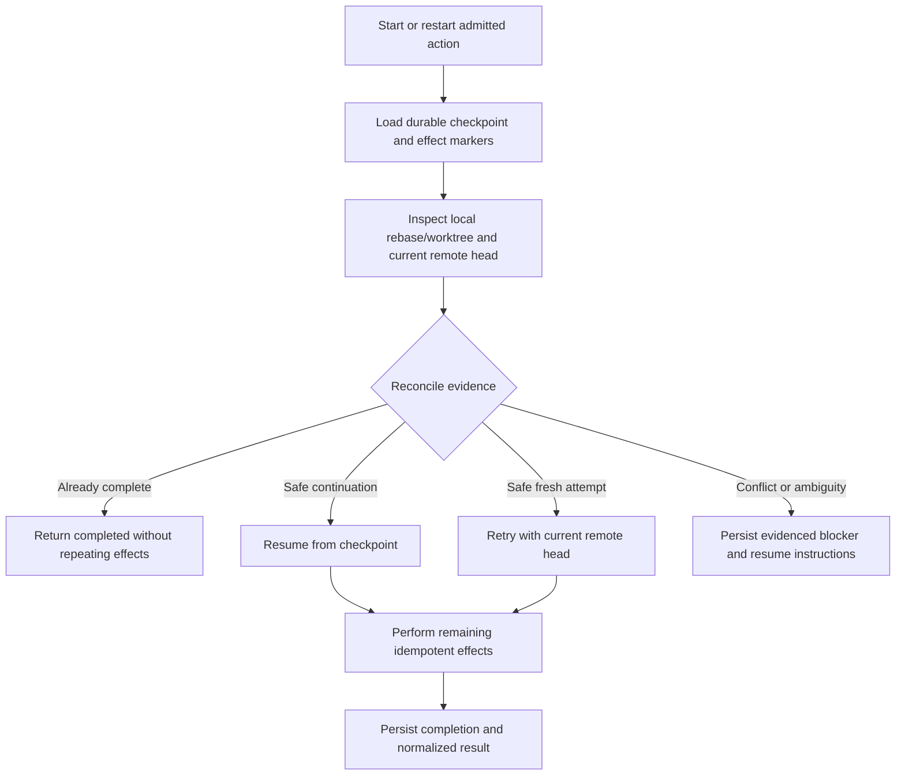

# Make conflict resolution restart-safe across providers

## Parent Epic

epic_035

## Scope

Harden the admitted conflict-resolution/rebase workflow so process interruption, retries, and provider differences cannot duplicate or misreport externally visible effects.

## Objective

Make one admitted rebase action recoverable from durable evidence and give every supported Feature/Epic Team provider the same launch and result semantics.

## Required outcomes

- A restarted action reconciles durable action state, local rebase/worktree state, and current remote head before choosing resume, safe retry, completed reconciliation, or blocker.
- Commits, pushes, reviews, War Room completion messages, and lifecycle completion events are emitted at most once per action identity.
- Every supported Feature/Epic Team provider launches and reports the same capability/result contract.
- Blockers preserve checkpoint, refs/SHAs, affected paths, test/command summary, and resume instructions.
- Acceptance validates the PR #147-style `action_recovery.py` semantic conflict and PR #148-style clean rebase, plus interruption and remote-head-race cases.

## Non-goals

No expansion to arbitrary branch maintenance, unrelated repositories, autonomous cross-feature product choices, or redundant broad unit-test coverage.

## Data structures

- **Action identity:** stable identifier shared by durable checkpoints, retries, provider adapters, and side-effect deduplication.
- **Recovery checkpoint:** durable action phase plus base/head/remote refs and SHAs, worktree/rebase evidence, affected paths, command/test summary, emitted-effect markers, and resume instructions.
- **Reconciliation result:** exactly one of `resume`, `safe_retry`, `completed`, or `blocked`, with normalized evidence required by the selected outcome.
- **Effect ledger:** per-action markers for commit, push, review, War Room completion message, and lifecycle completion event.

Exact storage representation remains an implementation choice for task `task_035_003_001`, provided it preserves these semantics and remains compatible with existing durable action state.

## API contracts

- Recovery accepts an action identity, durable checkpoint, observed local repository/worktree state, and freshly observed remote head.
- Reconciliation returns one normalized outcome and supporting evidence; it must not infer completion solely from stale local state.
- Workflow effects are committed through idempotent per-action operations and recorded durably before a retry can repeat them.
- Provider launchers supply the same recovery inputs, and provider adapters report the same normalized outcome/evidence contract.
- A blocker includes checkpoint, refs/SHAs, affected paths, command/test summary, and concrete resume instructions.

## Logic flow

## Task breakdown

1. `task_035_003_001` — Implement durable action recovery reconciliation and idempotency.
2. `task_035_003_002` — Integrate restart-safe recovery into the admitted rebase workflow. Depends on `001`.
3. `task_035_003_003` — Align Feature and Epic Team provider recovery contracts. Depends on `002`.
4. `task_035_003_004` — Validate restart-safe conflict resolution end to end. Depends on `003`.

The linear dependency order keeps contract work grounded in implemented recovery semantics and reserves broad acceptance coverage for the integrated provider path.

## Acceptance strategy

Favor high-signal reconciliation, contract, and end-to-end cases over redundant broad unit coverage:

- PR #147-style semantic conflict becomes an evidenced, resumable blocker.
- PR #148-style clean rebase completes once.
- Representative checkpoint interruptions resume without duplicate external effects.
- Remote-head movement produces safe retry/reconciliation or a correctly evidenced blocker.
- Supported providers satisfy the same normalized recovery contract.

## Risks & upward questions

- Existing durable action state may not contain enough evidence to distinguish completed from partially emitted effects; implementation must migrate or conservatively block rather than guess.
- Remote APIs may lack native idempotency keys for every effect; durable effect markers and reconciliation must close that gap.
- No epic contract amendment is currently required.

## Decision log

Board decisions are recorded through Cascade decision entries.

- `dec_001` · 2026-11-04 · Feature Lead · **Planning / dependency order**
  Chose Execute the four tasks linearly: durable reconciliation and idempotency, admitted-workflow integration, provider-contract alignment, then end-to-end acceptance..
  Rationale: Each later slice depends on stable semantics from the earlier slice; this avoids parallel contract drift and duplicate task scope.
  Honors: The feature outcomes, the already-minted dependency graph, and the smallest shippable implementation sequence..

- `dec_002` · 2026-11-04 · Feature Lead · **Planning / validation strategy**
  Chose Use focused reconciliation and provider-contract tests plus high-signal end-to-end cases for semantic conflict, clean rebase, interruption, and remote-head race..
  Rationale: These scenarios directly validate restart safety and at-most-once effects; redundant broad unit coverage would add maintenance cost without proportional confidence.
  Honors: The feature acceptance requirements, non-goals, and frugal-engineering testing guidance..

- `dec_003` · 2026-11-04 · Feature Lead · **Recovery / task 004 forbidden-path failure**
  Chose Recover the existing task after tightening its board instructions to exclude board-owned markdown; preserve the in-scope code and focused acceptance-test work and do not mint a replacement task..
  Rationale: The failed worktree contains in-scope runtime/test changes and one out-of-scope docs/tasks edit that triggered the commit guard. Reusing the task preserves work and dependency history while removing the permission violation.
  Honors: The existing four-task plan, the feature acceptance strategy, forbidden-path enforcement, and the smallest safe recovery..

## Closeout

Completed child work: `task_035_003_001` (Implement durable action recovery reconciliation and idempotency), `task_035_003_002` (Integrate restart-safe recovery into the admitted rebase workflow), `task_035_003_003` (Align Feature and Epic Team provider recovery contracts), `task_035_003_004` (Validate restart-safe conflict resolution end to end).
