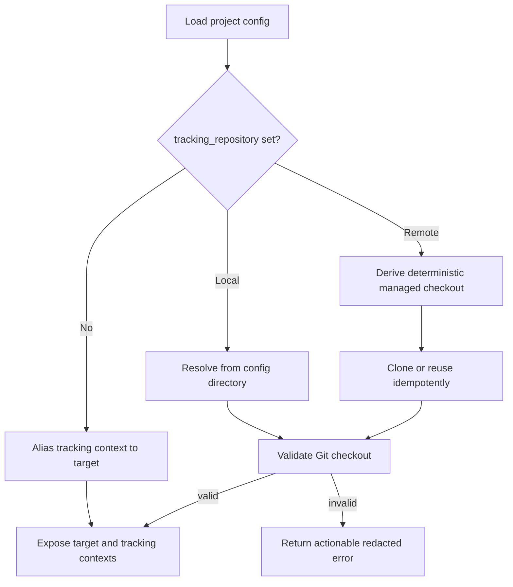

# Resolve the optional tracking repository

## Parent Epic

epic_036

## Scope

### Intent

Establish the repository-role model and optional tracking-repository configuration without changing default behavior.

### Acceptance criteria

- TOML and YAML accept one equivalent optional tracking-repository reference.
- Omission aliases tracking to target and preserves existing compatibility behavior.
- Local references resolve relative to the config location; remote references resolve to a deterministic managed checkout.
- Existing checkouts and clone preparation are validated idempotently.
- Git uses existing user configuration and credentials; Cascade does not prompt for or store credentials.
- Invalid paths, unsupported references, clone failures, and authentication failures produce actionable, redacted diagnostics.
- Resolved target and tracking contexts are explicit for downstream services.

### Scope constraints

Honor the epic contract and non-goals. This feature establishes and exposes repository roles; Feature 2 routes planning lifecycle consumers and supplies operator documentation.

## Data structures

- Optional top-level `tracking_repository` value in both TOML and YAML.
- One normalized tracking-reference type distinguishing local checkout and cloneable Git remote references.
- Explicit project repository contexts named `target` and `tracking`; omission makes both names refer to the existing target context.
- A prepared tracking context contains a validated local Git root and a redacted display identity suitable for diagnostics.

## API contracts

- Relative local references are anchored to the configuration file directory.
- Remote references map deterministically beneath Cascade's existing managed-data root using a stable, credential-stripped repository identity.
- Preparation clones only when needed, reuses a complete matching checkout, and rejects or safely recovers from incomplete/mismatched state.
- Git runs through the system client with the user's existing environment, SSH configuration, and credential helpers. Cascade adds no credential prompt or storage.
- Initialization returns repository contexts only after validation succeeds; failures are actionable and redact URL user-info, tokens, and credential-helper output.
- No consumer may infer a repository role from the current working directory after initialization.

## Logic flow

## Task breakdown

1. `task_036_001_001` — Define tracking-repository configuration and repository-role contexts.
2. `task_036_001_002` — Resolve and idempotently prepare local or remote tracking repositories. Depends on `task_036_001_001`.
3. `task_036_001_003` — Integrate repository resolution at startup and prove compatibility contracts. Depends on `task_036_001_002`.

## Risks & upward questions

- Remote URL spellings may identify the same repository differently. Keep canonicalization narrowly scoped to credential stripping and stable normalization; do not build hosted-provider-specific identity logic.
- Interrupted clones must never be accepted as prepared repositories. Validate repository completeness before reuse and return a recoverable error when safe automatic recovery is unavailable.
- No upward questions; the epic delegates the selected config key and preparation contract to this feature.

## Decision log

None yet.

- `dec_001` · 2026-11-06 · Feature Lead · **Configuration and repository roles**
  Chose Use one optional top-level `tracking_repository` key in TOML and YAML; when omitted, expose tracking as an alias of the existing target context..
  Rationale: One equivalent key keeps the public contract small, while explicit role names give Feature 2 a stable boundary without changing default on-disk behavior.
  Honors: Epic compatibility contract, equivalent TOML/YAML semantics, and explicit downstream target/tracking contexts..

- `dec_002` · 2026-11-06 · Feature Lead · **Remote checkout preparation**
  Chose Place remote tracking checkouts beneath Cascade's existing managed-data root using a stable credential-stripped repository identity; clone only when missing, validate before reuse, and perform no implicit synchronization in this feature..
  Rationale: This yields deterministic, idempotent preparation without adding credential management, provider-specific behavior, or the synchronization lifecycle owned by Feature 2.
  Honors: Deterministic managed checkout, system Git authentication, redacted diagnostics, and the epic's non-goals..

## Closeout

Completed child work: `task_036_001_001` (Define tracking-repository configuration and repository-role contexts), `task_036_001_002` (Resolve and idempotently prepare local or remote tracking repositories), `task_036_001_003` (Integrate repository resolution at startup and prove compatibility contracts).
