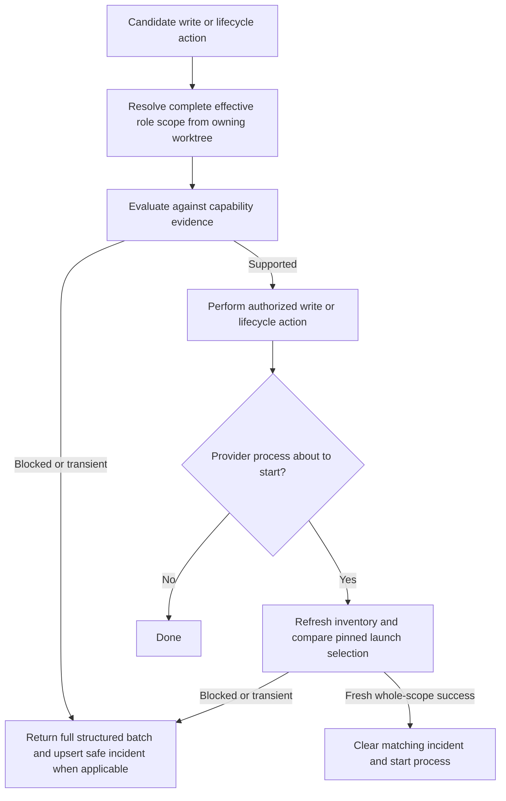

# Enforce complete configuration gates and durable start blockers

## Parent Epic

epic_037

## Scope

Apply the shared evaluator to every relevant boundary, satisfying epic_037 success criteria 1–3, 7–9 and the backend portions of 10.

Acceptance:
- Brief create/edit and Epic activation check the five-role stack. Feature/Task override introduction is validated before persistence of an invalid change; parent approval validates the effective existing downstream selections before granting new downstream authorization. Feature dispatch checks planning roles plus effective SWE; Task dispatch/retry checks SWE. Use resolved owning-worktree documents and reject stale provenance.
- Manual and automated activation, approvals and dispatch use the same admission checks. A known deterministic refusal leaves lifecycle events, worktrees, queue entries, approval/checkpoint advancement and model-turn counts unchanged; writing a safe blocker/audit observation is permitted. Transient capability failures also prevent unsupported starts and return bounded retry/setup actions.
- Refresh capability immediately before each Epic/Feature/Task provider process starts, even after a successful earlier check. Missing model/provider or configuration resolution failures take the structured failure path instead of returning early without a blocker. Compare pinned execution provenance with current authorized selection; do not silently replace reviewed selections.
- Extend the existing provider blocker record to retain all affected role results, configuration provenance and first/last observations. Repeated failures upsert one incident per work item and survive restart. Only a successful fresh check of the whole blocked scope clears that incident; cached readiness or checking one unrelated role cannot clear it.
- Preserve structured results through dispatch and approval responses, including failures discovered after an approval-triggered reconciliation; do not collapse them to an opaque error string. Existing accepted approvals remain intact if later environment drift blocks dispatch.

Validation: reuse dispatch/execution/approval integration fixtures to prove invalid future Feature/SWE roles block activation before side effects, invalid late child overrides cannot gain approval, legacy resolution errors fail closed, automatic and manual paths agree, and post-activation drift blocks every provider launch tier. Verify durable incident deduplication/restart and fresh-only clearing. Use fake inventory/process boundaries, no live provider turns.
Implementation anchors: cascade/briefs.py, cascade/brief_edit.py, cascade/approvals.py, cascade/watchdog/dispatch.py, cascade/automation.py, child mint/write paths, cascade/agent/graph_turn.py, Task execution runner, cascade/agent/execution_preflight.py.

## Data structures

- Reuse `EffectiveSelectionBatch` from `watchdog/model_resolve.py`: an ordered `EffectiveSelection` or safe `SelectionIssue` for every role in scope, with owning document path/revision, per-field sources and one selection fingerprint. Epic scope is all five roles; Feature scope is its two planning roles plus effective SWE; Task scope is SWE. Candidate writes use the proposed document values before persistence.
- Reuse `ProviderCapabilityBatchPreflight` from `agent/preflight.py` for the complete decision. Keep every role check, batch outcome/classification, stable reason, remedies, inventory freshness, work item/action and selection fingerprint. A deterministic failure takes precedence over a transient one without discarding either role result.
- Extend the existing `.cascade/provider_blockers.json` incident keyed by work ID with the complete safe failed-role results, selection fingerprint, action, provenance and inventory freshness. Preserve `first_attempt` on upsert; update `last_attempt`; retain `active` and `resolved_at`. Never store credentials, raw discovery errors or process-relative monotonic timestamps.

## API contracts

- Use `evaluate_work_selection(doc, root, inventory, action, runtime_selections)` to resolve and evaluate a candidate or owning-worktree document. A missing or malformed legacy selection yields a structured issue, never an empty successful result or a resolver exception that bypasses admission. A stale pinned runtime selection yields `stale_selection`.
- Brief create/edit and child configuration writes validate the candidate before saving. Activation, approval, dispatch and retry validate the effective current scope before any lifecycle effect. Manual and automated entry points share this gate. A refusal returns the complete batch through the existing `preflight` response field; approval-triggered reconciliation must preserve that field too. Candidate revision and fingerprint are computed from the proposed serialized document; the original SHA remains only the optimistic write token.
- `recheck_provider_capability` refreshes inventory immediately before each Epic, Feature and Task provider process start, compares launch arguments with the authorized selection, then upserts a blocker on refusal. A fresh successful check of the entire blocked scope may clear it. Cached readiness and an unrelated role check may not clear it.
- Epic plan approval preflights every existing child and its complete effective scope from one consistent merged-board snapshot using each child's owning-worktree document before writing the first child approval or the Epic approval timestamp. If any child fails, no approval state advances. Feature approval applies the same gate to its existing downstream selections. A later environment drift may block dispatch without rolling back an approval already accepted.
- No deterministic refusal may append a lifecycle event, create a worktree or queue entry, advance approval/checkpoint state or count a model turn. A diagnostic blocker update is allowed.

## Logic flow

## Task breakdown

1. task_037_002_001 — validate brief and child configuration writes.
2. task_037_002_002 — gate parent approvals on effective downstream selections.
3. task_037_002_003 — gate activation and dispatch before side effects.
4. task_037_002_004 — persist complete blockers and recheck every provider start.
5. task_037_002_005 — verify cross-boundary admission and recovery.

## Risks & upward questions

None.

## Decision log

- `dec_001` · 2026-11-07 · Feature Architect · **Admission ordering and candidate provenance**
  Chose Derive candidate selection fingerprints from proposed serialized content and preflight every affected child from one consistent merged-board snapshot using each child's owning-worktree document before any parent approval mutation..
  Rationale: An edit may carry the old optimistic SHA even though its proposed selection changed. Sequential child approval writes could otherwise grant partial downstream authorization when a later child fails validation.
  Honors: Epic success criteria 1, 2, 7, 8 and 9; feature acceptance on stale provenance, complete child validation, and refusal before approval effects..

## Closeout

Completed child work: `task_037_002_001` (Validate complete role selections at brief and child configuration writes), `task_037_002_002` (Gate parent approvals on effective downstream selections), `task_037_002_003` (Apply complete admission checks to activation and dispatch), `task_037_002_004` (Persist complete provider blockers and recheck every process start), `task_037_002_005` (Verify end-to-end gate consistency and structured recovery).
