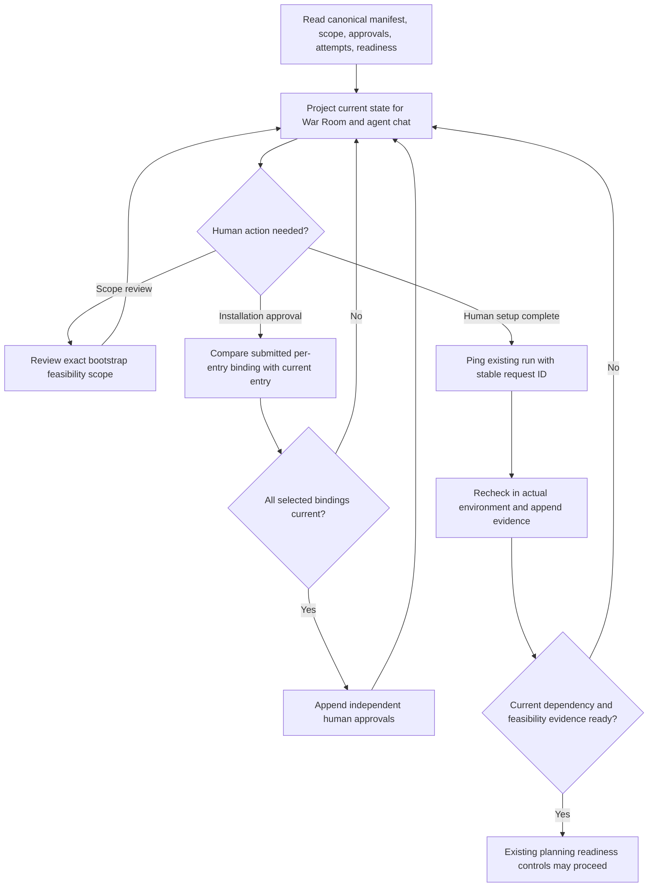

# War Room dependency review, resume, and acceptance flow

## Parent Epic

epic_039

## Scope

Implement slice C of epic_039 using feat_039_001 canonical records and feat_039_002 actions. Show bootstrap/dependency status, responsible actor, actual environment, last check, actionable failure and exact safe investigation/install guidance, expected verification output, owned-artifact cleanup, and Ping team after completion/resume. Provide narrow human bootstrap-scope review and separate per-entry installation approval without preapproving ordinary implementation. UI and agent chat derive live state from the same canonical projection. Scope changes require relevant renewed authority; resume never asserts readiness. Reuse existing War Room routes/actions and planning-readiness controls. Acceptance: existing browser/API integration harness proves complete blocked → human action → ping → same-run recheck → planning readiness, denial/stale authorization, duplicate requests/restart, preserved accepted work, mismatch visibility, and explicit no-dependency flow. Verify all eleven epic criteria with the real local/container and Structurizr evidence produced by slice B; do not replace missing real evidence with a simulated success. No general dependency dashboard or unrelated UI redesign.

### Per-dependency installation authority

Every dependency installation or upgrade requires explicit human approval bound to dependency ID, exact version, authoritative source, checksum/digest, target environment, install scope/destination, exact operation, and cleanup plan. Persist an independent approval for each entry with human provenance and the reviewed binding. Epic/feature plan approval and bootstrap review alone grant no installation authority. Provider `yolo` and owned-worktree access provide execution capability only. Cascade must enforce the approval at the operation boundary before mutation, independently of the provider sandbox and in addition to current execution policy.

A batch UI may approve several entries in one interaction only if it persists independent per-entry approvals. Any change to dependency ID, version, source, digest, environment, scope/destination, operation, or cleanup plan invalidates only that entry's approval; unchanged entries retain theirs. Read-only discovery and validation may proceed without installation approval. Checks that install, upgrade, or implicitly pull dependencies must pass the installation gate. Plan sign-offs, resume/ping, and successful checks never create installation approval.

Present the complete binding and current/missing/stale approval state for each dependency. Provide an explicit human installation/upgrade approval action separate from plan approval, bootstrap feasibility review, and resume. A batch interaction must record an independent human approval for each displayed entry; a changed entry cannot reuse another entry's approval or a blanket batch token. Use Cascade's operation gate even for direct API requests. Acceptance must show independent persisted approvals, rejection of stale submitted bindings, one changed entry requiring reapproval while unchanged batch entries remain approved, plan approval and ping granting no installation authority, and read-only discovery/validation without an installation prompt. Retain the full lifecycle and real-evidence acceptance obligations.

## Data structures

- **One live read model:** derive the epic's dependency panel and agent-chat summary from the current `DependencyManifestSnapshot`, `BootstrapSnapshot`/`BootstrapProjection`, check history and evidence, independent `InstallationApproval` records, and planning readiness. Do not persist a second UI status or authority store. Include manifest and scope revisions so clients can identify stale views.
- **Per-entry view:** carry the complete `InstallationBinding` (ID, exact resolved version, source, digest, environment, scope and destination, operation, cleanup), purpose/why needed, verification recipe and expected result, current/missing/stale approval state and matching approval reference, actual versus required environment, last attempt time/operation/status/redacted output, responsible actor, and actionable blocker guidance. Keep unavailable source, checksum, or install instructions explicit as unknown and direct the human to investigate; do not synthesize commands.
- **Bootstrap view:** show `unchecked`, `awaiting_authorization`, `checking`, `dependency_blocked`, or `ready` together with narrow scope, separate feasibility authorization/result, blockers and next action. A validated empty manifest has an explicit ready path when any separately required feasibility proofs pass. Preserve append-only evidence and existing planning/run history.

## API contracts

- **Read:** extend existing epic/plan War Room read routes with a fresh projection; supply the same projection to agent-chat summaries. Keep software prerequisites distinct from work-item `depends_on`. Never infer container or sandbox success from host checks. Output redacted text as text in the browser.
- **Bootstrap review:** an authenticated human submits the current scope fingerprint/revision and reviewed narrow feasibility scope. Reject stale scope and return the current projection with a reason. Review authorizes only the reviewed feasibility work and does not create installation approval.
- **Installation approval:** an authenticated human submits each displayed dependency ID and complete current binding (or its stable fingerprint) with manifest revision. The server compares all submitted bindings with canonical entries and appends approvals in one serialized operation; the canonical read, binding comparison, and journal append must be serialized with manifest writes across War Room and worker processes (a shared file lock or equivalent atomic compare-and-write), so a manifest change cannot approve an operation the human did not review. A process-local lock alone does not satisfy this boundary. Extend the existing per-entry approval helper with expected bindings or an equivalent guarded operation. Reject a changed submitted binding before any approval is written. A batch is atomic and writes distinct approval IDs and reviewed snapshots for every entry. An unchanged entry keeps its approval if another entry changes. Approval has no effect on current execution policy; all install, upgrade, and implicit-pull paths still pass Cascade's mutation gate.
- **Runtime trust and execution:** the normal War Room startup must resolve human identity for each authority-granting request from a trusted authentication boundary and supply a bounded executor for Ping in the actual target environment. A server-wide `AuthenticatedHuman` object is not request authentication; do not allow any loopback caller to act as that identity. If either capability is unavailable, return a visible refusal and leave authority and readiness unchanged. The browser must surface that refusal.
- **Ping/resume:** a human supplies a stable request identity through the existing lifecycle/recovery path. The action deduplicates repeat delivery, rechecks blocked and affected entries in the actual environment, and returns refreshed state and actionable refusals. Ping grants no authority and does not certify readiness; plan actions consume current readiness only. Read-only discovery and validation do not ask for installation approval.

## Logic flow

## Task breakdown

1. `task_039_003_001` — Project live dependency and bootstrap state for War Room and agent chat.
2. `task_039_003_002` — Expose human bootstrap review, per-entry approval, and ping actions; depends on 001.
3. `task_039_003_003` — Render dependency review and resume controls in the War Room; depends on 001 and 002.
4. `task_039_003_004` — Close runtime authentication, executor, and cross-process serialization gaps; then prove the blocked-to-ready lifecycle and all epic acceptance criteria; depends on 003.

## Risks & upward questions

- Task 004 closed the runtime authentication, bounded Ping execution, and cross-process approval serialization gaps. Its focused browser/API and process-race tests pass; see the [epic acceptance report](../../task_artifacts/task_039_003_004_epic_acceptance.md).
- Real smoke acceptance remains blocked by absent exact per-entry installation approvals and separate adapter feasibility authorization. The [slice-B smoke record](../../task_artifacts/task_039_002_005_smoke_acceptance.md) contains read-only host and image observations, but no real local install, container execution, in-container Structurizr check, or adapter result. Criteria 10 and 11 remain unpassed.

## Decision log

None yet.

- `dec_001` · 2026-11-07 · Feature Lead · **Data structures**
  Chose Use one live projection from canonical manifest, bootstrap, approval, evidence, and readiness records for both War Room and agent chat..
  Rationale: A shared projection prevents stale prose or a second authority store while exposing actual environment, blockers, and per-entry binding state.
  Honors: epic_039 slice C and success criteria 1, 2, 7, and 9; task_039_003_001..

- `dec_002` · 2026-11-07 · Feature Lead · **API contracts**
  Chose Require the authenticated human action to submit the displayed complete installation binding and reject stale bindings before appending independent per-entry approvals; keep scope review and ping separate..
  Rationale: The existing approval helper snapshots current entries by ID, so the UI boundary must prove that the human reviewed that exact current operation. Neither review nor ping creates installation authority.
  Honors: epic_039 success criteria 3 through 6, 9, and 10; task_039_003_002 and task_039_003_003..

- `dec_003` · 2026-11-07 · Feature Lead · **Risks & upward questions**
  Chose Keep real local install, Structurizr in-container check, and adapter feasibility acceptance open until separately authorized real attempts are recorded..
  Rationale: Slice B's smoke artifact contains read-only observations but explicitly no approved installation, container execution, or feasibility proof. Deterministic tests cannot establish those real outcomes.
  Honors: epic_039 success criteria 10 and 11; task_039_003_004..

- `dec_004` · 2026-11-07 · Feature Architect · **API contracts**
  Chose Require verified human provenance for authority-granting War Room actions and compare reviewed installation bindings with canonical entries under the same lock that appends approvals..
  Rationale: The current loopback server hardcodes human without caller authentication, and the existing ID-only approval helper would permit a manifest change between route comparison and journal append. Both gaps could record authority for an operation the human did not review.
  Honors: epic_039 success criteria 3, 4, 7, 9, and 10; task_039_003_002 and task_039_003_004..

- `dec_005` · 2026-11-07 · Feature Architect · **API contracts**
  Chose Serialize canonical manifest reads, reviewed-binding comparison, and installation-approval journal appends with manifest writers across processes, using a shared lock or equivalent atomic compare-and-write..
  Rationale: The current manifest writer and approval helper share only a process-local Python RLock. A separate War Room or worker process could change the manifest after approval comparison but before the approval journal append, recording authority for an unreviewed operation.
  Honors: epic_039 installation-authority criteria; task_039_003_002 and task_039_003_004..

- `dec_006` · 2026-11-07 · Feature Architect · **API contracts**
  Chose Complete the ordinary War Room runtime with request-scoped trusted human authentication, a bounded dependency executor for Ping, and cross-process serialization of manifest and authority writes before lifecycle acceptance..
  Rationale: The merged API is closed at normal startup because neither capability is wired; configuring one static server-wide human would authorize every loopback caller. Manifest, scope review, and approval writes still share only a process-local lock, so a second process can race a reviewed binding.
  Honors: epic_039 installation-authority and lifecycle criteria; task_039_003_004; dec_004 and dec_005..

## Post-merge acceptance status

Task `task_039_003_004` merged with the blocked-to-ready War Room lifecycle covered by the browser/API integration tests. The [epic acceptance report](../../task_artifacts/task_039_003_004_epic_acceptance.md) records criteria 1–9 as passed and criteria 10–11 as **unpassed**. The [slice-B smoke record](../../task_artifacts/task_039_002_005_smoke_acceptance.md) has no authorized real project-local installation, in-container Structurizr check, or separately authorized adapter feasibility result. Keep the feature's real-evidence acceptance open until exact per-entry installation approvals and separate feasibility authorization permit those attempts and their results are recorded. Deterministic tests do not satisfy the missing real smoke evidence.

## Closeout

Completed child work: `task_039_003_001` (Project live dependency and bootstrap state for War Room and agent chat), `task_039_003_002` (Expose human bootstrap review, per-entry approval, and ping actions), `task_039_003_003` (Render dependency review and resume controls in the War Room), `task_039_003_004` (Prove blocked-to-ready lifecycle and epic acceptance).
