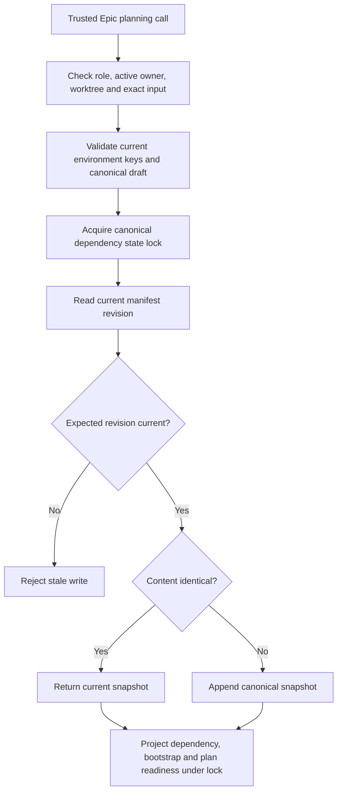

# Scoped dependency manifest authoring for Epic planners

## Parent Epic

epic_043

## Scope

Implement Feature A from epic_043: the smallest scoped declaration boundary that lets an owning active Epic planning team recover from missing_manifest using supported tools.

Acceptance criteria:
1. Expose read_dependency_manifest and write_dependency_manifest in the Epic planning registry/MCP catalog for epic_manager and epic_architect only. Enforce trusted role, Epic, and owning integration-worktree scope at runtime, including calls bypassing schema validation. No feature/task/Boss authoring authority, caller scope/root/actor overrides, unknown fields, generic sidecar permissions, completed/non-owned Epic writes, or trunk fallback.
2. Read returns the canonical snapshot and manifest revision, or explicit missing with revision 0. Write requires expected_revision as a non-negative integer (reject absent, boolean, negative, fractional, and string values). Reuse canonical dependency_manifests validation, append-only persistence, and dependency_state_lock.
3. Support explicit none_required=true with dependencies=[] and complete target environment identity, plus real canonical dependency entries. Validate raw current-schema identity keys before legacy defaults for the top-level target, each dependency target, and non-null actual_environment. Keep actual_environment=null valid and preserve independent per-entry targets. Reject malformed entries, duplicate IDs, incomplete environments, and invalid actual environments before mutation.
4. Preserve concurrency semantics: expected revision checked under the canonical lock before content equality; identical current-revision content is a no-op, stale replay fails. Return JSON-safe persisted data with manifest_revision and fresh canonical software/bootstrap and plan-readiness projections, coherent under the same re-entrant lock. Graph-only readiness is insufficient.
5. Manifest authoring requires no prior software readiness and grants no installation, upgrade, sudo, credential, license, approval, or execution authority. Preserve existing evidence/approval binding invalidation, human approval boundaries, and ordinary lifecycle gates.

Verification: extend existing production planning-dispatcher/catalog and boundary integration tests for both roles; absent/read/create/append/no-op; explicit none-required and real declarations; malformed/runtime inputs; stale/concurrent/replayed writes; completed/cross-Epic and path/symlink denial; actual owning-worktree destination and canonical lock identity, including split target/tracking repositories; fresh readiness and unchanged installation authority. Do not duplicate schema unit tests or install external software.

Scope maps to epic success criteria 1–3 and authoring/readiness safety portions of 5. Feature B owns user guidance and complete cross-surface lifecycle verification. No new dependencies, generalized editor, resolver, executor, bulk migration, or automatic backfill.

## Data structures

Use the canonical `DependencyManifestDraft` fields: `target_environment`, nullable `actual_environment`, `none_required`, and `dependencies`. Every supplied environment uses the current ten-key `EnvironmentIdentity` shape, checked before the canonical parser can fill legacy defaults. Dependency entries retain their own targets and pass the existing canonical entry validator. The persisted `DependencyManifestSnapshot` supplies `revision` and `recorded_at`; callers cannot set either. Manifest revision is independent of the Epic plan Git SHA.

## API contracts

- `read_dependency_manifest({})` takes no caller-selected Epic, path, root, role, or actor. It returns the current canonical snapshot with `manifest_revision`, or `manifest: null` and `manifest_revision: 0` when absent.
- `write_dependency_manifest({expected_revision, manifest})` takes exactly those top-level fields. `expected_revision` is a required non-negative JSON integer, with 0 for the first write. `manifest` is a canonical draft. An explicit no-dependencies declaration has `none_required: true`, `dependencies: []`, a complete target environment, and `actual_environment: null` or a complete observed identity. Empty dependencies without `none_required: true` fail.
- A successful write returns the persisted JSON-safe snapshot, `manifest_revision`, and fresh canonical dependency/bootstrap and Epic plan-readiness projections. Current-revision identical content returns the existing snapshot; a stale revision fails even for identical content. Validation and authority failures do not mutate history.
- Both tools derive role, active Epic, and owning integration worktree from trusted planning context. Only `epic_manager` and `epic_architect` receive them. The runtime handler rejects unknown fields and caller overrides even if schema validation was bypassed. These tools grant declaration authority only.

## Logic flow

## Task breakdown

1. `task_043_001_001` — Canonical manifest read and revisioned write operations, strict request validation, lock and projection coherence.
2. `task_043_001_002` — Epic planning registry/MCP exposure with trusted role, Epic, and owning-worktree scope; depends on `task_043_001_001`.
3. `task_043_001_003` — Production dispatcher/catalog and boundary integration verification; depends on `task_043_001_001` and `task_043_001_002`.

## Risks & upward questions

None.

## Decision log

None yet.

- `dec_001` · 2026-11-07 · Feature Architect · **API contracts**
  Chose Use a two-field public write request with required expected_revision and canonical manifest draft; keep Epic, role, root, and actor bound to trusted planning context..
  Rationale: The lower-level writer permits an omitted revision and can apply legacy identity defaults, so the planning boundary needs an explicit optimistic-concurrency contract and raw current-schema validation without changing existing history reads.
  Honors: Epic 043 scoped declaration contract and success criteria 1–3 and 5; Feature A acceptance criteria; canonical append-only storage and human-only installation approval..

## Final direct delivery · 2026-11-08

Status: completed. Implementation through `a37f05ff` and preceding commits supersedes the earlier partial-completion audit. The operator explicitly requested implementation directly on main because the affected tool could not reliably implement its own repairs. No acceptance criteria are waived.

This existing child plan is satisfied by the Epic 43 implementation delivered directly on main. Its scope, requirements and accepted history are preserved; completion records the operator-authorized direct delivery, not a fabricated Task merge or forge review. The Epic 43 final-delivery section maps the acceptance evidence.

Validation: the combined affected acceptance suite passed 164 tests; additional targeted crash, failure, and cross-process checks passed. This records scoped acceptance, not a claim that every unrelated repository test passes.
