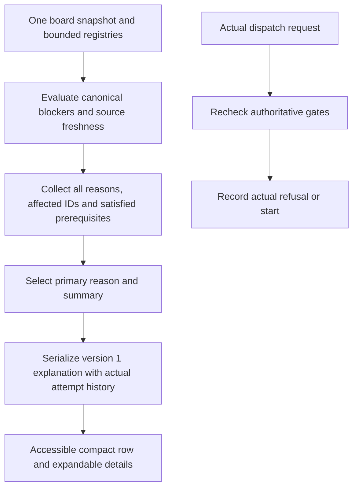

# Explain feature activation readiness and actual dispatch waits

## Parent Epic

epic_045

## Scope

Deliver the activation explanation end to end: authoritative Python readiness projection, board/API serialization, and compact accessible War Room presentation. This feature owns epic success criteria 1–5 and the activation-specific additional validation; the next feature consumes its action contract for new work.

Acceptance:
- Every open, not-yet-active feature has one summary: needs your action, waiting on another work item/system, ready awaiting dispatch, or readiness unavailable. Supply primary reason, additional blockers, satisfied prerequisites, actor/next action, affected work IDs and valid existing action/review links.
- Extend canonical evaluations in cascade/feature/readiness.py and cascade/stacked_dispatch.py to retain actual blocking sibling identities and distinguish execution from merge/review. Preserve serial/stacked policy and action-boundary refusals; never manufacture a declared dependency.
- Cover approval/reapproval, authoritative dependency outcomes (including unavailable), parent inactivity/cancellation, dispatch base, blocking review threads, provider/preflight and required merge/review. Reuse revision-bound approvals and cached provider inventory; do not implement gate logic in JavaScript.
- Version the additive explanation contract; preserve approved/blockers compatibility. Include evaluation time, source freshness and last actual dispatch attempt/refusal when present. Absent/stale required evidence is unknown/rechecking, never ready. A historical refusal cannot override a newer valid evaluation without being labeled historical.
- Polling uses a shared bounded snapshot and performs no dispatch, approval, lifecycle writes, provider discovery or new expensive Git checks. Actual dispatch still rechecks canonical gates and records its own refusal evidence.
- Show a deterministic primary reason and expandable secondary reasons/satisfied prerequisites; fresh human-action blockers remain visible even with simultaneous waits/unknown evidence. Reuse existing dependency display and plan/review/provider actions; expose missing evidence rather than a dead link.
- Reproduce approved 034_008 with satisfied 006/007 and supported provider, blocked by active 034_009. Name/link the sibling and explain the one-active-feature rule without implying failure or reapproval; completion refreshes readiness without extra approval. IDs are fixture data only.
- Test simultaneous blockers, review versus execution, inactive/cancelling parent, changed-plan approval, missing/stale evidence, empty blockers awaiting dispatch, a real dispatch refusal, and serial/stacked compatibility. Assert render/poll does not invoke dispatch or expensive preflight.
- Add focused Python API/integration regressions and browser coverage for expansion, existing action links, keyboard access and text/screen-reader labels. No redundant unit suite or test-only feature.

Boundaries: no automatic approval, scheduler redesign, notification stream, new dependencies, or epic_044 dependency. Preserve inherited Codex provider/model/reasoning defaults. Keep creation/acknowledgement storage out of this feature. Before task execution, document the exact explanation schema, source and freshness policy of each fact, primary-reason ordering and dispatch-refusal persistence in this feature plan.

## Data structures

Add `readiness.explanation` as a version 1, read-only projection alongside the existing `approved` boolean and `blockers` string array. Its exact shape is:

```json
{
  "version": 1,
  "summary": "needs_action | waiting | ready_awaiting_dispatch | unavailable",
  "primary_reason_code": "reason code or null",
  "reasons": [
    {
      "code": "stable_reason_code",
      "kind": "human_action | work_wait | system_wait | unknown",
      "message": "plain text",
      "actor": "human | feature_team | supervisor | system | null",
      "next_action": "plain text or null",
      "affected_work_ids": ["feat_..."],
      "links": [{"label": "plain text", "href": "existing local route"}],
      "source_ids": ["board | approval | dependencies | review | provider | dispatch_base"]
    }
  ],
  "satisfied": [{"code": "stable_prerequisite_code", "message": "plain text", "affected_work_ids": []}],
  "evaluated_at": "UTC ISO 8601",
  "sources": {
    "board": {"state": "current | stale | unknown", "revision": "digest or null"},
    "approval": {"state": "current | stale | unknown", "revision": "digest or null"},
    "dependencies": {"state": "current | stale | unknown", "revision": "fingerprint or null"},
    "review": {"state": "current | stale | unknown", "revision": "digest or null"},
    "provider": {"state": "current | stale | unknown", "revision": "inventory identity or null"},
    "dispatch_base": {"state": "current | stale | unknown", "revision": "selection/plan identity or null"}
  },
  "last_dispatch_attempt": {
    "attempt_id": "durable actual dispatch attempt identity",
    "at": "UTC ISO 8601",
    "outcome": "refused | started",
    "reason_code": "actual refusal code or null",
    "detail": "safe detail or null",
    "source_revisions": {"board": "digest or null", "approval": "digest or null", "dependencies": "fingerprint or null", "review": "digest or null", "provider": "inventory identity or null", "dispatch_base": "selection/plan identity or null"},
    "historical": false,
    "history_state": "same_sources | changed_sources | unverifiable"
  }
}
```

`last_dispatch_attempt` is null when no recorded attempt exists. `historical` is true only after a complete current reevaluation proves a relevant source revision changed since the actual attempt. A later `evaluated_at` timestamp alone does not make it historical. `history_state=unverifiable` covers missing or stale source identities and leaves `historical=false`; this evidence is diagnostic and never a gate. `primary_reason_code` is null only for `ready_awaiting_dispatch`. Reason and prerequisite arrays are ordered deterministically by precedence, code, then work ID. Keep reason codes independent of display text. A reason may link only to an existing route/action; absent evidence supplies an explanation without a fabricated link. No secrets or raw provider responses enter the payload.

## API contracts

`GET /api/board` includes this additive explanation for each open feature in `backlog` or `ready_to_plan` in the canonical backlog column. The same evaluation snapshot supplies the legacy `approved`/`blockers`, dependency display, and explanation. Existing consumers of the legacy fields retain their meanings. The new contract is presentation evidence, not a dispatch token; actual approval and dispatch boundaries re-evaluate canonical state.

Source and freshness policy:
- Board/parent/sibling identity: the single request-scoped merged board snapshot; its content revision identifies the source. An active sibling is an execution wait, while a pending review or merge is a review wait. Return all blocking sibling IDs, without adding them to declared dependencies.
- Approval: revision-bound feature approval and current plan revision, using existing approval semantics. Missing approval is a human action; a changed plan makes the old approval stale and requires reapproval. A missing revision comparison is unknown.
- Dependencies: authoritative dependency outcome and its snapshot fingerprint, reused from the row's dependency projection. `dependency_unmet` names known prerequisite IDs; `dependency_status_unavailable` is unknown even if a stale prior result was satisfied.
- Review: one request-scoped blocking-thread/review snapshot, with IDs and existing plan/review links. Required merge/review is distinct from active execution.
- Provider/preflight: the already acquired bounded provider inventory and existing cached compatibility evidence. Missing, stale or transient inventory is unknown; unsupported known configuration is an action. Board polling never probes/discovers the provider.
- Dispatch base: reuse a durable dispatch selection if present; otherwise use only cheap, existing board/registry facts. Any topology requiring a new Git probe stays unknown on polling until an action boundary resolves it. Do not call costly ancestry checks per feature.
- Actual attempt: a small durable per-feature record written only by actual dispatch outcome, with timestamp, refusal/start outcome, safe reason and source revision identity. Store atomically under the tracking-owned workspace with cross-process locking; retain most recent attempt and do not write from polling. A newer current evaluation labels an older refusal historical. Preserve existing action response codes.

The backend maps each reason to the valid current actions already available in War Room (approve/reapprove, dependency detail, plan/review, provider setup/recovery); it omits links when the destination is unavailable. JavaScript renders the supplied contract and never infers eligibility.

## Logic flow



Primary ordering: fresh human-action blockers first (approval/reapproval, blocking review thread, known provider correction); then unknown required evidence; then known work waits (active sibling execution before merge/review, dependencies, inactive/cancelling parent); then system waits; then `ready_awaiting_dispatch` when every required gate is known and satisfied. Within a class use stable code and work ID ordering. Summary derives from the selected class. A missing required fact cannot yield ready. Fresh human action remains the primary reason when a work wait or unknown source also exists; all secondary reasons remain visible.

## Task breakdown
- task_045_001_003
- task_045_001_002
- task_045_001_001

1. Extend the Python readiness and stacked-dispatch projection with typed reasons, sibling IDs, execution versus review waits, source freshness and deterministic priority. Preserve action-boundary refusal codes and legacy fields. Add focused gate/readiness tests.
2. Wire one bounded board/API snapshot, existing actions, cached provider facts and durable actual-attempt evidence into the versioned explanation. Update dependency-satisfied approval fixtures and add API/integration regressions for simultaneous blockers, stale/missing evidence, actual refusal and polling cost.
3. Render the compact summary and accessible details in War Room using the backend contract. Add browser coverage for two-feature sibling wait, expansion, links, keyboard access, labels and refresh behavior.

## Risks & upward questions

The existing board readiness tests approve a feature while a declared dependency remains backlog. Repair those fixtures through the legitimate dependency-satisfied approval path before using them as regression evidence. Dispatch-base topology requiring Git inspection is intentionally unknown on polling; only an actual action may run that check.

## Pinned implementation contract for Task 002 and Task 003

The version 1 JSON above is the consumer contract. Every reason carries `source_ids` drawn from the six named sources; the serializer emits one coherent set of source states and the legacy `approved`/`blockers` from the same evaluation. Both `backlog` and `ready_to_plan` are open states, matching `cascade.feature.readiness._OPEN` and `cascade.war_room.serialize._backlog_open_feature`.

| Reason code | Canonical predicate and owner | Source IDs | Refresh and invalidation |
| --- | --- | --- | --- |
| `not_approved` | `approvals.py` approval boundary plus `feature/readiness.py`; compare the approved plan body revision with the current owning document, rather than relying on `approved_at` alone | board, approval | Approval or any plan body/selection edit changes the approval revision. Missing comparison evidence is unknown. A proven mismatch is human reapproval. |
| `dependency_unmet`, `dependency_status_unavailable` | `dependency_evaluation.evaluate_dependencies` and the row's `dependency_projection.project_dependency_status` | board, dependencies | Reevaluate from the same request snapshot; retain outcome and fingerprint. Incomplete named dependency is a wait; unavailable/stale status is unknown. |
| `sibling_active_execution` | `stacked_dispatch.feature_dispatch_blockers.active_execution_ids` | board | Any sibling status/path change invalidates the row. Return actual same-Epic IDs; never append them to declared `depends_on`. |
| `feature_awaiting_merge` | `stacked_dispatch.feature_dispatch_blockers.pending_review_ids` with `review.feature_review_views` and stacked setting | board, review | Review state/registry or stacked setting changes invalidate. Keep merge/review distinct from active execution. |
| `review_threads_blocking` | `comments.gate.blocking_threads_for_many` and `gate_refusal_reason` | board, review | Thread/plan revision change invalidates. Reuse one batched thread snapshot and existing review/plan links. |
| `epic_inactive`, `parent_cancellation_pending`, `not_in_backlog` | `feature/readiness.py` parent/backlog checks and `cancellation_feedback.cancellation_dispatch_gated` | board | Parent identity, path, status and cancellation feedback come from the same board response. Missing parent is an explicit wait/unknown as determined by the canonical predicate. |
| `dispatch_base_unavailable` | `stacked_dispatch.plan_feature_dispatch`/`ensure_feature_dispatch_selection` | board, review, dispatch_base | A stored base is current only when its feature plan, predecessor/review identities, stacked policy and relevant branch evidence still match. Missing or stale proof is unknown; a known invalid topology uses the canonical refusal reason. |
| Provider correction or unavailable evidence | `agent.selection_admission.evaluate_work_selection`, `war_room.serialize._provider_readiness_view` and one `get_provider_inventory` result | board, provider | Reuse the bounded inventory and compatibility cache already acquired for the response. Known unsupported selection is human action; missing/stale/transient evidence is unknown. No discovery in the per-feature loop. |

The UI ordering is human action, unknown required evidence, known work wait, system wait, then fully evaluated ready awaiting dispatch. It is independent of `feature.readiness.dispatch_refusal_from_readiness` and its existing action-boundary refusal codes/order. Reason arrays sort by class, stable code and work ID. A passing gate is a satisfied prerequisite and never claims the agent started. A missing required source makes readiness unavailable unless a fresh human-action blocker takes primary priority; all other reasons remain visible.

Approval evidence is a revision-bound record written at the real approval boundary, keyed by stable feature ID in the tracking-owned workspace. It stores the approved owning body digest and selection/parent identity with the approval timestamp; the read projection compares them with the current owning document. An older `approved_at` with no verifiable matching revision is `approval.state=unknown` and cannot count as current approval. Do not silently manufacture an approval record or clear an old timestamp on a poll. Genuine plan edits invalidate the match; sibling completion does not.

Dispatch-base evidence can be resolved outside browser polling by actual approval/selection writes and review/merge reconciliation. For a simple Epic base with no feature predecessor, the deterministic Epic integration branch plus current board/registry identity is cheap, complete evidence; it needs no new Git call. A single stacked predecessor may use a current existing review/branch registry identity. A multi-predecessor covering-head decision requires the existing action-boundary ancestry check; until that result is durably bound to plan and branch revisions, polling reports unknown. `read_feature_dispatch_selection` alone is not validity proof. An actual dispatch action still calls the canonical planner and rechecks every gate before starting.

Persist `last_dispatch_attempt` only from an actual dispatch request or supervisor attempt, at its result boundary. The tracking root is `board.context.resolve_tracking_root(root)`; use its `.cascade` state area for one per-workspace JSON store keyed by feature ID, shared by managed worktrees and split roots. Persist schema version, monotonic attempt sequence/ID, UTC attempt time, outcome, canonical refusal code and safe detail, plus the six source revision identities and completeness recorded at the attempt. Resolve the tracking root before acquiring a cross-process file lock (for example `fcntl.flock` on a sibling lock file); `board.lock.process_lock` alone is only thread local. Under that lock, read, compare, write a unique temp file, fsync and atomically replace. A late writer with an older admitted attempt sequence must not overwrite the latest actual attempt. Polls only read. `historical=true` requires a complete current comparison that finds a changed relevant source identity; unchanged identities yield `same_sources`, and missing/stale comparison yields `unverifiable` with `historical=false`. The current explanation always comes from current facts, regardless of an older refusal.

Task 002 acceptance includes the approved `034_008` wait on actual executing sibling `034_009`, with declared `034_006`/`034_007` already complete and approval established through the real dependency-satisfied gate. The three existing War Room fixtures currently approve before their dependencies are complete; correct fixture ordering and keep the gate. Verify completion removes the sibling wait without reapproval, review versus execution, simultaneous reasons, unknown evidence, a real refusal, and no writes or added provider/Git probes during board polling. Task 003 renders only backend reasons and existing links with keyboard and screen-reader coverage. Feature 002 consumes this versioned contract after integration and owns all attention/Mark seen state.

## Decision log

- Use a version 1 additive explanation, sourced from one board response, with legacy fields intact.
- Persist only actual dispatch attempts; treat earlier refusals as historical diagnostics after source state changes.

- `dec_001` · 2026-11-12 · Feature Architect · **Activation explanation contract**
  Chose Use a version 1 additive readiness.explanation object with ordered reasons, satisfied prerequisites, source freshness, and the existing approved/blockers fields intact..
  Rationale: One request-scoped backend projection gives the UI a stable, reviewable explanation without duplicating dispatch eligibility in JavaScript.
  Honors: Epic 045 activation acceptance criteria 1–5 and DEC-WARROOM-REFRESH-001..

- `dec_002` · 2026-11-12 · Feature Architect · **Dispatch evidence**
  Chose Persist only outcomes from actual dispatch attempts; label older refusals historical when newer source state is evaluated..
  Rationale: A refusal can be useful diagnostic evidence but must not override the current gate evaluation or make a poll mutate lifecycle state.
  Honors: Epic 045 activation acceptance criteria 1–5 and DEC-WARROOM-REFRESH-001..

- `dec_003` · 2026-11-13 · Feature Lead · **Source identity and dispatch evidence**
  Chose Bind approval and dispatch-base claims to current source revisions; persist only actual dispatch outcomes under the tracking root with a cross-process lock and monotonic attempt identity..
  Rationale: An approval timestamp, stored base selection, or later poll time alone cannot prove current readiness or that an earlier refusal is historical.
  Honors: Epic 045 activation criteria 1–5 and DEC-WARROOM-REFRESH-001..

## Closeout

Completed child work: `task_045_001_001` (Extend canonical feature readiness with structured activation reasons), `task_045_001_002` (Serialize bounded board explanations and actual dispatch evidence), `task_045_001_003` (Render accessible War Room activation summaries and details).
