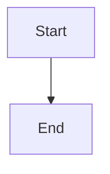

# Complete live paired C4 navigation comments and exact-tuple approval

## Parent Epic

epic_046

## Scope

# Complete live paired C4 navigation comments and exact-tuple approval

## Intent
Review real current/proposed architecture beside a feature or epic plan, discuss semantic targets, and approve only the exact evidence displayed.

## Scope
Own epic_046 requirements 3 and 4 and client consumption/refresh behavior in requirement 2. Consume feat_046_001 production data and existing Epic 034 semantic identity, thread routing and lifecycle gates.
Provide shared viewer primitives reusable by the branch tab: view/level selection, counterpart selection, explicit absent counterparts, deterministic drill choices and explanations, shared back navigation, pan/zoom/fit, keyboard semantic target access and visible focus. Show all changed views. Element and relationship change styling must persist alongside selection; ignore layout-only changes.
Always show the architecture region and its explicit failure/loading/retry states, adjacent to plan text with accessible narrow-screen stacking. Bound refresh while active and preserve surviving selections, navigation and drafts.
Create requirement/view/element/relationship threads through the live page. Validate owner, repository, exact review tuple and pinned target inventory on server writes AND authoritative reads. Reuse the current thread store and owner routing. Deliver replies, incoming refresh, reload persistence, authorized human resolution and supported reopen. Preserve original source links; removed/drifted targets become outdated and remain blocking until resolved. Reuse reviewed renames without label heuristics.
Approval submits the displayed exact tuple and server rechecks it at submission and existing downstream boundaries. Blocking semantic threads stop only affected work. Partial split acceptance cannot unlock full acceptance.
Working source/model/plan/design diffs must use pinned readable resources from feat_046_001.

## Acceptance
- Exercise native SVG pointer/keyboard selection, relationship hit targets, drill/back, change styling, fit/zoom and responsive layout in real Chromium against running HTTP routes.
- Real-page requirement/view/element/relationship creation, reply, incoming reply, resolution, reload and supported reopen use existing routing.
- Focused HTTP tests reject forged repository/owner/target and stale anchors; an old tab cannot implicitly approve a new tuple.
- Demonstrate a local blocking thread preventing approval and affected downstream work while an unrelated feature remains available; resolving only restores eligibility if other gates pass.
- Retained outdated threads and partial acceptance remain correctly represented after restart.
- Extend the shared real planning/renderer/browser journey scaffold; deterministic DOM tests remain supplementary.

## Boundaries
Do not create branch-wide comments or new decision-anchor types. Documentation context presentation is feat_046_004; expose semantic selection hooks for it.

## Data structures

TBD.

## API contracts

TBD.

## Logic flow

## Task breakdown

1. **task_046_002_001 — Shared viewer and paired navigation.** Complete semantic SVG interaction, change presentation, accessibility, responsive layout, pinned links, and bounded refresh. Expose selection hooks for branch browsing and documentation context.
2. **task_046_002_002 — Authorized semantic thread lifecycle.** Validate exact review context and pinned targets on HTTP reads and writes; retain freshness, original links, routing, resolution, and reopen.
3. **task_046_002_003 — Live discussion UI.** Connect requirement/view/element/relationship selection to creation, replies, incoming updates, resolve/reopen, and stale-draft handling. Depends on 001 and 002.
4. **task_046_002_004 — Exact-tuple approval and gates.** Bind approval to displayed tuple, recheck under mutation lock and downstream, and enforce local blocking and partial acceptance. Depends on 002 and 003.
5. **task_046_002_005 — Integrated Chromium journey.** Extend the real planning/renderer/browser scaffold through semantic interaction, discussion, tuple approval, downstream effects, refresh, and restart. Depends on 003 and 004.

## Risks & upward questions

None.

## Decision log

None yet.

## Closeout

Completed child work: `task_046_002_001` (Build shared semantic C4 viewer and complete paired navigation), `task_046_002_002` (Enforce authorized semantic thread lifecycle and freshness over HTTP), `task_046_002_003` (Wire live semantic discussion into the paired review page), `task_046_002_004` (Bind approval and downstream gates to the displayed review tuple), `task_046_002_005` (Prove the complete live paired-review journey in Chromium).
